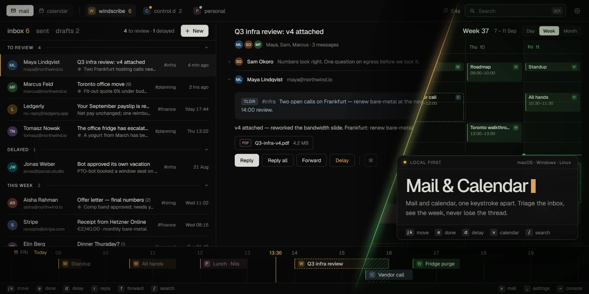
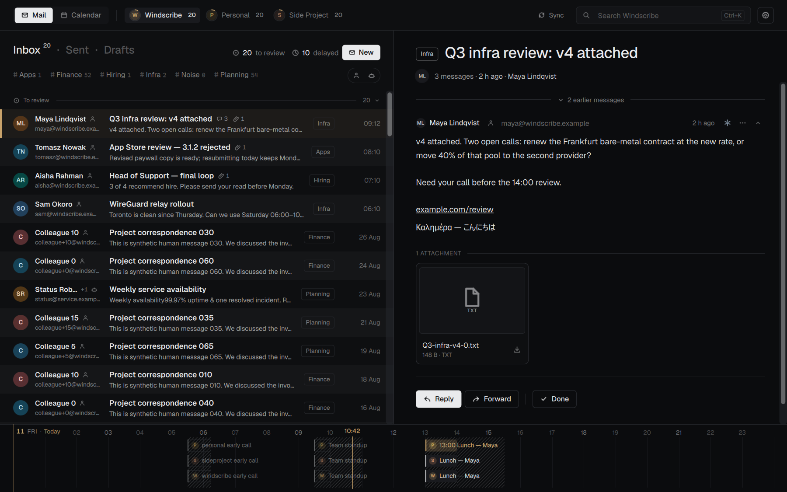
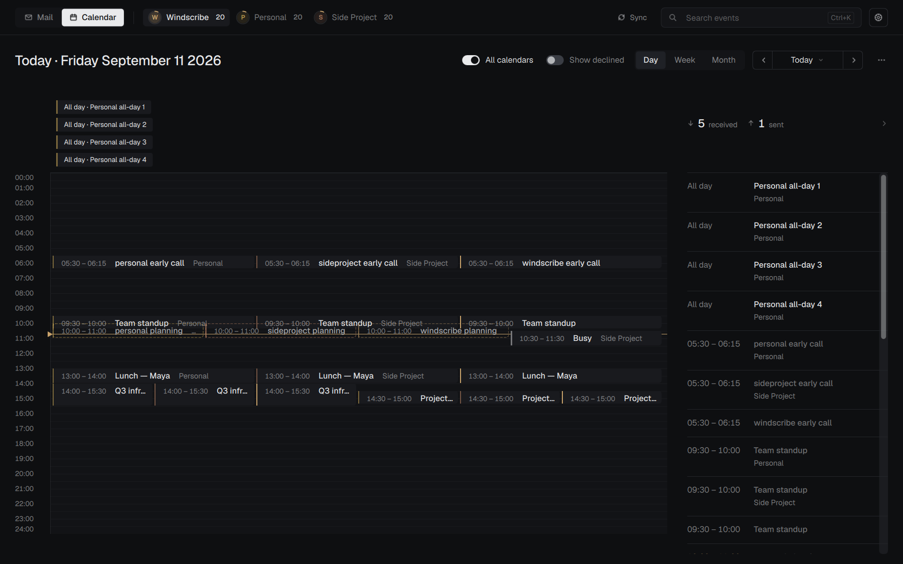

# fuckMail

A native desktop mail and calendar client for Gmail and Google Workspace, with a local LLM doing the sorting. Rust engine, C++/Qt Quick GUI, SQLite store, and a CLI on the same engine. Windows, macOS and Linux.



> **Status:** early, under active development, no release yet; build from source. The [changelog](CHANGELOG.md) lists what has shipped.

<details>
<summary>Screenshots</summary>





</details>

The screenshots use the built-in demo profile (`fuckMail --demo-profile`). Every person and message in these images is made up.

## What it does

**Mirrors your mailbox locally.** Every message, its raw MIME source and its attachments are stored in SQLite on your machine. Sync pulls the last 30 days first, then walks the full mailbox in the background, with Gmail history checks for new mail slotted in between. Reads, account switches and search never touch the network.

**Sorts mail with a local model.** Every received message goes to a model on your own model server: [Ollama](https://ollama.com) or anything OpenAI-compatible. It returns a one-line summary, human or bot, and at most one of your Gmail labels, picked using descriptions you write for each label. Output is constrained to a JSON schema and validated. Per label, you choose whether an applied label also marks the mail read or sends it to Spam. Newsletters and notifications then file themselves, and Unread is mostly people.
- New mail is processed first. Older mail is processed on request, from the last week back to all of it.
- The system and user prompts are editable.
- Results are cached with the name of the model that wrote them, and redone only when the message or your labels change.
- Your own labels and corrections always win over the model's.

**Keeps triage to two flags.** Unread is "not reviewed". Starred is "still needs action". Done clears both, and Delay keeps the star. The aim is zero of each at the end of the day.

**Keeps accounts separate.** Each account has its own mailbox, picked at the top, and remembers its own view. There's no unified inbox. Mail is always grouped into conversations.

**Searches locally.** SQLite FTS5 over subject, body and people, with `from:`, `to:`, `subject:`, `body:`, `label:`, `has:attachment` and `is:` operators ([syntax](docs/user-guide.md#search)). Works offline across the whole mirror.

**Composes plain text first.** New message, reply, reply all and forward, with attachments. Drafts round-trip through the Gmail drafts API, sending uses the Gmail API, and recent actions can be undone. The model doesn't write or send mail.

**Renders HTML mail safely.** HTML is sanitized, and scripts and trackers are stripped. Remote images stay blocked until you allow them, load over https only, and can go through your own proxy. Link hosts can be blocked.

**Calendar.** Google Calendar API across all your accounts, in day, week and month views. Handles recurring events, invitations and RSVP, and reminders with a Join button. A timeline strip under the mail view shows your day.

**Has a full CLI.** `fm` sends the same engine requests the GUI does and returns JSON, so scripts and external agents can search, read, draft, run model work and manage the calendar without the GUI.

## Architecture

```text
fuckmail-gui (C++20, Qt 6 Quick) ─┐
                                  ├─ JSON over a local socket / named pipe ─ fm-engine (Rust) ─ SQLite (WAL, FTS5) + blob store
fm (Rust CLI) ────────────────────┘                                              │
                                                                                 ├─ Gmail API, Google Calendar API
                                                                                 └─ your model server
```

- **`fm-engine`** is the only process that writes the store. It runs Gmail and Calendar sync, sending, remote-content fetches and the model queue. Clients find it through the profile's `engine.json`, or start it on demand. It exits shortly after the last client disconnects; there's no resident service.
- **`fuckmail-gui`** is the desktop client. It never opens the database; it keeps recent views and threads in memory and asks the engine for changes.
- **`fm`** doesn't link the store at all. Every command is an engine request.

OAuth refresh tokens are stored in the OS keychain. There are no servers of ours and no telemetry. Besides Google and your model server, the app only contacts hosts for things you control: remote images you load, sender pictures (on by default) and unsubscribe links. [PRIVACY.md](PRIVACY.md) lists every destination. There's no web runtime and no Node.js. [crates/README.md](crates/README.md) and [gui/README.md](gui/README.md) map the source.

## Build and run

You need:

- **Windows:** Visual Studio 2022 C++ build tools. The bootstrap step can install them.
- **macOS:** Xcode Command Line Tools (`xcode-select --install`).
- **Linux (Ubuntu 24.04):** a C++ compiler, Python with venv, and the graphics libraries listed in [the CI workflow](.github/workflows/native.yml).

Bootstrap downloads the pinned Rust, Qt and build tools into `.tools/` inside the checkout and leaves system installs alone.

```sh
scripts/dev.sh bootstrap              # once; ./scripts/dev.ps1 on Windows
scripts/dev.sh run --preset release
```

Without `--preset release` you get a debug build, several times slower. Add `-- --demo-profile` to run against sample data. Other commands:
- `test` runs the tests.
- `cli -- --help` shows the CLI.
- `package --preset release` builds an unsigned installer in `dist/`: `.exe` on Windows, `.dmg` on macOS, `.tar.gz` on Linux.

The [build guide](docs/build-development.md) has the details.

## Google account setup

You need your own Google Cloud project with the Gmail and Calendar APIs enabled, and an OAuth client of type **Desktop app**. See the [setup guide](docs/build-development.md#google-sign-in-setup). Register the client JSON once per checkout (`python` on Windows):

```sh
python3 scripts/configure_google.py /path/to/desktop-client.json
```

It's copied into the ignored `.tools/` folder, so it stays out of Git. Rebuild, then go to **Settings → Accounts → Connect Google account**. Nothing downloads until you start sync for that account.

## Local model setup

Run Ollama, or any OpenAI-compatible server, and pull a model. Then set the endpoint and model under **Settings → Local LLM**, and turn it on for the accounts you want. Label descriptions, and the Read and Spam choices, are in each account's label settings.

## More

- [User guide](docs/user-guide.md): triage, shortcuts, search, calendar, settings, your data
- [CLI reference](docs/cli.md) and [troubleshooting](docs/troubleshooting.md)
- [Architecture](docs/architecture.md) and the [documentation index](docs/README.md)
- [Changelog](CHANGELOG.md), [privacy](PRIVACY.md) and [security policy](SECURITY.md)

## Contributing

fuckMail targets Gmail and Google Workspace through Google's APIs only. Bug fixes are welcome; see [CONTRIBUTING.md](CONTRIBUTING.md). For other providers or a different feature set, fork it.

## License

[MIT](LICENSE). Bundled third-party components keep their own licenses; see [THIRD_PARTY_NOTICES.md](THIRD_PARTY_NOTICES.md).
