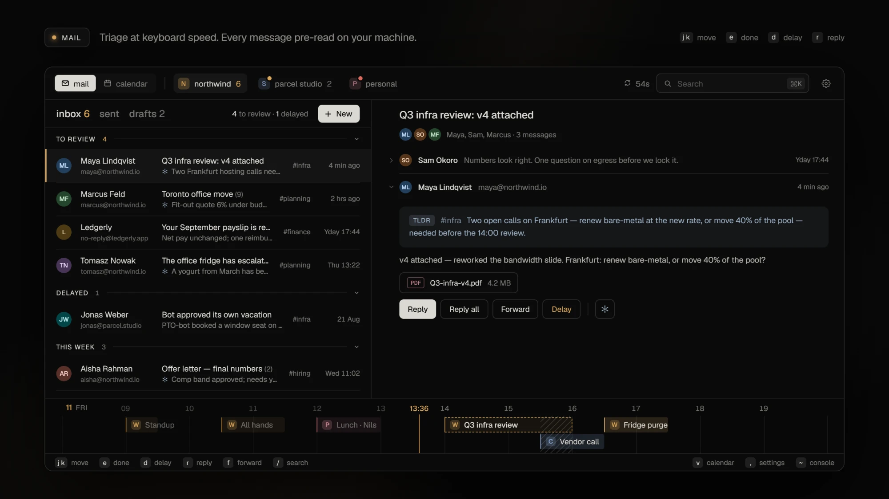
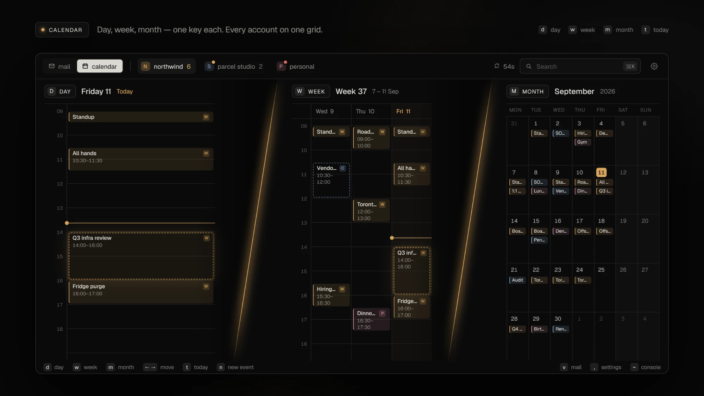
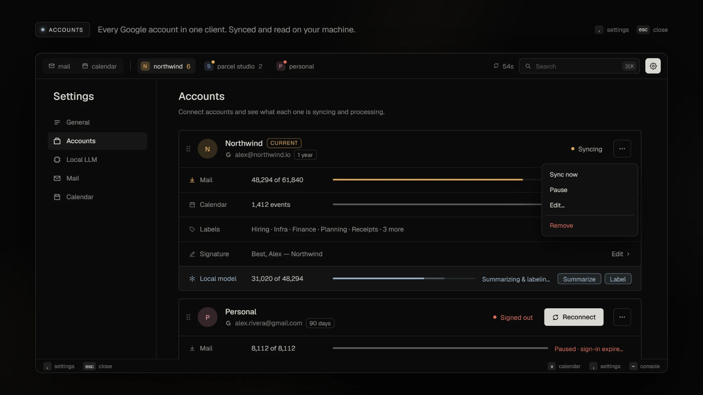

<h1 align="center">fuckMail</h1>

<p align="center">
  <b>Fast desktop mail and calendar for Gmail and Google Workspace.</b><br>
  Your whole mailbox on your machine. Noise sorted by a local model. Nothing unread, nothing starred by the end of the day.
</p>

<p align="center">
  
</p>

<p align="center"><sub>Early and in active development. No release yet; build from source. See the <a href="CHANGELOG.md">changelog</a>.</sub></p>

## Why

Mail clients slow down as your history grows, bury the basics under features, and treat the calendar as an afterthought. fuckMail does less, on purpose: mail and calendar, quick at any mailbox size, with every old conversation available offline.

## What it does

|   |   |
| --- | --- |
| **Your mail, offline** | Every message and attachment is stored locally. Reading, switching accounts and searching never wait on the network. |
| **Two-flag triage** | Unread means you haven't looked at it. Starred means it still needs doing. **Done** clears both; **Delay** keeps the star for later. |
| **Noise sorts itself** | An optional model on your own machine ([Ollama](https://ollama.com) or any OpenAI-compatible server) summarizes each message and files newsletters and notifications under your Gmail labels. It never writes or sends mail. |
| **Separate accounts** | Each account has its own inbox, always in threaded conversations. No unified inbox. |
| **One calendar** | Day, week and month views across every account, with invitations, RSVP and reminders with a Join button. Today's timeline sits under your mail. |
| **Instant search** | Your whole mailbox, searched locally, with `from:`, `to:`, `subject:`, `label:`, `has:attachment` and more. |
| **Safe HTML** | Scripts and trackers are stripped. Remote images stay blocked until you allow them. |
| **A real CLI** | `fm` does what the app does, as JSON, for scripts and agents. |

No servers of ours and no telemetry. Sign-in tokens stay in your system keychain. [PRIVACY.md](PRIVACY.md) lists every host the app contacts.

### Mail



### Calendar



### Accounts



## Architecture

```text
fuckmail-gui (C++20, Qt 6 Quick) ─┐
                                  ├─ JSON over a local socket / named pipe ─ fm-engine (Rust) ─ SQLite (WAL, FTS5) + blob store
fm (Rust CLI) ────────────────────┘                                              │
                                                                                 ├─ Gmail API, Google Calendar API
                                                                                 └─ your model server (optional)
```

- **`fm-engine`** is the only process that touches the store. It runs sync, sending, remote images and model work. Clients start it on demand, and it exits shortly after the last one disconnects. No always-on service.
- **`fuckmail-gui`** is the desktop app. It never opens the database; it asks the engine.
- **`fm`** is the CLI. Every command is an engine request.

No web runtime, no Node.js. More in [docs/architecture.md](docs/architecture.md), [crates/](crates/README.md) and [gui/](gui/README.md).

## Build and run

Windows, macOS and Linux. You need:

- **Windows:** Visual Studio 2022 C++ build tools (bootstrap can install them).
- **macOS:** Xcode Command Line Tools (`xcode-select --install`).
- **Linux:** a C++ compiler, Python with venv, and the graphics libraries in [the CI workflow](.github/workflows/native.yml).

Bootstrap downloads the pinned Rust, Qt and build tools into `.tools/` inside the checkout and leaves your system alone.

```sh
scripts/dev.sh bootstrap              # once; ./scripts/dev.ps1 on Windows
scripts/dev.sh run --preset release
```

Add `-- --demo-profile` to try it with sample data. `package --preset release` builds an installer in `dist/`. The [build guide](docs/build-development.md) has the rest.

### Connect Google

Create a Google Cloud project with the Gmail and Calendar APIs enabled and an OAuth client of type **Desktop app** ([setup guide](docs/build-development.md#google-sign-in-setup)). Register it once per checkout (`python` on Windows), then rebuild:

```sh
python3 scripts/configure_google.py /path/to/desktop-client.json
```

Then open **Settings → Accounts → Connect Google account**.

### Local model (optional)

Run Ollama or any OpenAI-compatible server, then set it up under **Settings → Local LLM**.

## More

[User guide](docs/user-guide.md) · [CLI](docs/cli.md) · [Troubleshooting](docs/troubleshooting.md) · [Security](SECURITY.md) · [Contributing](CONTRIBUTING.md)

Gmail and Google Workspace only. Bug fixes are welcome; for other providers or features, fork it.

[MIT](LICENSE). Third-party components keep their own licenses: [THIRD_PARTY_NOTICES.md](THIRD_PARTY_NOTICES.md).
