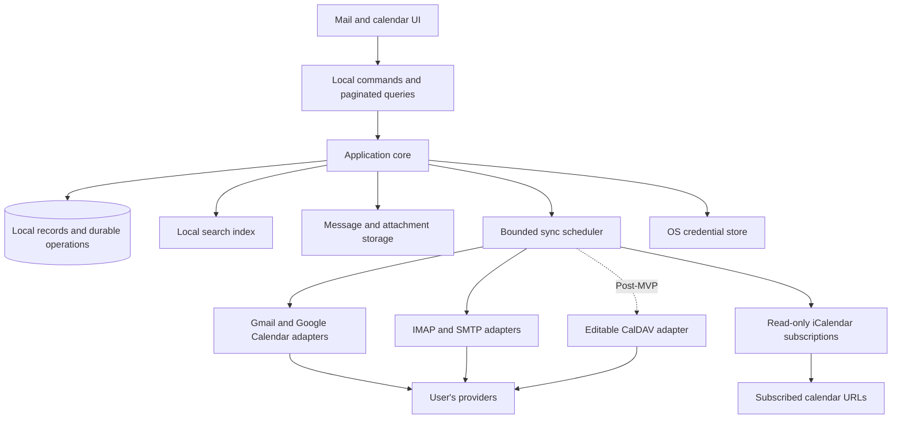

# Proposed architecture

Status: native cross-platform direction established; exact framework, language, schema and libraries await a prototype. Rust + Slint + SQLite/FTS5 is the next candidate to evaluate following the founder's request; Qt remains a fallback. Supporting technical sources are in [research](research.md) and the [Slint UI investigation](slint-ui-investigation.md).

## Shape

Use a local application core with a small desktop UI on Windows and macOS; Linux is optional. The UI reads local views and submits commands. Provider synchronization, parsing, indexing, and storage work run outside the UI's event loop. Direct provider access with no app-operated server is required. Mail navigation and search stay within the selected account and render conversations.

Use a native desktop toolkit for navigation, lists, calendar and composition. No JavaScript/TypeScript application layer, npm/Node toolchain, Electron shell or Tauri web frontend is planned. The local API can be an in-process typed interface; no web-style IPC layer is required unless an isolated component needs it.

For the Rust/Slint candidate, use Rust core modules, declarative Slint components and a paged local model backed by SQLite. Prototype visual quality and native interaction with a deliberate custom design. Resolve formatted composition and a separate script-disabled HTML message renderer early: Slint's text widgets do not establish full email HTML support, and its Servo example remains experimental. See the focused investigation for sources and exit gates.

The Qt fallback would use C++ core modules and Qt Widgets with CMake. A Qt WebEngine reader embeds Chromium and has a real memory/distribution cost; an OS-specific renderer involves platform integration. A rich-text-only reader has limited HTML/CSS compatibility. Choose using actual email fixtures; do not promise full HTML fidelity with a basic text widget.

This describes module responsibilities, not a requirement for one process per box.

## Contracts to agree before parallel implementation

| Boundary | Contract |
| --- | --- |
| UI queries | Bounded conversation pages and opaque cursors; stable sorting; cancellation; current-account scope; explicit loading/offline/partial states |
| UI commands | Local operation ID, durable acceptance, pending/confirmed/failed/ambiguous state, and any recovery action |
| Mail providers | Capabilities, discovery, paged initial retrieval, delta/reconciliation, body/attachment retrieval, mutations, drafts/submission where supported |
| Calendar providers | Calendar permissions, range queries, series/exception identity, changes, edits, and scheduling capabilities |
| Search | Sender/subject/body query and filters, current account, stable conversation IDs with matching message IDs/snippets, coverage and index generation |
| Calendar feeds | Read-only source identity, refresh/freshness state, last valid snapshot and bounded recurrence expansion |
| Storage | Single schema owner, versioned migrations, transaction rules, retention classes and recovery procedure |

Adapters expose differences explicitly. The common layer must not pretend Gmail labels, IMAP folders, provider threading, and calendar scheduling behave identically.

## Data ownership

- **Accounts and identities:** provider account, authentication reference, allowed From identities, and capabilities. Never use email display text alone as the internal account key.
- **Mail records:** local ID, account-scoped remote identity, headers, message dates, flags, memberships, body availability, and provider thread reference. Use explicit mappings for IMAP mailbox identities and moves.
- **Bodies and attachments:** retain every synchronized message and attachment for complete offline use; track durable download completion and retry state. Keep source material needed for rendering and re-indexing; store large binary content outside hot list queries. Content hashes may share bytes without collapsing account ownership or permission boundaries.
- **Drafts and operations:** locally authored drafts, staged attachments, queued commands, attempts and provider acknowledgements. These are durable user data, not disposable cache.
- **Calendars and events:** calendar permissions, provider identifiers, iCalendar UID where applicable, recurrence masters, exceptions, cancellations and original time-zone/date semantics. Read-only subscriptions have a separate source identity, protected URL and last valid snapshot; feed event identity includes the source, UID and recurrence identity.
- **Derived state:** message-level search indexes, account-scoped conversation projections and occurrence windows can be rebuilt. Gmail uses provider threads; IMAP uses reference-based threading without merging unrelated equal-subject mail. Preserve remote cursors, coverage and local pending operations separately from these projections.

Proposed first storage experiment: a single local SQLite database with account-scoped tables and a separate blob directory. Compare partitioning by account only if the measured write contention, recovery, or query behavior justifies it. A separate search engine requires a durable change journal, replay, tombstones and a visible index watermark.

## Synchronization lifecycle

1. Authenticate and discover capabilities, folders/labels, calendars, permissions, and initial synchronization state.
2. Fetch a useful recent conversation slice; expose it immediately. Track inventory, text indexing and full attachment acquisition separately. Continue until all required mail and attachments are stored; no silent age-based eviction.
3. Interleave history backfill with fresh changes. Allocate bounded per-account and global concurrency, honor retry guidance, and prioritize foreground requests.
4. Apply remote changes and commit their checkpoint safely. Replaying a page must not duplicate records; advancing a cursor must never skip unapplied pages.
5. Recover invalid cursors with staged reconciliation. Keep the readable store available where possible; only conclude that missing records were deleted after a complete applicable inventory. Merge pending local intent deliberately.
6. Resume after sleep, loss of network, authentication expiry or process restart. Checkpoint attachment downloads and verify completeness before declaring them available offline. Pause imports on low disk space without discarding unsent work or silently pruning old content.

Provider state remains authoritative for synchronized records, with pending local intent overlaid until confirmed. Calendar version conflicts must be surfaced or merged under documented rules rather than silently overwriting another device's edits.

## Sending and mutation reliability

Persist the intent and required content before showing a queued action. Make retryable state changes idempotent where the provider allows it. Sending has a separate state machine because an acknowledgement may be lost. An internal operation ID or stable Message-ID alone does not guarantee server deduplication.

Proposed send states: draft, queued, submitting, accepted, failed, and acceptance unknown. A sent-copy failure after acceptance must not cause a second submission. Show enough information to recover without promising recipient delivery merely because the submission server accepted the message.

## Calendar consistency

Use one local event store for day/week/month/agenda and reminders. Keep Google series identity, exceptions, attendee state and event versions together. Map a mail invitation to its calendar event and reconcile provider updates before sending any additional scheduling email. Prevent duplicate notifications when synchronization replays changes.

Calendar subscriptions are read-only snapshots; a failed or malformed refresh does not erase the last valid events. Resolve feed removals only from a valid complete refresh, and display stale status. Do not route feed edits or RSVP to Google or SMTP as if the feed granted those capabilities.

Schedule reminders from the locally reconciled event state and invalidate them when events move, cancel or disappear. Closing the app stops synchronization and reminders. On reopening, reconcile before scheduling upcoming reminders; do not replay a burst of obsolete alarms. Scheduling horizon and cross-account overlay defaults remain design choices. Test daylight-saving changes, all-day boundaries, organizer/attendee updates and edits from another device as distinct acceptance cases.

## Lifecycle and composition

Close exits the application after a bounded durable checkpoint; no tray/menu-bar helper remains. Never require a network acknowledgement to save a draft or close. On next launch, resume queued work and resolve any uncertain send state before a retry. Running-app notifications use native OS facilities; do not leave future reminder notifications scheduled to fire after an explicit app close.

Provide plain-text and HTML composition with per-account signatures. Construct standards-compliant alternatives where appropriate and retain the user's authored content in drafts. The default sender is the current account; alias management is deferred. Sanitize pasted rich content and keep the composing surface separate from untrusted received HTML.

## Rendering, privacy, and recovery

Treat message HTML and calendar descriptions as untrusted content. Sanitize and isolate rendering; it must have no privileged app bridge or script execution. Remote image loading is a product-controlled policy. Opening links or attachments uses explicit user actions.

Keep tokens/passwords in the OS credential store and out of UI storage and logs. App-level encryption of message data and indexes is an open decision; credential storage alone does not encrypt cached mail. Account removal, backups, upgrades and index rebuilds must have explicit behavior for local drafts and retained attachments.

Keep the database and live indexes on local storage, outside cloud-synced folders. Add migration/recovery fixtures before real daily-driver use. No telemetry upload or central mail service is assumed.
