# Architecture

fuckMail is three programs around one local store. A background engine owns the data and talks to Google. The desktop app and the command-line client are thin clients that ask the engine for everything over a private local connection. This page explains how those parts fit together; [crates/README.md](../crates/README.md) and [gui/README.md](../gui/README.md) go deeper into the Rust and Qt sides.

## Processes and lifetime

```text
fuckmail-gui (QML + C++)      fm (CLI)
            │                     │
            └──── pipe/socket ────┘
                       │
                   fm-engine ──► Gmail and Calendar APIs (HTTPS)
                       │     └──► local model server (optional, loopback)
                       ▼
    profile: store.sqlite3, blobs/, cache/
```

- **`fm-engine`** is the only process that opens a profile's SQLite store. It runs Google sign-in and sync, sending, remote images and local-model work, and serves every client request.
- **`fuckmail-gui`** is the desktop app: QML views over a C++ backend. It holds no mail data.
- **`fm`** is the CLI. Each command becomes one or more engine requests; it never links `fm-core` or opens the database.

A profile is one directory (see [Storage](#storage)). There is one engine per profile at a time, enforced by an exclusive lock on `store.lock`.

**Finding or starting the engine.** Both clients run the same loop for at most 30 seconds ([`Client::connect`](../crates/fm-ipc/src/lib.rs) in Rust, `MailBackend::attemptConnection` in C++):

1. Read `<profile>/engine.json`: protocol version, engine PID, endpoint name and a random 64-hex-character token that is new on every engine start. The file must be a small, private, regular file; an untrusted or incompatible one is a hard error, not a retry.
2. Connect to the endpoint and check the peer before sending anything: it must run as the same OS user and have the PID from `engine.json`.
3. Send `hello` with the token. The engine compares it in constant time and replies with the protocol and schema versions, profile mode (live or demo), capabilities and method list.
4. If there is no discovery file or the connection fails transiently, start `fm-engine --profile <dir>` with no console and null stdio: up to 10 launches, backing off 1, 2, then 4 seconds after each exit. A launch that loses the race to a running engine just exits.

The engine listens before it publishes `engine.json`, so a client that can read the file finds a live endpoint. An engine that permanently refuses a profile (wrong schema version, or the wrong profile kind) writes `engine-refusal.json` with its PID, so the client that launched it shows the reason instead of timing out.

**Ownership.** Every authenticated connection is an owner. The engine exits 350 ms after its last owner disconnects, 10 seconds after start if no client ever connects, or on Ctrl-C. Queued work alone never keeps it running, and there is no installed or always-on service. On exit it stops listening, removes its `engine.json`, lets admitted Google mutations record their outcome, stops sync, drains the writer and closes the store.

**GUI versus CLI.** The GUI launches the engine detached and never kills it. On close it cancels sends still inside their Undo window (the drafts stay saved), saves the draft, preferences and views, then disconnects; the engine stops any sync job no other session owns and exits if nobody else is connected. A CLI command connects, runs and disconnects, so an engine it started exits shortly after. Long-running CLI commands are explicit sessions: `fm google sync` owns sync until Ctrl-C or `--seconds`, and `fm watch` keeps the engine alive while it prints status changes. Both can outlive the GUI.

## Local IPC

- **Transport.** A per-profile named pipe `\\.\pipe\fuckmail-<hash>` on Windows; a Unix socket `engine.sock` in the profile elsewhere, or a hashed socket in a private `/tmp/fuckmail-<uid>` when that path is too long. There is no TCP or HTTP and no shared-library ABI between Rust and C++. Bulky content (attachments, decoded images, large HTML views) comes back as a path to a private file in the profile.
- **Framing.** One UTF-8 JSON object per line, at most 1 MiB including the newline, in both directions. A result that would not fit becomes a `response_too_large` error.
- **Limits.** At most 16 clients; extra connections are closed. One request in flight per connection. The engine allows 5 seconds for `hello` and 15 seconds to write a frame or finish reading one; the Rust client waits 15 seconds for a reply by default.
- **Envelope.** A request is `{"version":1,"id":"7","method":"conversations","account":"work","params":{...}}`: `id` of 1–128 bytes, `method` of at most 64, `params` an object, `account` only for account-scoped methods, unknown fields refused. The reply is `{"version":1,"id":"7","ok":true,"result":{...}}` or `{"version":1,"id":"7","ok":false,"error":{"code":"stale_revision","message":"..."}}`. Mutations carry a `request_id` in `params`, so a retry returns the original outcome instead of acting twice.
- **Trust.** The profile directory must be private (user-owned with mode 0700 on Unix; a user-only access list on Windows). The engine accepts only same-user peers: socket mode 0600 plus peer credentials on Unix, and a user-only pipe DACL that rejects remote clients on Windows. Clients verify the engine's PID and user before sending the token, and the token proves the client can read the private profile. The boundary is the OS user, not other processes already running as that user.
- **Change notification.** There is no event stream. Clients poll `status` (the GUI once a second) and reload when its `revision`, `mail_generation` or `calendar_generation` changes.

A client that disconnects cancels its queued work and interrupts its running SQL reads; a mutation that has started always finishes its transaction. The method reference is [docs/local-protocol.md](local-protocol.md), and `fm call METHOD` sends any request from JSON.

## Crates

| Crate | Responsibility |
| --- | --- |
| `fm-engine` | The engine binary: IPC server, store-writer thread, Google sign-in and sync runtimes, remote content, local-model queue |
| `fm-cli` | The `fm` binary: arguments, and text or `--json` output over `fm-ipc` |
| `fm-ipc` | Framing, discovery, endpoint naming, same-user checks and the launching `Client` |
| `fm-core` | The SQLite store and all domain logic behind requests: mail, drafts, sends, labels, Calendar cache and write journal, preferences, accounts |
| `fm-google` | OAuth desktop sign-in and token refresh, Gmail API client, quota scheduler, OS keychain vault |
| `fm-calendar` | Calendar event model, recurrence expansion, permission filtering, write requests and the Calendar API client |
| `fm-mail` | Pure transforms: MIME parsing and construction, text extraction, HTML sanitiser, image normalisation |
| `fm-assist` | Local-model settings, prompts, request bodies and reply validation |

Solid arrows are Cargo dependencies. The GUI is not a crate; it only speaks the protocol.

```mermaid
flowchart LR
  gui["fuckmail-gui (C++/QML)"] -. "local protocol" .-> engine
  cli["fm-cli (fm)"] --> ipc["fm-ipc"]
  engine["fm-engine"] --> ipc
  engine --> core["fm-core"]
  engine --> google["fm-google"]
  engine --> calendar["fm-calendar"]
  engine --> mail["fm-mail"]
  engine --> assist["fm-assist"]
  core --> calendar
  core --> google
  core --> mail
  core --> assist
  calendar --> google
```



Inside the engine, a Tokio runtime handles sessions and network I/O, and one dedicated thread owns the `fm_core::Store`. The session loop routes each request by method name. Model methods, remote content (`message_html`, `message_image`, ...), Google sign-in, Google sync and explicit Google operations, and local file work (draft saves, attachment imports, message sources) each go to their own runtime; everything else is queued to the writer. Runtimes reach the store only through short queued calls (`CoreBridge`), and do HTTP, MIME parsing and hashing elsewhere, mostly on blocking worker threads. The writer queue holds 32 jobs, 16 for client requests and 16 for background calls. It runs up to four client requests before giving background work a turn, and answers `busy` when full.

## Storage

- **One database per profile.** `store.sqlite3` is opened with WAL journaling, `synchronous=FULL`, foreign keys on and `trusted_schema` off. Ordinary tables are `STRICT`. Search uses a contentless FTS5 table, `message_fts`, over sender, subject and body.
- **Single writer.** Only the engine's writer thread holds the connection, and the exclusive `store.lock` keeps a second engine out (`store_in_use`). Clients never open SQLite.
- **External blobs.** Raw MIME sources, authored attachments and other retained bytes are written to `blobs/<sha256>` before any row refers to them, and checked against their hash when read. Received attachments refer to parts inside their original MIME rather than duplicate decoded blobs. Preview/export extracts and verifies a part off the writer into `exports/`. That disposable cache targets 512 MiB, with five minutes of protection for recently returned paths and retries for locked files; user-saved downloads are separate.
- **Schema.** A new profile gets [`fresh-schema.sql`](../crates/fm-core/src/fresh-schema.sql) in one transaction, together with its kind, fixture marker and `PRAGMA user_version`. The baseline is version37 (`RESET_BASELINE_VERSION` in [`lib.rs`](../crates/fm-core/src/lib.rs)); the current version38 adds received attachment source references. Schema37 upgrades in place through `POST_RESET_MIGRATIONS`, each step committed with its version. A profile older than the baseline or newer than the engine is refused with `schema_mismatch`.
- **Profile kind.** A profile is live (starts empty, connects to Google) or demo (synthetic accounts, seeded once). Live profiles carry a `live-profile` marker written before the first transaction, so a crash cannot turn one into a demo ([`live_profile.rs`](../crates/fm-core/src/live_profile.rs)). Opening a profile as the other kind is refused.
- **Recovery on open.** Work a crashed engine left in flight (draft uploads, sends, draft deletions, Calendar writes) becomes "outcome unknown" and is never retried automatically.

The default profile is `fuckMail/default` under `%LOCALAPPDATA%`, `~/Library/Application Support` or `$XDG_DATA_HOME` (else `~/.local/share`); `--demo-profile` uses `fuckMail/demo-v1` beside it.

```text
<profile>/
  store.sqlite3, -wal, -shm   the database
  store.lock                  writer lock held by the running engine
  live-profile                live profiles only
  engine.json                 discovery, while an engine runs
  engine-refusal.json         reason for the last permanent refusal
  engine.sock                 Unix endpoint, while an engine runs
  blobs/                      content-addressed MIME sources and attachments
  exports/                    verified attachment copies for other apps
  cache/images/, cache/html/  decoded images and large sanitised HTML views
  diagnostics/                engine.log and gui.log (bounded, scrubbed, rotated)
```

## Google sync

**Sign-in.** A client calls `google_auth_begin`. The engine opens a temporary listener on `127.0.0.1` and builds an authorization URL with PKCE (S256), `state` and an OpenID `nonce`; the client opens it in the system browser. The engine receives the callback, redeems the code, verifies the ID token and stores the access and refresh tokens in the OS credential store ([`vault.rs`](../crates/fm-google/src/vault.rs)): Windows Credential Manager, the macOS Keychain or the Linux Secret Service, under hashed names that reveal neither the email nor the account ID. The database keeps only the account binding and granted scopes. The attempt belongs to the client's session, and signing in does not start sync. The app's OAuth client registration is a file shipped beside the engine; see [Google sign-in setup](build-development.md#google-sign-in-setup).

**Sync jobs.** `google_sync_start` gives an account one job, owned by the sessions that started it. The job runs one worker per granted service: mail, labels, the Gmail drafts inventory, outgoing mail actions, draft uploads and Calendar. It stops when its last owner disconnects or calls `google_sync_release`. Explicit operations (send, draft sync, Calendar writes, remote search) run on the requesting session with the job's context, and fail with `sync_not_running` when there is no job. A reconnect or disconnect bumps the account's connection generation, and the store refuses every call from older work (`stale_google_work`).

**Quota.** One engine-wide scheduler ([`scheduler.rs`](../crates/fm-google/src/scheduler.rs)) admits every request against per-minute budgets for the project and for each account, separately for Gmail and Calendar. The defaults are Google's published quotas less 20% headroom. At most four requests are in flight, two reads per account; background backfill may use three quarters of a budget; mutations run one at a time per account. Quota is admitted before a request takes one of the shared memory slots, so an account waiting on quota never blocks another.

**Mail.** Before listing anything, the worker reads the mailbox's current `historyId` as a baseline. Three lanes share it ([`google_live_mail.rs`](../crates/fm-core/src/google_live_mail.rs)): *Recent* lists the last 30 days first, *Inventory* lists everything in the account's retention window, and *Delta* replays `history.list` from the baseline. A history check gets a turn after every four listing parts, so new mail keeps arriving during a long backfill; once caught up it repeats at the sync interval (1, 5 or 15 minutes) or on refresh. Each Gmail page goes through four steps:

1. Its message IDs and continuation token are recorded before any message is fetched, so a restart resumes exactly that page.
2. A message whose source is already stored normally has only its labels re-read, since Gmail never changes a source. Otherwise the RAW source is downloaded.
3. Preparation runs on a blocking thread, off the writer: size limits, MIME parsing, text extraction, writing the original source to `blobs/`, and recording attachment checksums and positions for later extraction.
4. Prepared items are staged, then published in parts of at most 10 items or 512 KiB, one transaction each. The lane's checkpoint advances only when every item on the page has an outcome.

If Gmail's history has expired, the account starts a new generation with a fresh baseline and lists again, keeping stored sources and the person's pending actions. Transient errors back off 1, 2, 4 ... seconds and then poll every five minutes, never sooner than Google's `Retry-After`.

**Labels and mail actions.** The labels worker reads the full Gmail label list at start and every ten minutes. Read, star, Done, Delay, archive, trash and label changes commit locally first; the mail-actions worker then delivers each as `messages.modify`, `trash` or `untrash`, one durable claim per request.

**Drafts.** Every save commits locally first. With mail-write access, the draft worker uploads a changed draft as a Gmail draft (`drafts.create` or `drafts.update`) once it has rested for 30 seconds. Each upload is journaled: prepared, in flight, then acknowledged, rejected, back to prepared if it provably never left, or `acceptance_unknown`. An unknown outcome is never retried blindly, because that could create a second Gmail draft; a read-back settles it. A read-back that finds Gmail's copy changed marks a conflict for the person to resolve. Another worker lists Gmail's drafts every minute to pick up ones made or changed elsewhere.

**Send.** The client holds a send for its Undo interval before contacting Google: a setting in the GUI, six seconds with Ctrl+C in the CLI. `google_send` then rechecks the saved draft, reads back its Gmail copy if it has one, freezes the MIME, journals the attempt and submits once, with `drafts.send` for a linked Gmail draft or `messages.send` otherwise ([`google_send.rs`](../crates/fm-core/src/google_send.rs)). The result is accepted, rejected, undispatched or unknown. Unknown is settled only by `google_send_reconcile`, which reads Gmail; nothing is ever resent automatically. A dispatched send records its outcome even if the client disconnects.

**Calendar.** The worker refreshes the calendar list at most once a minute and each calendar's events with Google sync tokens ([`live_calendar.rs`](../crates/fm-core/src/live_calendar.rs)). A run's pages are staged and published together only when the last page brings a new sync token, so a partial run never replaces stored events. HTTP 410 restarts with a full sync, and a full run drops events it no longer sees. Recurring series are stored as Google sends them and expanded into bounded date windows by `fm-calendar`, with a vendored `rrule` patched to skip nonexistent daylight-saving times ([FUCKMAIL-PATCH.md](../crates/fm-calendar/vendor/rrule/FUCKMAIL-PATCH.md)). Views receive only the fields each calendar's access level permits; free/busy is fetched on demand.

Calendar writes and RSVPs ([`live_calendar_writes.rs`](../crates/fm-core/src/live_calendar_writes.rs)) are journaled per request ID. Each re-reads the event, sends one request guarded by its ETag and records accepted, conflict, rejected or unknown; unknown is settled by reading, never by resending. An RSVP changes only the signed-in attendee's response. A "this and following" edit is two requests, and the second is sent only when the person resumes it ([`live_calendar_recurring.rs`](../crates/fm-core/src/live_calendar_recurring.rs)).

## The GUI

`main.cpp` loads `Main.qml` from the `FuckMail` QML module and exposes one `MailBackend` object as the `backend` context property. QML reads its properties, calls its `Q_INVOKABLE` methods and binds to its list models: `ConversationListModel` instances for accounts, conversations and the open thread, updated in place so delegates keep focus and scroll position across refreshes. Screens (`MailView.qml`, `CalendarView.qml`, `SettingsView.qml`) and controls are plain QML files.

`MailBackend` talks to the engine over `QLocalSocket` once `IpcTrust` has checked the discovery file and the engine's PID and user. Its main connection sends one request at a time from a bounded queue. Slow or cancellable work (Google operations, attachment imports, the HTML reader's calls) uses its own single-request connection (`GoogleOperation`), so it never blocks the main queue.

Received HTML is made safe before the GUI sees it. For `message_html`, the engine rebuilds the message's HTML with an allowlist sanitiser ([`html_view.rs`](../crates/fm-mail/src/html_view.rs)) that drops scripts and replaces every image and link with `fm-res:N` and `fm-link:N` references listed in a manifest; large documents arrive as a file under `cache/html/`. Only the engine fetches images: HTTPS on port 443, through the optional proxy, decoded in Rust and cached as PNG files. `FmHtmlView` then lays the document out with [litehtml](../gui/third_party/litehtml/VENDORED.md) through `HtmlDocument` on one shared worker thread and paints texture tiles near the viewport. It loads nothing itself and reports link clicks by ID.

## Local AI (optional)

The engine keeps one local-model queue ([`local_model.rs`](../crates/fm-engine/src/local_model.rs)) and runs one inference at a time: an email the person asked about first, then new mail, then any catch-up they started, newest first. The background queue runs only while a session watches it (`assist_watch`), and explicit requests belong to the session that made them, so closing the GUI ends GUI-started model work. The provider is Ollama or an OpenAI-compatible server on a loopback address (`127.0.0.1`, `localhost` or `[::1]` with an explicit port), called without proxies or redirects. The model sees one received email and the account's labels, and returns a summary, a person-or-automated sender kind and at most one of the person's labels. Results are stored in the local database. A chosen label is queued like any other label change, and per-label Read and Spam settings that the person controls may follow it.

## Security model

Mail, sources and attachments sit unencrypted in the private profile folder; the app relies on OS account separation and full-disk encryption. Google tokens and the image-proxy password live in the OS credential store. Besides the private IPC endpoint, the only listening socket is the temporary `127.0.0.1` OAuth callback. Received HTML is sanitised in Rust and rendered without scripting or networking. Details and how to report a problem: [SECURITY.md](../SECURITY.md).

## Testing

- **Rust.** Unit tests sit beside the code (`#[cfg(test)]` modules and `*_tests.rs` files). Integration tests live in each crate's `tests/`; `fm-engine/tests/sessions.rs` starts the real engine binary on temporary demo profiles and talks to it through `fm-ipc`.
- **Fake Google.** Network and credentials sit behind traits (`fm_google::transport::HttpTransport` and `fm_google::auth::CredentialVault`). Tests implement them in memory with scripted responses and recorded Gmail pages ([crates/fm-google/tests/fixtures](../crates/fm-google/tests/fixtures/README.md)), so no test touches the network or a real account.
- **GUI.** CTest runs the Qt unit and UI tests offscreen; backend tests drive the real `MailBackend` against a scripted stand-in engine. Whole-app checks such as `gui-smoke` and `gui-integration` run the built app with the real engine on disposable profiles, and `gui-integration` also drives `fm`.
- **Demo data.** The demo profile's three synthetic accounts are generated in code ([`fixture.rs`](../crates/fm-core/src/fixture.rs)); MIME samples live in [fixtures/](../fixtures/README.md). `--fixture-clock` pins the GUI to the demo date.

`scripts/dev.py test` builds everything and runs the whole CTest suite, which includes the Rust workspace tests. See [docs/build-development.md](build-development.md).
