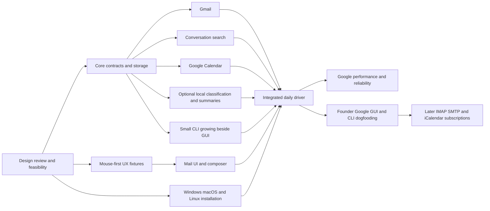

# Build contracts

Living specifications for the major areas of fuckMail. Each is an independently implementable work unit once its consumed interfaces and fixture revision are agreed. Current state: **all whole areas Draft; each file records its revision; Phases 0/1 are complete on available hosts and Phase 2 is planned**. The framework carries verified foundation evidence and the next scoped implementation boundaries. The current [stack recommendation](../research/desktop-stack.md) is a Rust engine/CLI with a C++20/Qt Quick UI over private local IPC; implemented experiments are linked from the owning contracts and evidence report.

The founder is collaborating with Claude Design on one design for every OS; [ui-ux.md](../ui-ux.md) records confirmed screen structure and design proposals. The supplied nonfinal mockups guide the technical prototype while visual design continues. Keep requirements separate from proposed implementation details and use the [development plan](../development-plan.md) for phases/dependencies and [status](../status.md) for active work and readiness. The detailed [Phase 2 packets](../plans/phase-2.md) prepare the real Google pilot; [Phase 1 packets](../plans/phase-1.md) retain the completed redesigned local client. The [Phase 0 packets](../plans/phase-0.md) and evidence remain the completed baseline; Draft whole-area contracts do not erase those scoped results.

## Parallel workstreams

| Stream | Owns | Can start independently with | Contract / integration dependency |
| --- | --- | --- | --- |
| [A — Core and storage](core-storage.md) | Identifiers, schema, migrations, journal, retention, triage projections, category mappings/overrides, inference provenance and recovery | Synthetic fixtures and provider/model fakes | Owns shared schema and query/command contracts; bounded writes and durable checkpoints |
| [B — Gmail](gmail.md) | Desktop auth, backfill/deltas, labels/categories, read/star state, attachments and draft/send mapping | Fake transport and provider fixtures | A's identities/checkpoints/operations; F's invitations; H's allowed category application |
| [C — IMAP/SMTP (deferred)](imap-smtp.md) | Capabilities, category-folder moves, read/flag state, threading, reconciliation and submission/sent copy | After Google GUI/CLI dogfooding: local protocol fixtures and library experiments | A's contracts without Gmail multi-label assumptions; supported-server matrix and durable move outcomes |
| [D — Search](search.md) | Sender/subject/body parsing/indexing, ranking, coverage and benchmarks | Generated normalized messages/conversations | A's record/change contract; conversation results with matching-message snippets for E and I |
| [E — Mail UI](mail-ui.md) | Unread/Starred conversation workflow, sender/category chips, view restoration, reader/local summaries, human-only composer and signatures | Mock local API and realistic datasets | A/D/F/H interfaces, including Calendar's bounded today view; responsive pending states; no direct provider/model networking or schema ownership |
| [F — Calendar](calendar.md) | Google first; feeds after dogfooding, recurrence, views/search, compact all-day/current-next presentation, conference links and reminders | Google-shaped event/recurrence fixtures and mocked application API; external feeds later | A's event/version model, B/C's invitations, G's lifecycle/notifications; Join acknowledgement distinct from RSVP |
| [G — Platform and release](platform.md) | Windows/macOS/Linux shell, credential store, close/quit lifecycle, notifications, installers and OS integration | Minimal shell prototypes | Starts in phase 0; owns platform integration and verifies GUI close, explicit CLI lifetimes and final-engine shutdown |
| [H — Local assistance](local-ai.md) | Ollama/vLLM adapters, modes/settings, bounded classification/summary queue, result validation and evaluation | Fake runner, synthetic received mail and configured category fixtures | A's revisions/overrides/journal; B/C apply permitted changes; E displays results; G verifies local execution/cancellation |
| [I — CLI](cli.md) | Small useful CLI with the first GUI, growing Google workflow coverage, JSON schemas, exit/error semantics, help/completions and foreground streams | Fake engine and structured workflow fixtures | A owns the shared protocol/store/journal; B/C/D/F/H provide domain operations; G installs the CLI and validates headless lifecycle |

These are ownership boundaries, not a requirement for simultaneous contributors. A small team can combine roles. Keep one owner for shared API and schema changes; each stream owns its tests and diagnostics. Linux, including Ubuntu, Arch and Omarchy, is required alongside Windows/macOS. GUI, CLI and installation are joint Google-first release gates. The first usable slice needs a real but incomplete CLI alongside the GUI; never finish the full command surface before GUI iteration. IMAP/SMTP and external subscriptions are deferred until actual founder Google GUI/CLI dogfooding. The local-assistance capability is in MVP, but enabling it is optional; manual workflows have independent completion gates.

## Shared specifications

| Contract | Owner and purpose |
| --- | --- |
| [Triage and categories](triage.md) | Core owns the policy consumed by Mail UI, providers and Local assistance: unread/star semantics, counts, mapped categories and human correction precedence |
| [Quality and release acceptance](quality.md) | Platform/release coordinates evidence from every stream: workload, proposed budgets, recovery, optional-model quality and release gates |

These are shared constraints, not extra teams editing every module. Core remains the sole schema/shared-type owner; Calendar owns event behavior and reminder intent, Platform owns OS delivery/lifecycle, and Mail UI owns mail/composer surfaces, the resizable split and placement of the persistent bottom calendar strip. The strip consumes Calendar's day projection and shares its event identity/fixtures. Providers apply journaled mutations; inference returns validated data only.

## Contracts to agree before parallel implementation

| Boundary | Contract |
| --- | --- |
| GUI/CLI queries | Bounded conversation pages and opaque cursors; stable sorting; cancellation; current-account scope; explicit loading/offline/partial states |
| GUI/CLI commands | Local operation ID, durable acceptance, pending/confirmed/failed/ambiguous state, and any recovery action |
| Mail providers | Capabilities, discovery, paged initial retrieval, delta/reconciliation, body/attachment retrieval, mutations, drafts/submission where supported |
| Calendar providers | Calendar permissions, range queries, series/exception identity, changes, edits, and scheduling capabilities |
| Search | Sender/subject/body query and filters, current account, stable conversation IDs with matching message IDs/snippets, coverage and index generation |
| Triage and categories | Message-level unread/star state; conversation projection and account totals independent of view filters; category IDs mapped to provider labels/folders; pending operation provenance and manual overrides |
| Local inference | Optional capability, account/message scope, content/model/policy versions, bounded text input, validated category IDs and summary output, abstention, cancellation and no provider tools |
| Calendar feeds — deferred | Read-only source identity, refresh/freshness state, last valid snapshot and bounded recurrence expansion |
| Storage | Single schema owner, versioned migrations, transaction rules, retention classes and recovery procedure |

Adapters expose differences explicitly. The common layer must not pretend Gmail labels, IMAP folders, provider threading, and calendar scheduling behave identically.

## Shared contracts before parallel implementation

Agree engine/client lifecycle, versioned local protocol and CLI output/error semantics, account/message/conversation identities, read/star action targets and count scope, native category mappings, manual-override precedence, inference input/policy versions, capability flags, pending/error/ambiguous operation states, bounded pagination, search coverage, event series/exception representation and reminder ownership. Use provider and model fakes so manual UI/search development does not wait for live services.

Give schema migrations a single owner. Synchronization emits normalized changes; search consumes those changes; the UI consumes bounded local views. Both GUI and CLI use the same query/command implementation; no direct database API is exposed to agents. Long conversations require paginated member loading and a way to open the matching search message directly. Attachments have durable download states independent of message-text indexing.

Integrate small end-to-end slices frequently: a message enters the local store, joins its conversation, becomes searchable, opens in the reader, and an action survives restart. Repeat for a calendar event and an offline attachment. Never commit private mailbox captures or real authentication material.

Include the complete triage slice: an unread message is reviewed, categorized, starred while action is underway, answered by the human, then explicitly unstarred. Repeat classification manually and through a local runner without changing read/star state. Verify current/next events, a Join action, and restoration of the account's previous reading position.

## Dependency map

The arrows show integration dependencies, not a ban on independent implementation with fakes. A contract-ready UI/search/provider slice need not wait for a live account; all consumers agree the same shared type and fixture revision first. Google Calendar and shared MIME feasibility run early; legacy transports and external subscriptions do not. The Google-first scope has nine required areas, with C deferred. No contributor should invent a second schema or incompatible interface to unblock its own module.

## Contract format and readiness

Every area file contains its state/revision, owner, what it owns, consumed inputs, produced outputs, independent starting fixtures, behavior, acceptance gates and unresolved choices. Add concrete typed interfaces, commands, error states and reproducible verification instructions when the stack and implementation make them real. Do not fill placeholder APIs or pretend the current prose is an executable test suite.

| State | Meaning |
| --- | --- |
| Draft | Requirements and proposals recorded; some consumed boundaries or implementation choices remain open |
| Ready | Work can start independently: scope and relevant open choices resolved, shared interface/fixture revision agreed, acceptance gates and module ownership explicit |
| In progress | Implementation active against a named contract revision; dependencies and remaining gaps recorded in status |
| Verified | Implemented behavior passes its contract and applicable quality/platform gates, with linked evidence |

Changing a contract increments its revision and identifies affected consumers. Append significant choices, pivots and Q&A to [decisions](../decisions.md); update consumers and fixtures together for shared-interface changes. A contract may return to Draft/Ready when scope changes, while earlier decisions and evidence remain in history. State is per area; readiness for parallel implementation is not the same as shipped-feature readiness.

A scoped slice can be ready while the overall feature remains Draft. Record that slice explicitly in the contract: resolved behavior, consumed interface/fixture revision, owner, acceptance evidence and remaining work. Do not silently promote the whole area or imply that prose is executable. Phase 0 investigation packets may begin against Draft contracts because their purpose is to resolve those boundaries; their resulting interfaces must be agreed before independent production consumers implement them.

Before assigning a work unit, name its phase packet and scoped contract/revision, code ownership after the tree exists, consumed fixture version and completion evidence. During implementation, integrate small end-to-end slices frequently. Record measured results in the relevant research topic and quality contract, then update status. Do not open new workstreams for out-of-scope integrations.
