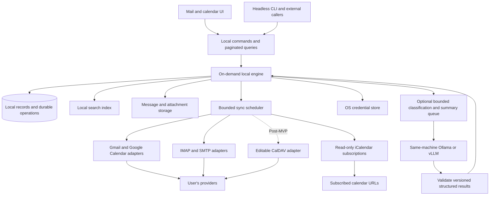

# Core and storage

State: Draft · Revision: 3 · Updated: 2026-09-11 · Implementation: not started.

Owner: A — Core/storage. These are living specifications of accepted requirements and proposed behavior; exact types, libraries and unresolved details are not committed. See [contract workflow](README.md).

## Build boundary

| Boundary | Responsibility |
| --- | --- |
| Owns | Shared identity and schema, migrations, durable drafts/operations, offline retention, normalized change stream, bounded local API and account isolation |
| Consumes | Normalized provider changes, user commands, validated assistance results; credential references from Platform |
| Produces | Account/message/conversation/event identities and revisions, capabilities, paged views, coverage, durable operation outcomes and change notifications |
| Independent start | Synthetic records and fake providers; publish shared types and fixture revision before parallel consumers implement against them |

Related: [triage](triage.md), [search](search.md), [platform](platform.md), [storage research](../research/search-storage.md).

## Shape

Use one local application core for the desktop GUI and a full headless CLI on Windows, macOS and Linux, including Ubuntu, Arch and Omarchy. Both clients read the same local views and submit the same validated commands. Provider synchronization, parsing, indexing, storage and optional local inference work run outside the UI's event loop. Direct provider access with no app-operated remote server is required; optional inference connects to the user's local Ollama/vLLM service. Mail navigation and search stay within the selected account and render conversations. The 2026-09-11 requirements are detailed in [triage](triage.md) and [local assistance](local-ai.md).

Use a native desktop toolkit for navigation, lists, calendar and composition. No JavaScript/TypeScript application layer, npm/Node toolchain, Electron shell or Tauri web frontend is planned. Recommend a private, versioned local IPC boundary to one on-demand engine. Keep the domain/API implementation independent of Qt Quick and WebEngine so CLI use requires no display or renderer. No remote control server is required.

The revised recommendation is a Qt-free Rust engine and Rust CLI, with a C++20/Qt Quick UI accessing the same engine over private local IPC. The engine owns all domain behavior and persistence; the GUI owns presentation models, input, composition widgets and renderer integration. Neither client writes the database directly. No in-process Rust/Qt binding is required for this proposal. See [desktop research](../research/desktop-stack.md) and [HTML research](../research/html-mail.md). Language, transport and library choices remain subject to prototype evidence; the module boundaries below are independent of that choice.

This describes module responsibilities, not a requirement for one process per box.

## GUI/CLI ownership and runtime

A proposed engine process owns migrations, writes, provider synchronization and the operation journal for a profile. GUI and CLI share its capabilities and state; neither maintains a separate mailbox or bypasses the journal. Core owns protocol types/versioning, engine exclusivity and bounded change streams; CLI owns command grammar/output, while providers/Search/Calendar supply the same workflows to either client. Internal database schema is not a public agent API.

Start the engine on demand without an installed startup service. Closing the GUI cancels GUI-owned jobs/reminders; independent explicit CLI commands/watch sessions can continue. Stop after the final active client/job, checkpointing canceled work. Offline queued intent is durable data, not an implicit keep-alive. Verify client crashes, stale endpoint recovery, concurrent launches and mismatched protocol/schema versions without split-brain writers or duplicate submissions.

Use private authenticated local transport with OS-specific permission/peer checks. Noninteractive credential failures must be actionable, never trigger hidden browser login or plaintext fallback. See [CLI contract](cli.md) and [process research](../research/cli-and-local-engine.md).

## Data ownership

- **Accounts and identities:** provider account, authentication reference, allowed From identities, and capabilities. Never use email display text alone as the internal account key.
- **Mail records:** local ID, account-scoped remote identity, headers, message dates, flags, memberships, body availability, and provider thread reference. Use explicit mappings for IMAP mailbox identities and moves.
- **Triage and organization:** read/star provider flags, known hold-set or first-observed timestamps, configured category definitions and provider destination mappings. Manual corrections and pending category mutations survive restart; displayed counts derive from account scope rather than the active filter.
- **Local AI results:** optional cached message/conversation summaries, category suggestions, included message IDs, coverage and source-content revisions, model and prompt/schema versions, category-policy version and provenance. Generated results do not replace source bodies or manual/provider assignments; changed content invalidates affected results without forcing a historical inference sweep.
- **View state:** account-specific selected conversation/member, scroll position, search/category filters, proposed persisted mail split position, and calendar position/visibility. Restore without crossing accounts and handle removed items predictably. Mail UI consumes Calendar's bounded day view for the persistent bottom strip; it is another view of the existing event state, not separate event storage. See [visual design](../ui-ux.md).
- **Bodies and attachments:** retain every synchronized message and attachment for complete offline use; track durable download completion and retry state. Keep source material needed for rendering and re-indexing; store large binary content outside hot list queries. Content hashes may share bytes without collapsing account ownership or permission boundaries.
- **Drafts and operations:** locally authored drafts, staged attachments, queued commands, attempts and provider acknowledgements. These are durable user data, not disposable cache.
- **Calendars and events:** calendar permissions, provider identifiers, iCalendar UID where applicable, recurrence masters, exceptions, cancellations, separate conference URL/physical location and original time-zone/date semantics. Read-only subscriptions have a separate source identity, protected URL and last valid snapshot; feed event identity includes the source, UID and recurrence identity. Reminder acknowledgements use account/event/occurrence identity and remain separate from RSVP.
- **Derived state:** message-level search indexes, account-scoped conversation projections and occurrence windows can be rebuilt. Gmail uses provider threads; IMAP uses reference-based threading without merging unrelated equal-subject mail. Preserve remote cursors, coverage and local pending operations separately from these projections.

Proposed first storage experiment: a single local SQLite database with account-scoped tables and a separate blob directory. Compare partitioning by account only if the measured write contention, recovery, or query behavior justifies it. A separate search engine requires a durable change journal, replay, tombstones and a visible index watermark.

## Complete offline mail

Eventually download and retain all messages and attachments within the account's synchronized mailbox scope. Recent conversations and user-requested content have priority, while older bodies and attachments continue in a resumable background queue. On-demand retrieval is an acceleration path during initial import, not the final retention policy.

Never silently evict old attachments or replace full history with a rolling window. Estimate and display storage needs, preserve disk headroom, and pause with an actionable explanation if space is insufficient. Store attachments and the message content required for complete offline reading and reply/forward. Do not claim complete offline availability until required content is present.

Offline draft creation is proposed as mandatory reliability behavior; durable queues for sends and supported edits are recommended. Remote deletion and permanent local archival behavior are separate: the full offline copy is not automatically an independent backup. Trash/spam inclusion and retention after remote deletion remain explicit follow-up details.

## Synchronization lifecycle

1. Authenticate and discover capabilities, folders/labels, calendars, permissions, and initial synchronization state.
2. Fetch a useful recent conversation slice; expose it immediately. Track inventory, text indexing and full attachment acquisition separately. Continue until all required mail and attachments are stored; no silent age-based eviction.
3. Interleave history backfill with fresh changes. Allocate bounded per-account and global concurrency, honor retry guidance, and prioritize foreground requests.
4. Apply remote changes and commit their checkpoint safely. Replaying a page must not duplicate records; advancing a cursor must never skip unapplied pages.
5. Recover invalid cursors with staged reconciliation. Keep the readable store available where possible; only conclude that missing records were deleted after a complete applicable inventory. Merge pending local intent deliberately.
6. Resume after sleep, loss of network, authentication expiry or process restart. Checkpoint attachment downloads and verify completeness before declaring them available offline. Pause imports on low disk space without discarding unsent work or silently pruning old content.

Provider state remains authoritative for synchronized records, with pending local intent overlaid until confirmed. Calendar version conflicts must be surfaced or merged under documented rules rather than silently overwriting another device's edits.

## Sending and mutation reliability

Persist the intent and required content before showing a queued action. Make retryable state changes idempotent where the provider allows it. Sending has a separate state machine because an acknowledgement may be lost. An internal operation ID or stable Message-ID alone does not guarantee server deduplication.

Proposed send states: draft, queued, submitting, accepted, failed, and acceptance unknown. A sent-copy failure after acceptance must not cause a second submission. Show enough information to recover without promising recipient delivery merely because the submission server accepted the message.

## Acceptance gates

- Build/test the proposed Rust domain engine without Qt. Exercise the same protocol fixtures from the Qt GUI adapter and Rust CLI; use bounded pages and revisioned changes, keeping Qt models on the GUI thread and database access inside the engine.
- Run equivalent GUI and headless CLI operations against one store/journal, including concurrent launch/mutations, client crashes, schema/protocol mismatches, explicit request-ID retries and shutdown after the final client. CLI startup must not load UI/rendering libraries.
- Replay a provider page and restart mid-transaction without duplicate records or a skipped checkpoint. Invalid cursors reconcile against a complete inventory while readable local state and pending intent survive.
- Read/search during ingestion; retain every synchronized body and attachment. Track inventory, text/index and attachment completion separately; pause on low disk without silent history eviction.
- Preserve authored drafts, staged attachments, manual corrections and queued operations across restart and index rebuild. An uncertain send cannot become an automatic duplicate submission.
- Account removal clears its derived/model results and cancels its work; no search or view can expose data through another account. Coordinate handling of durable unsent work with Platform before removal ships.

## Open before implementation

Choose storage/schema and language after evidence; finalize shared IDs, revision/cursor types and error states with consumers. Resolve trash/spam scope, provider-deletion retention, backup/export and account-removal handling for unsent work before those behaviors ship. Actual account/provider counts and complete storage size are unmeasured. [Quality](quality.md) owns workload evidence and targets.
