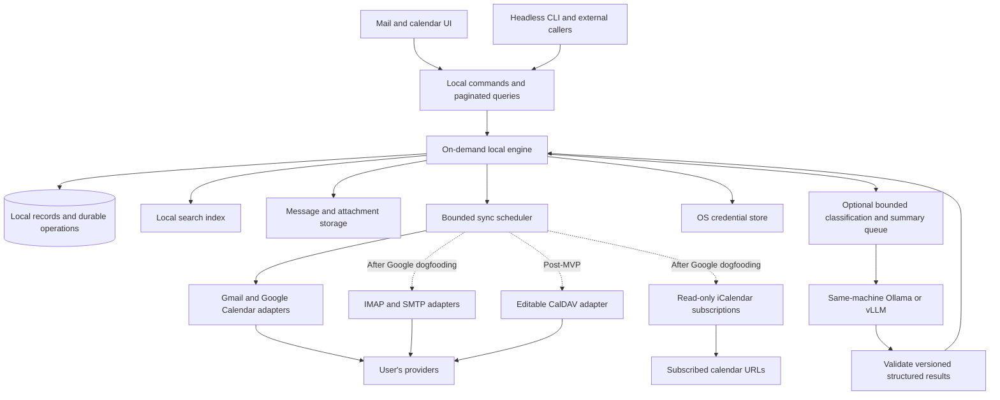

# Core and storage

State: Draft · Revision: 26 · Updated: 2026-09-14 · Implementation: D038/P2-Final is active from bfd7e05 under Core 26/Calendar 19/Mail UI 24/CLI 19/Platform 14/Quality 22/schema 20. Gmail 12/Search 5, fixtures 0/3/protocol 1 unchanged. Fresh live startup, complete recurring workflows/reminders, new reference UI and final package/performance gates are in progress; prior evidence remains source-specific and readiness stays 0/9.

Revision 25 applies D037/P2-06C to schema 19. Preserve old journal/source bytes and version only new occurrence intents/dispatches as 3. Retain actual instance target, expected instance/master versions, typed parent/original identity, exact originalStartTime source, full instance baseline and opaque bounded master observation/fences. Master source comparison and normalization run off-writer under one admitted Calendar seat; finish/stage/start recheck current lifecycle, connection, permission, effective published source generation and Calendar revision. No full master/page source crosses a later quota wait. Reuse the existing journal and exact late-outcome/read-publication distinctions. Keep ordinary visible source selection strict and add a narrow effective-published cancellation input for an already-current parent, preserving observation metadata and supersession ordering. An unreadable or over-budget exception blocks its series. Consumers: Calendar 18/Mail UI 23/CLI 18/Quality 21; Gmail 12/Platform 13/Search 5 unchanged.

Version-three master/source qualification for read reconciliation accepts current permitted Calendar detail-read grants; editable lookup finish and stage/start separately require writable organizer eligibility. It never relaxes private-master detail, catalog, permission, connection or lifecycle checks. DELETE ACK publication retains its dispatch-derived cancellation tuple in `calendar_sources`, while `calendar_event_state.observed_json` holds `{kind: acknowledged_occurrence_cancellation, request_id, source}` provenance and the outcome names `source_origin: dispatched_occurrence_identity`. Actual fetched cancellations retain exact provider JSON and replace this envelope on subsequent observation. No new provenance column or reinterpretation of v1/v2 journals is introduced.

Revision 24 applies D036/P2-01B account lifecycle in the existing Store. Retain account identity, saved content and all old receipts. Active/removed state has a monotonic lifecycle revision; bounded current cleanup metadata is separate from immutable historical results. Removal commits inactivity and advances connection generation before vault cleanup. Exact receipt replay and cross-kind conflicts precede new-work admission. Current active lifecycle fences mutation/claim/publication, and local off-writer plans carry the admitted lifecycle revision through finish. Remove followed by restore cannot revive an old plan. Late exact provider outcomes and startup in-flight recovery remain recordable while source publication is blocked. Ordinary lists/default combined queries omit archives; explicit cached account reads and source/file exports remain available without new legacy-draft creation. Prepared archived replay never dispatches. Revision-bound remove preview/commit/status and same-subject restore reuse the existing command/journal model; reports distinguish local removal, current cleanup and historical receipts. Actual schema-17 upgrade/refusal must preserve all old data and receipt bytes. Consumers: Core 24/Gmail 12/Calendar 17/Platform 13/Mail UI 22/CLI 17/Quality 20/schema 18; Search 5, fixtures 0/3/protocol 1 remain unchanged.

Revision 23 applies D035/schema 17. Preserve every existing Calendar journal/source/receipt byte while versioning newly prepared live invitation intents and dispatches. The schema bump prevents earlier engines from reconciling guest removal with the old self-RSVP-only predicate. Reuse the existing journal; distinguish provider acceptance from observed-state reconciliation and never invent notification delivery. Exact target, ETag, connection, permission and operation stamps fence preparation, dispatch and late outcomes. Organizer roster replacement preserves protected entries and supported unchanged guest metadata; omission preserves the whole array. Observed-state evidence retains its own opaque publication fence captured before the reconciliation read; connection, permission and source revisions must still match and current catalog membership must permit access before cache publication or staging expiry. The original mutation lease remains immutable and controls any later provider acknowledgment. Consumers: Calendar 16/Mail UI 21/CLI 16/Quality 19; Gmail 11/Platform 12/Search 5, fixtures 0/3/protocol 1 unchanged.

Revision 22 uses schema 16 and the existing Store/drafts/blob/capture structures for explicit source conversion, observed-target adoption and typed remote-draft deletion. Bounded twin metadata retains derivation separately from adoption and acknowledged upload baselines; indexed due selection excludes an unchanged newly adopted revision. Both upload and Send use one effective target rule. Fresh source checks, opaque off-writer content proofs and short revision-fenced commits preserve original RAW, authored edits and old receipts. Delete guards block conflicting exact-target work; kind `draft_delete` is excluded from upload/Send/synthetic loaders and inventory owner linking. Missing provider state never proves sending or an uncertain mutation's success. Consumers: Gmail 11/Mail UI 20/CLI 15/Quality 18; Calendar 15/Platform 12/Search 5, fixtures 0/3 and protocol 1 stay unchanged.

Revision 21 adds D032/schema 15 provenance to the existing drafts table and bounded remote-inventory/source-version metadata in the same Store. Existing blobs and nullable-message attachments retain exact remote RAW and decoded parts; imported previews have no invented conversation, primary From, signature, upload baseline or operation. Local B1/B2 baselines and receipts stay unchanged. Read-only provenance is checked from persisted state at every save/attachment/discard/capture/upload/Send preparation and commit/claim entry, and auto-upload selection explicitly excludes it. Cached unfiltered Drafts paging counts/indexes the collection and loads only the requested page. Consumers: Gmail 10, Mail UI 19, CLI 14 and Quality 17; Calendar 15/Platform 12/Search 5, fixtures 0/3 and protocol 1 stay unchanged.

Inventory stores generation, connection generation, bounded pending page, per-item durable outcomes and continuation. List pages contain at most 50 identities; RAW decoding, MIME parsing, hashing and exports run on bounded workers before short source-fenced publication. Cancel resumes pending work; expired tokens restart enumeration without deleting versions. Completed enumeration, retained RAW, preview issues and freshness remain separate. Known B1/B2 targets are rechecked at publication; uncertain creation without a provider identity is never linked or acknowledged by content similarity. Imported previews may follow a newer retained remote version, with older RAW/source metadata preserved; linked authored text remains unchanged. Exact source revisions bind cached history and verified source/attachment export.

Revision 20 adds explicit Google submission under D029 using schema 14 and a draft/send discriminator in the existing capture journal. Preserve old draft and synthetic receipts; all loaders, recovery and due selection respect operation kind. Freeze exact authored identity/content outside the writer, retain known-unsent/in-flight/accepted/rejected/unknown outcomes, and exclude pending or consumed sends from automatic draft work. Newer authored revisions survive every outcome. Consumers: Gmail 9, Mail UI 18, CLI 13 and Quality 16; Calendar 15/Platform 12/Search 5, fixtures 0/3 and protocol 1 stay unchanged.

After definitive acceptance, a strictly newer authored revision may be submitted only by another explicit Send with a fresh request and RFC Message-ID. Reusing the accepted authored revision with a new request is refused. The consumed Google draft ID is never reused; later submissions use a fresh direct-message intent. Pending or unknown submissions block all new attempts. The last accepted authored revision remains distinct from the current operation revision and monotonically advancing Google twin revision. Cached `draft.google_send` reports the latest operation without rebasing editor content. Per-account `capabilities.send` requires a connected live account and the existing mail-write scope predicate; global live `status.capabilities.send` describes the implemented interface, not account admission or delivery readiness.

Two competing preparations with the same exact request must preserve one journal winner's MIME/Message-ID, with one atomic claim. A lost local response followed by `not_found` does not prove absence of an invocation still preparing. Explicit Resume may repeat only that original four-field request and ID; an existing in-flight/unknown/accepted operation returns its retained outcome without another submission. Direct predispatch error proof is scoped to the invocation that returned it and cannot erase earlier transport uncertainty.

An exact obsolete request can be conclusively refused without dispatch only if the writer first finds no journal row, then finds its current local or Google revision strictly greater than the request's expected revision. Emit the bounded `send_request_obsolete_without_dispatch` proof with the existing stale error; all pending proofs recheck the same monotonic stamps before insertion and claim requires that row. Existing journal states, future revisions, connection errors or `not_found` cannot supply this stronger proof. This lets an explicit original-ID Resume release a no-longer-possible request after newer edits while preserving both durable uncertainty and authored content.

Revision 19 adds bounded Google twin metadata on existing drafts and an execution discriminator on existing capture operations, defaulting old rows to synthetic. Synthetic replay/history/recovery must exclude Google rows and preserve old JSON receipts; request-ID collisions across modes fail explicitly. Freeze exact authored revision/identity/source/attachments using opaque off-writer proofs and the existing blob store. Google draft operations retain uploaded MIME separately from fetched provider RAW, stable draft ID, acknowledged contained-message ID, acknowledged local revision and observation/version fences. A late acknowledgment may record its original operation while a newer local draft survives; stale connection work cannot publish a new twin baseline. Consumers: Gmail 8, Mail UI 17, CLI 12, Quality 14 and MIME; Calendar 15/Platform 12/Search 5 unchanged, schema 13/fixtures 0 and 3/protocol 1.

Only readback matching both acknowledged provider IDs establishes an observed baseline. Later changed IDs or RAW hash preserve both versions and require explicit conflict resolution; missing remote drafts remain distinct from proven send. Store upload-versus-observed byte equality separately from version identity. Unknown create/update outcomes survive restart without automatic replay. Small status/progress projections contain references and hashes, never raw MIME or tokens. Preparation and fetched-RAW hashing stay outside the writer, bounded by worker memory; SQL commits recheck account, generation, operation and draft stamps without rebasing authored text.

Fresh readback of an unknown update may retain a conflict observation for its exact existing target. Only a new request ID with the current local and Google revisions may explicitly replace that observation; the original unknown operation remains immutable and unknown. Unknown creation and missing unknown targets cannot take this path. Historical replay exposes its selected operation separately through `operation_is_current: false`; current status and `draft.google` use `true`. The nullable operation `provider_draft_id` is the frozen update target, never a target inferred from an unrelated later baseline.

An unchanged draft with a deterministic local preparation failure must not block newer drafts. Retain bounded revision-bound failure metadata without inventing an upload receipt; changed authored revisions become eligible again. Retryable local IO, cancellation, quota and authentication failures retain their respective retry semantics. Due selection remains bounded and fair to other eligible drafts.

Revision 18 adds account-scoped local-file attachments to existing durable composition. Schema 12 permits a NULL received-message link in `attachments`, retains its message foreign key and adds a direct account foreign key. Imported files do not enter received messages, attachment filters, FTS or source coverage; negative attachment filters must explicitly exclude NULL links. Existing rows, drafts, fingerprints and exact receipts survive migration. Consumers: Mail UI 16, CLI 11, Quality 13, Gmail 7/MIME and Search 5; Calendar 15/Platform 12 remain unchanged.

The additive `draft_attachment_import` boundary requires `draft_id`, positive `expected_revision`, `request_id` and an absolute local `path` under an explicit account. Check replay before opening a file. Off-writer preparation retains exact bounded regular-file bytes; one short transaction rechecks current draft/attachment stamps, adds the attachment and selected ID, advances the draft revision once and records the result. The result contains `draft` plus attachment account/id/name/type/size/state/SHA-256 and nullable message identity. Preserve the 50-file and 25-MiB combined bounds. Store only a bounded basename, `application/octet-stream` and immutable blob reference; the source path contributes only to the request fingerprint, never retained metadata or receipt text.

`local_content_begin` and `local_content_finish` exchange either an exact reply or an opaque preparation plan with a bounded blocking worker. `prepare_local_content` has no SQLite access and produces an opaque verified proof. The same path handles unchanged `draft_save` and synthetic `draft_capture` requests: attachment hashing, first-save legacy source parsing, MIME construction and capture export occur outside the Store writer. Snapshot and recheck draft/source/attachment/account-identity stamps; preserve existing routing fallback and old first-save receipt compatibility. Capture replay verifies its original frozen bytes, never the current draft. A same-request capture race may redirect once to the winning frozen capture; other stale work fails without automatic rebase. No bulk attachment/MIME bytes enter the Core queue. Runtime verification remains separate from this agreed boundary.

Revision 17 adds a generation-fenced cached Google label catalog, complete-generation publication, revision-bound pagination and explicit category binding through existing categories/maps/operation receipts. Discovery changes no categories or messages. Binding validates a present user label and current catalog revision, plus explicit prior mapping on remap; missing destinations retain configured category identity. Exact mail delivery lookup counts all rows for one account/request and never infers confirmation from a truncated pending list. Live Calendar status/history project bounded target/kind/state/revision/outcome fields without copying dispatch bodies; known-unsent `prepared` or `ready` request extraction supports explicit resume under D025, while unknown work requires reconciliation. Saved confirmed quota limits use existing typed preferences. Consumers: Gmail 7, Calendar 15, Mail UI 15, CLI 10, Platform 11, Quality 11 and Search 5/Triage 6. Current implementation evidence remains separate from this boundary.

Revision 16 applies D023: extend the existing operation receipts/manual intents with per-message delivery state, frozen target revisions and generation-fenced reconciliation. Schema 10 adds a Trash projection and extends the existing Calendar write journal with explicit local/live execution modes, conditional dispatch and durable outcomes. A late provider response can record the exact attempt without publishing through a stale connection; its receipt must survive normalized source removal. Core rechecks every prepared Calendar chunk against connection, permission, run and source stamps. Two shared Calendar memory permits remain owned through off-writer hashing/normalization and bounded SQL stages; normal chunks contain at most 32 items/1 MiB and page JSON is limited to 16 MiB. Prior source byte lengths are checked in SQL before copying; merged serialization is capped at 32 MiB before normalization. These logical source bounds do not establish physical allocation/RSS limits. Resource refusal preserves prior source and continuation. Consumers: Gmail 6, Calendar 14, Mail UI 14, CLI 9, Platform 11, Quality 11 and Search 5/Triage 6. Implementation and measured acceptance remain distinct.

Revision 15 defines D022's bounded live acquisition boundary, consumed by Gmail 5, Calendar 13, Mail UI 14, CLI 8, Platform 11, Quality 11 and Search 5. Schema 9 adds provider work, coverage and projection metadata to the existing store; it does not create a second message or authored-operation store. The synthetic complete-page path remains unchanged. Live Gmail commits bounded visible parts, each with source references, normalized messages, FTS, retained human intent and an exact replay receipt in one transaction. It advances the Google page cursor only after every requested item has a durable outcome. Parsing, sanitization, hashing, blob publication and recovery verification occur on bounded workers before Store admission. Partial inventory, source availability, attachment completeness and indexed text remain separate coverage dimensions. An opaque prepared item cannot be reconstructed merely by deserializing an unverified manifest.

Independent recent, inventory and delta lanes share account generation and per-message history ordering. Only complete inventory proves absence; neither the recent cutoff nor an older source response may erase a newer observation or rewind current history. Calendar stages bounded chunks into generation-tagged slots of the existing source tables, seals complete pages and publishes by changing a committed generation/token pointer. Pending runs do not invalidate the visible model. Permission restrictions invalidate stale leases immediately; limited-writer private masters/exceptions remain busy-only. Indexed window candidates, bounded expansion and explicit incomplete coverage replace the whole-inventory source cap. Actual packet evidence belongs in the [execution record](../research/phase-2-execution.md).

D021 implements this revision's first shared boundary: immutable live/synthetic profile identity, persistent vault namespace and stable Google-subject bindings in schema 8. Live fixture 0 seeds nothing. Internal verified-auth registration preserves reconnect identity; capabilities and inventory remain unavailable/incomplete until their adapters pass. [Execution evidence](../research/phase-2-execution.md) separates targeted tests from complete packet acceptance. The following planning record describes the revision's broader scope.

Revision 14 prepares D020/Phase 2's real Google boundary; no new runtime schema is implemented. P2-00 owns exact account identity (validated Google subject mapped to a local ID), provider capability/auth references, inventory/source/blob/index coverage, checkpoint generations and durable remote-operation outcomes. GUI/CLI keep one store and writer; provider HTTP and unbounded parsing never hold the UI or store mutation path. A separate empty live profile must never seed synthetic accounts, replay fake acknowledgments or submit old captures. Preserve schema-7 profiles and authored state; assign the next schema/fixture revision only with an actual agreed migration.

The founder chose OS account permissions plus verified disk encryption for the pilot; app-level database/blob encryption is deferred. Verify every real-data volume, temporary path and backup destination before import. Tokens remain in the OS vault. Resolve Spam/Trash inventory, confirmed remote-deletion retention, backup/restore, disk-full behavior and account removal before affected real-data work. Disconnect pauses access without deleting drafts or unresolved operations; explicit cleanup/revocation is separate. The proposed retention choices are in P2-00, not silently accepted defaults.

Extend the tested atomic page/checkpoint/FTS boundary with streaming and durable staging that can handle real source sizes and dense calendars. Per-item unavailable/error states must preserve coverage and let other valid items progress without silently discarding originals. Full inventory, retained MIME, verified attachments and indexed text are distinct completion states. Gmail draft container IDs, source message IDs, local draft IDs and submission IDs stay distinct. Preserve local revisions and known remote conflicts; a fresh read followed by an unconditional Google draft update is not atomic conflict protection. Never reinterpret synthetic capture acknowledgment as live submission. Consumers: Gmail 4, Calendar 12, Mail UI 14, CLI 8, Platform 11, Quality 11 and existing Search 5/Triage 6. See the [Phase 2 plan](../plans/phase-2.md).

Revision 13 defines D018/P1-09: schema 7 adds `message_sender_kinds(account,message_id,source_hash,kind,provenance)`, with an account/member foreign key, people/automated kinds and explicit fixture provenance. A missing annotation or retained-source hash mismatch projects unknown. Conversation kind follows the newest incoming member by actual timestamp and stable member ID, falling back to the newest member when all are outgoing. Querying never changes review state. Source changes and annotation changes invalidate projections/cursors; bounded message appends update the existing conversation cache. Fresh fixture 3 carries explicit known annotations; migrated fixture 1/2 profiles retain their revision, accounts, sources, drafts and exact receipts without reseeding or inferred classifications. Consumers: Mail UI 12, Search 5, Triage 6, CLI 7, Platform and Quality.

The additive protocol-1 boundary supplies `kind` and `exact_sender` conversation filters, exact whole-filter `filtered_group_counts`, and bounded account-scoped `sender_summary` history. The [fixture API](../../fixtures/README.md#p1-09-sender-kinds-and-presentation-preferences--core-13-cli-7-search-5-triage-6) owns exact fields. Local preferences also add theme graphite/paper/harbour, text size small/default/large, startup view mail/calendar/last, last workspace mail/calendar, timeline position footer/header, and default event duration 30/45/60 minutes. Defaults are graphite/default/mail/mail/footer/60; old saved JSON and receipts remain unchanged and getters merge new defaults.

Presentation-only `collapsed_groups` removes review/held/done groups from paging while preserving full filtered totals, adding `expanded_conversation_count`. Cursor scope includes that presentation choice. `status.calendar_generation` starts at zero after each Store startup and advances on actual calendar-table writes; mail/draft/appearance changes do not advance it. Clients can retain their calendar model through appearance-only changes; a new engine starts a fresh generation scope. Account unread/starred message totals reuse the same source-derived append projection and remain independently verified against stored message sums/counts.

Windows P1-09 verification passed the full release workspace's 161 executed tests before the last collapsed-group/calendar-generation additions. The final six focused sender-kind/query/generation/migration tests pass in 6.02 seconds, including parser-supported Unicode sender identity and structured draft recipients. Strict workspace/all-target release Clippy passes, and production engine/CLI relink succeeds. Logs are retained at `build/verification/p1-09-rust-workspace-01.log`, `p1-09-core-final-additions-01.log`, `p1-09-rust-clippy-02.log` and `p1-09-production-build-02.log`. Final-source integrated/native/performance/package evidence remains separate; the preceding full run does not claim to include those last two tests.

Revision 12 defines the explicitly authorized P1-08 local New/Reply-all/Forward/Drafts boundary. Schema 6 generalizes the existing drafts table with durable account/draft identity, an optional source conversation/member and frozen routing. Protocol 1 and fixture 2 remain additive/unchanged. Existing reply selectors, authored columns, operation receipts, captured bytes and fixture revisions survive migration. A migrated historical draft freezes its currently retained source: routing that the old schema never stored cannot be reconstructed historically. Consumers: Mail UI 11, CLI 6, MIME, Platform and Quality. Exact fields are in the [P1-08 fixture API](../../fixtures/README.md#p1-08-local-composition--core-12-cli-6-mail-ui-11). Current execution evidence remains separate from the specification.

New drafts never manufacture received conversations or provider-sent records. New, reply, reply-all and forward share the existing account identity/signature snapshot, revision journal, authored text/HTML, retained-attachment selection, discard and immutable local capture path. Recipients and subject are persisted and editable; source member/hash, RFC reply context and account identity are fixed. The first legacy save may bind the source member returned by `draft_get`, so an arrival before autosave does not retarget the reply. Later saves reject a different source. Reply-all excludes the current identity case-insensitively, deduplicates visible source recipients and starts with empty Bcc. Forward starts with an editable quote of retained source text and no implicit attachment selection. Its MIME is not a reply to the original Message-ID.

Draft browsing is a bounded account projection with plain-word subject/body/recipient search, exact filtered totals, stable update-time/identity order and a byte-bounded page. Draft content never enters received-source FTS or mail counts. Explicitly created/saved empty drafts remain visible until discarded; merely querying a nonexistent legacy reply does not create a draft. Source I/O, recipient validation, stale revisions and acceptance-unknown recovery remain meaningful failure states. Real transmission, account connection/removal, aliases, models and new-file import are outside this local extension.

The scoped Windows run `cargo test -p fm-core -p fm-cli -p fm-engine -p fm-mail --locked` passed 108 executed tests: Core 71 unit and 14 integration, engine 5 unit and 6 integration, CLI 3, MIME 9. The opt-in 100k experiment and native-GUI startup case retain their separate runners. Six new composition tests cover independent draft identity, frozen source across actual provider-row ingestion, Reply-all recipient privacy, Forward without implicit retained attachments, bounded/account-scoped Drafts, stale/invalid edits, schema-5 authored-column and exact journal preservation, and capture replay with a maximum escaped subject. Scoped all-target clippy passes with warnings denied. The [21-call actual CLI report](../research/assets/phase-1/p1-08-cli-composition.json) records preserved schema-5 first-save replay through the updated CLI, exact stored fingerprint/receipt preservation, new first-save replay and local capture recovery after later edits/restart, including binary hashes. Build/test logs are retained under `build/verification/p1-08-*`; whole-phase execution belongs in the [execution record](../research/phase-1-execution.md).

Revision 11 refines Search 4 cursor invalidation to search-table changes and writer restart, so unrelated view/preferences/draft/calendar writes preserve paging. Response revisions remain store-wide. Bounded message/FTS append projections independently verify inventory and fall back on mutation, overflow or transaction rollback. Consumers: Search, Mail UI, CLI 5, Platform and Quality; schema 5/protocol 1 remain unchanged.

Revision 10 records the implemented P1-00/P1-01/P1-05 boundary: schema 5, protocol 1 and fresh fixture 2; typed local preferences, metadata/signature snapshots, grouped typed search/counts/cursors, snapshot action recipes, durable discard and capture history. Consumers: Mail UI, Triage, Search, Calendar, CLI, Platform and Quality. [Fixture API](../../fixtures/README.md) owns exact wire fields; [local protocol](../local-protocol.md) owns envelopes and CLI grammar. Existing fixture-1 profiles retain their revision/accounts/data under migration. Windows Core/CLI tests and the 19-call live CLI smoke pass; native whole-phase, other-host, large-corpus and product gates remain separate.

Revision 9 applies D014 and the [Phase 1 plan](../plans/phase-1.md): read-on-open and snapshot Done/untimed Delay, bounded typed preferences, grouped conversation queries and combined permission-aware calendar views. Consumers: Mail UI, Triage, Search, Calendar, CLI and Platform. Current runtime remains schema 4, protocol 1 and fixture 1; implementation determines the next required revisions.

Revision 8 records the integrated Phase 0 experiment. Schema 4 adds completed calendar-batch checkpoints/visibility/write receipts and validated fake-assistance policies/results/intents to the existing store. Calendar permissions filter the shared projection; assistance rechecks retained source/provider/manual/policy stamps inside its apply transaction. Consumers: Calendar, Local assistance, Gmail, Qt UI, CLI and Platform.

Revision 7 records the next Phase 0 integration checkpoint. Schema 3 joins fake Google pages, normalized source text/FTS, provider checkpoints and durable receipts in the one store; pending human actions survive reconciliation. Authored HTML and retained draft attachments round-trip through capture. Per-request SQL cancellation, abrupt engine termination/replay and schema 1/2 migration are tested. Consumers: Gmail, CLI, Qt UI, MIME, Search, Calendar and assistance.

Revision 6 records D012’s implemented experimental slice. Protocol 1 and fixture 1 now have a single SQLite writer, bounded queries, independent flags, durable drafts/views and recorded operation responses. See [local protocol](../local-protocol.md) and [fixture contract](../../fixtures/README.md). Consumers: CLI, Qt UI, Search, Gmail, Calendar and assistance. Full provider reconciliation, retention policy and migration/recovery qualification remain open.

Revision 5 applies D009: Google-first scope, paired early GUI/CLI, retained MIME/text without an initial HTML renderer, and user-owned action state. Affected consumers: Gmail, Search, Mail UI, Calendar, Triage, Local assistance, Platform and CLI; future IMAP/SMTP contracts stay deferred.

Owner: A — Core/storage. These are living specifications of accepted requirements and proposed behavior; exact types, libraries and unresolved details are not committed. See [contract workflow](README.md).

## Build boundary

| Boundary | Responsibility |
| --- | --- |
| Owns | Shared identity and schema, migrations, durable drafts/operations, offline retention, normalized change stream, bounded local API and account isolation |
| Consumes | Normalized provider changes, user commands, validated assistance results; credential references from Platform |
| Produces | Account/message/conversation/event identities and revisions, capabilities, paged views, coverage, durable operation outcomes and change notifications |
| Independent start | Synthetic records and fake providers; publish shared types and fixture revision before parallel consumers implement against them |

Related: [triage](triage.md), [search](search.md), [platform](platform.md), [storage research](../research/search-storage.md).

Revision 4 links the initial shared-boundary handoff to [Phase 0](../plans/phase-0.md). Affected consumers: Gmail, IMAP/SMTP, Search, Mail UI, Calendar, Platform, Local assistance and CLI. The area remains Draft; no wire types or schema have been implemented.

## Phase 1 boundary — implemented local slice

The existing store and journal now implement schema 7. Protocol 1 stays additive: legacy date-sorted queries and message-count fields retain their meaning. Fresh fixture 3 has three accounts and explicit sender kinds; migration never reseeds existing fixture 1/2. The exact reviewed request/response fields and bounds are recorded in the [fixture API](../../fixtures/README.md). No client opens SQLite or introduces another mail/calendar store.

- **Mail state and counts:** `conversations` supplies bounded, stably ordered conversation groups through `grouped:true`, typed source filters, filtered totals and account totals with explicit message/conversation units and coverage. Cursor paging binds the account, options, page size, writer instance and search-table generation; a changed query/search state or writer restart fails `stale_cursor`. Unrelated view, preference, draft and calendar writes preserve pagination. Sender/category/date/attachment/text constraints combine on one source member; status examines the full conversation. Dates are inclusive `after` and exclusive `before` at UTC midnight. Held count includes unread+held conversations even though group precedence is review, held, done. Existing unread_count/starred_count keep their message-count meaning; new conversation fields are distinct. A user opening a conversation in the GUI submits a journaled read action for its opened member snapshot; the underlying fetch remains a query. Done atomically marks that snapshot read and clears its stars; Delay is an untimed star hold. Later arrivals remain outside earlier actions. These use provider-backed read/star state and the existing durable request/revision rules. Filtering, paging and sending never manufacture an all-clear.
- **Preferences and view state:** `preferences_get/save` stores validated density, week start, calendar/timeline hours and calendar selection with independent revision/replay receipts. Calendar selection uses null=all, []=none or explicit scoped identities. Distinguish these app-wide preferences from account-specific mail selection, typed filters, reply-open/member state and scroll position. Calendar selection/navigation is independent of the selected mailbox. Extend the current view allowlist deliberately; do not serialize arbitrary prototype state. Account display names/signatures, provider permissions and operation intent are domain data, not presentation fields.
- **Calendar scope:** a combined view names its participating account/calendar identities, date range, display time zone, coverage and scope revision. Reuse Calendar's permission-filtered occurrences and preserve the owning account on every event. Bind continuation/cursor state, where needed, to that complete scope; changes in visibility/permissions invalidate stale results. Enforce an aggregate response bound across calendars and never truncate silently. Full permitted details may appear across connected accounts; free/busy and private-field restrictions still apply before serialization. Mail queries remain account-scoped.
- **Reply and calendar writes:** plain/formatted replies, signatures, retained attachments, explicit discard and local MIME capture share the durable path. First save snapshots signature/From display identity; body edits preserve the snapshot, and explicit per-draft `signature_text` edits participate in its revision. Account preference changes never rewrite an existing draft. Explicit discard clears authored fields but preserves a revision tombstone; composing anew snapshots current metadata. Capture appends the saved signature once. `capture_history` returns bounded journal-derived outcomes linked to the original conversation, with distinct accepted/failed/unknown states and explicit `provider_delivered:false`. Captures are not provider-sent messages. New mail, forwarding and local-file attachment import follow later. Expose nonrecurring create/edit and self-RSVP through the journal and deterministic fake acknowledgment. Create needs a new stable identity/prepared-intent/acknowledgment path because current edit/RSVP assumes an existing stored event/ETag. Recurrence-series editing remains later work.

Acceptance includes GUI-to-CLI readback, restart/replay, concurrent new mail and stale revisions, permission changes during combined calendar queries, and migration preserving existing drafts/actions/views. The [Phase 1 plan](../plans/phase-1.md) owns packet evidence. Real provider/model execution remains outside this phase.

## First shared-boundary handoff

P0-01 defines synthetic identity/state expectations; P0-03 and P0-10 prove storage and client behavior. Before a production consumer starts, publish the relevant agreed interface/fixture revision covering account/message/conversation identities, calendar series/occurrence identity when needed, revisions/cursors, snapshot action targets, operation outcomes, capabilities, coverage and session ownership. Define representation and serialization in the actual chosen implementation, with Rust/Qt contract tests; do not let each adapter invent its own IDs or error model.

The first slice needs a bounded page/query, one journaled action, source/blob availability and an explicit event view, not every future API. Keep later provider/inference capabilities open behind the same ownership rules. Mark only that resolved slice ready; full Core readiness still requires retention, migration and all applicable recovery decisions/gates. The [development plan](../development-plan.md) sets when unresolved choices become blocking.

## Shape

Current delivery scope is Gmail/Google Calendar first, with both GUI and a small CLI using this same boundary immediately. MIME decoding, original source retention, text extraction and outgoing MIME remain required. Neither a full HTML renderer nor IMAP/SMTP/external-feed adapters are initial prerequisites. Preserve extensible identities and capabilities without implementing unused adapters. User-selected Done/Delayed and classifier tags are distinct state domains; inference never supplies read/star/completion commands.

Use one local application core for the desktop GUI and a full headless CLI on Windows, macOS and Linux, including Ubuntu, Arch and Omarchy. Both clients read the same local views and submit the same validated commands. Provider synchronization, parsing, indexing, storage and optional local inference work run outside the UI's event loop. Direct provider access with no app-operated remote server is required; optional inference connects to the user's local Ollama/vLLM service. Mail navigation and search stay within the selected account and render conversations. The 2026-09-11 requirements are detailed in [triage](triage.md) and [local assistance](local-ai.md).

Use a native desktop toolkit for navigation, lists, calendar and composition. QML expressions are acceptable; no Node.js or separate JavaScript/TypeScript compilation/bundling pipeline is planned. Recommend a private, versioned local IPC boundary to one on-demand engine. Keep the domain/API implementation independent of Qt Quick and WebEngine so CLI use requires no display or renderer. No remote control server is required.

The revised recommendation is a Qt-free Rust engine and Rust CLI, with a C++20/Qt Quick UI accessing the same engine over private local IPC. The engine owns all domain behavior and persistence; the GUI owns presentation models, input, composition widgets and renderer integration. Neither client writes the database directly. No in-process Rust/Qt binding is required for this proposal. See [desktop research](../research/desktop-stack.md) and [HTML research](../research/html-mail.md). Language, transport and library choices remain subject to prototype evidence; the module boundaries below are independent of that choice.

This describes module responsibilities, not a requirement for one process per box.

## GUI/CLI ownership and runtime

A proposed engine process owns migrations, writes, provider synchronization and the operation journal for a profile. GUI and CLI share its capabilities and state; neither maintains a separate mailbox or bypasses the journal. Core owns protocol types/versioning, engine exclusivity and bounded change streams; CLI owns command grammar/output, while providers/Search/Calendar supply the same workflows to either client. Internal database schema is not a public agent API.

Start the engine on demand without an installed startup service. Closing the GUI cancels GUI-owned jobs/reminders; independent explicit CLI commands/watch sessions can continue. Stop after the final active client/job, checkpointing canceled work. Offline queued intent is durable data, not an implicit keep-alive. Verify client crashes, stale endpoint recovery, concurrent launches and mismatched protocol/schema versions without split-brain writers or duplicate submissions.

Use private authenticated local transport with OS-specific permission/peer checks. Noninteractive credential failures must be actionable, never trigger hidden browser login or plaintext fallback. See [CLI contract](cli.md) and [process research](../research/cli-and-local-engine.md).

## Data ownership

- **Accounts and identities:** provider account, authentication reference, allowed From identities, and capabilities. Never use email display text alone as the internal account key.
- **Mail records:** local ID, account-scoped remote identity, headers, message dates, flags, memberships, body availability, and provider thread reference. Use explicit mappings for IMAP mailbox identities and moves.
- **Triage and organization:** read/star provider flags, known hold-set or first-observed timestamps, configured category definitions and provider destination mappings. Manual corrections and pending category mutations survive restart; displayed counts derive from account scope rather than the active filter.
- **Local AI results:** optional cached message/conversation summaries, category suggestions, included message IDs, coverage and source-content revisions, model and prompt/schema versions, category-policy version and provenance. Generated results do not replace source bodies or manual/provider assignments; changed content invalidates affected results without forcing a historical inference sweep.
- **View state:** account-specific selected conversation/member, scroll position, search/category filters and mail split position; independently scoped combined-calendar navigation/visibility and bounded application preferences. Restore mail state without crossing accounts and handle removed items predictably. Mail UI consumes Calendar's bounded day view for its browsable bottom timeline, visible only in Mail; it is another view of the existing event state. See [visual design](../ui-ux.md).
- **Bodies and attachments:** retain every synchronized message and attachment for complete offline use; track durable download completion and retry state. Keep source material needed for rendering and re-indexing; store large binary content outside hot list queries. Content hashes may share bytes without collapsing account ownership or permission boundaries.
- **Drafts and operations:** locally authored drafts, staged attachments, queued commands, attempts and provider acknowledgements. These are durable user data, not disposable cache.
- **Calendars and events:** calendar permissions, provider identifiers, iCalendar UID where applicable, recurrence masters, exceptions, cancellations, separate conference URL/physical location and original time-zone/date semantics. Read-only subscriptions have a separate source identity, protected URL and last valid snapshot; feed event identity includes the source, UID and recurrence identity. Reminder acknowledgements use account/event/occurrence identity and remain separate from RSVP.
- **Derived state:** message-level search indexes, account-scoped conversation projections and occurrence windows can be rebuilt. Gmail uses provider threads; IMAP uses reference-based threading without merging unrelated equal-subject mail. Preserve remote cursors, coverage and local pending operations separately from these projections.

Proposed first storage experiment: a single local SQLite database with account-scoped tables and a separate blob directory. Compare partitioning by account only if the measured write contention, recovery, or query behavior justifies it. A separate search engine requires a durable change journal, replay, tombstones and a visible index watermark.

## Complete offline mail

Eventually download and retain all messages and attachments within the account's synchronized mailbox scope. Recent conversations and user-requested content have priority, while older bodies and attachments continue in a resumable background queue. On-demand retrieval is an acceleration path during initial import, not the final retention policy.

Never silently evict old attachments or replace full history with a rolling window. Estimate and display storage needs, preserve disk headroom, and pause with an actionable explanation if space is insufficient. Store attachments and the message content required for complete offline reading and reply/forward. Do not claim complete offline availability until required content is present.

Offline draft creation is proposed as mandatory reliability behavior; durable queues for sends and supported edits are recommended. Remote deletion and permanent local archival behavior are separate: the full offline copy is not automatically an independent backup. Trash/spam inclusion and retention after remote deletion remain explicit follow-up details.

## Synchronization lifecycle

1. Authenticate and discover capabilities, folders/labels, calendars, permissions, and initial synchronization state.
2. Fetch a useful recent conversation slice; expose it immediately. Track inventory, text indexing and full attachment acquisition separately. Continue until all required mail and attachments are stored; no silent age-based eviction.
3. Interleave history backfill with fresh changes. Allocate bounded per-account and global concurrency, honor retry guidance, and prioritize foreground requests.
4. Apply remote changes and commit their checkpoint safely. Replaying a page must not duplicate records; advancing a cursor must never skip unapplied pages.
5. Recover invalid cursors with staged reconciliation. Keep the readable store available where possible; only conclude that missing records were deleted after a complete applicable inventory. Merge pending local intent deliberately.
6. Resume after sleep, loss of network, authentication expiry or process restart. Checkpoint attachment downloads and verify completeness before declaring them available offline. Pause imports on low disk space without discarding unsent work or silently pruning old content.

Provider state remains authoritative for synchronized records, with pending local intent overlaid until confirmed. Calendar version conflicts must be surfaced or merged under documented rules rather than silently overwriting another device's edits.

## Sending and mutation reliability

Persist the intent and required content before showing a queued action. Make retryable state changes idempotent where the provider allows it. Sending has a separate state machine because an acknowledgement may be lost. An internal operation ID or stable Message-ID alone does not guarantee server deduplication.

Proposed send states: draft, queued, submitting, accepted, failed, and acceptance unknown. A sent-copy failure after acceptance must not cause a second submission. Show enough information to recover without promising recipient delivery merely because the submission server accepted the message.

## Acceptance gates

- Build/test the proposed Rust domain engine without Qt. Exercise the same protocol fixtures from the Qt GUI adapter and Rust CLI; use bounded pages and revisioned changes, keeping Qt models on the GUI thread and database access inside the engine.
- Run equivalent GUI and headless CLI operations against one store/journal, including concurrent launch/mutations, client crashes, schema/protocol mismatches, explicit request-ID retries and shutdown after the final client. CLI startup must not load UI/rendering libraries.
- Replay a provider page and restart mid-transaction without duplicate records or a skipped checkpoint. Invalid cursors reconcile against a complete inventory while readable local state and pending intent survive.
- Read/search during ingestion; retain every synchronized body and attachment. Track inventory, text/index and attachment completion separately; pause on low disk without silent history eviction.
- Preserve authored drafts, staged attachments, manual corrections and queued operations across restart and index rebuild. An uncertain send cannot become an automatic duplicate submission.
- Account removal clears its derived/model results and cancels its work; no search or view can expose data through another account. Coordinate handling of durable unsent work with Platform before removal ships.

## D038 recurring journal and reminder storage

Schema 20 adds nullable bounded `recurring_steps_json` to the existing `calendar_write_operations`; it retains the first following-step lease, outcome and receipt while the same row advances to its frozen replacement. Existing v1/v2/v3 intent, dispatch and receipt bytes remain unchanged. Only recurring requests select version four. The schema bump prevents older engines from interpreting a new two-step intent as an ordinary one-request operation. Metadata-only status exposes step identity and resume eligibility without loading full sources. Related unresolved series work fences new mutations, including legacy occurrence entry points; exact immutable replay retains priority.

The same migration adds `calendar_reminder_receipts`, keyed by account/calendar/occurrence/exact start with shown/dismissed state and timestamp. This is local presentation acknowledgment, never a provider operation. Existing account lifecycle, cached-read policy, quota-before-memory ownership and permission/source publication guards remain unchanged. Following recovery cannot overwrite a newer or absent current master, and a fresh confirmed trim is cached before its never-attempted replacement is admitted.

## Open before implementation

Choose storage/schema and language after evidence; finalize shared IDs, revision/cursor types and error states with consumers. Resolve trash/spam scope, provider-deletion retention, backup/export and account-removal handling for unsent work before those behaviors ship. Actual account/provider counts and complete storage size are unmeasured. [Quality](quality.md) owns workload evidence and targets.
