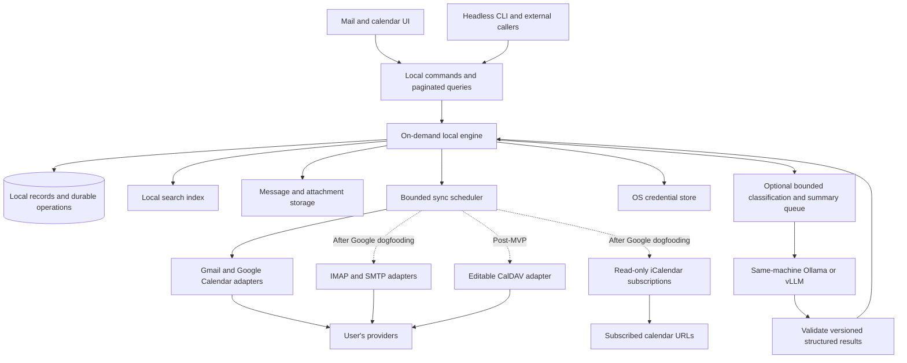

# Core and storage

## D220 — account From names (Core107)

- **Schema 42** (migration 042 and the fresh schema): `account_metadata` gains `from_name` (the person's choice, `''` when unset) and `gmail_from_name` (Gmail's send-as display name for the primary address, `''` when Gmail has none). Existing accounts upgrade with both empty.
- **The name mail goes out under** is `from_name`, else `gmail_from_name`, else the display name unless it equals the address (case-insensitively), else none (the From header is the bare address). New drafts, unsaved replies and copied Gmail drafts record it as `from_name` when first made, as before.
- **Requests.** `account_update` takes an optional `from_name`: at most 80 characters with no control characters, trimmed; `''` follows Gmail. Left out, it keeps the saved one. `accounts` rows add `from_name` and `default_from_name` (what is used while `from_name` is empty).
- **Sync.** `Store::google_send_as_name` stores the Gmail name and bumps the store revision when it changes; it never changes the metadata revision, so an open Edit account dialog doesn't go stale.

Consumers: Gmail48, Mail UI161, CLI68, Quality98; fixtures live0/demo3 and protocol1 unchanged.

## D219 — OpenPGP audit fixes (Core106)

- **Import preview and conflicts.** `pgp_key_import` takes optional booleans `preview`, `public_only` and `replace` (anything else is `invalid_request`). `preview` isn't a mutation (no `request_id`): it returns `{keys, revoked, conflicts}`, each key `fm_pgp::inspect` plus `action` `add` or `update`, lists a secret key without unlocking it, and stores nothing. `public_only` refuses a file holding a secret key with `secret_key_not_allowed`. A conflict is `{address, fingerprint, holders, own}`: an address a key in the file gains that another stored key has (`holders`), or one of the profile's account addresses when the key isn't an own key (`own`). Without `replace`, conflicts fail with `pgp_key_conflict` (`details.conflicts`).
- **Key order.** `pgp_keyring` reads keys in insertion order (`rowid`), and an address encrypts to the usable key stored last. Keys new in one import are inserted oldest first by creation time.
- **Cleaning and size.** `fm_pgp::merge` keeps only verified signatures made by the primary key (`fm_pgp::clean`); a stored key over `fm_pgp::MAX_KEY_BYTES` (1 MiB) is `limit_exceeded`.
- **Export to a file.** `pgp_key_export` takes an optional absolute `path` and `replace`; a relative path is `invalid_request`. `PgpPlan::export_path` hands it to the engine, which writes the file. `Store::handle` refuses a plan with a path (`invalid_request`), as only the engine writes key files.
- **Sending.** The signed or encrypted entity starts with copies of the message's header fields other than `MIME-Version` and `Bcc`, its `Content-Type` marked `hp="clear"` (signed) or `hp="cipher"` (encrypted, with an `HP-Outer:` line per copied field). The outer header is unchanged. A signature inside encrypted mail names every recipient's primary key fingerprint unless a recipient is Bcc.
- **Reading.** `pgp` adds `unprotected` (inline armor with text or files outside its block; the text is left out) and `headers` (`{subject, altered}` from RFC 9788 header protection, or null); each signature adds `forwarded`. Only binary and text signatures count; others are `bad`.
- **Signed files.** Sync treats as plumbing only the detached signature of `multipart/signed` (a direct child after the first, `application/pgp-signature`) and the version and payload parts of `multipart/encrypted` (direct children). `repair_pgp_messages` runs a second one-time pass (`pgp_attachment_repair`) that restores attachment rows for files inside signed mail that the first pass dropped, bumping message and conversation revisions.
- **Encrypted replies.** A reply (not a forward) to encrypted mail starts with `pgp_encrypt` whether or not every recipient has a key; encrypt by default still needs every key. Draft projections add `replies_to_encrypted`.

Consumers: fm-pgp, the engine's keyring runtime, Mail UI160, CLI67, Platform28, Quality97; schema 41, fixtures live0/demo3 and protocol1 unchanged.

## D218 — Encrypted mail read on request, recipient-aware Encrypt, Gmail-rewritten PGP/MIME (Core105)

- **Sealed reads.** `message_source` and `message_html` take an optional boolean `decrypt` (default false; anything else is `invalid_request`). Without it encrypted mail isn't decrypted and no secret key is unsealed: `pgp.decryption` is `{state: "sealed", recipients, can_decrypt}`, where `can_decrypt` says one of the profile's own keys or subkeys is among the recipient key IDs (or a recipient is anonymous). There are no signatures, attachments or decrypted text, and `message_html` reports no HTML. Signed mail is checked either way. A decrypted view memoised for `message_html` isn't handed to a sealed read. `message_image` and `attachment` always decrypt: their ids come from a decrypted view. `google_sent_message` (a send's own frozen copy) still decrypts.
- **Gmail's rewrite.** Gmail delivers PGP/MIME encrypted mail as `multipart/mixed` with the armored message in a text part ([research](../research/openpgp.md#through-real-gmail)). Inline decryption whose plaintext is a MIME entity (it starts with a `Content-*` or `MIME-Version` field and has a header block) reads it as PGP/MIME does: the entity under the outer headers, a signed entity inside unwrapped and checked; `pgp.inline` is false.
- **Draft defaults.** A new draft, the unsaved reply `draft_get` projects for a conversation (revision 0), and a discarded draft reopened all take their account's defaults: `pgp_sign` when it signs by default; `pgp_encrypt` when it encrypts by default or the draft replies (not forwards) to encrypted mail, but only when there is at least one recipient and every To, Cc and Bcc address has a key that can encrypt now (`Store::pgp_can_encrypt_to`). Otherwise the draft starts unencrypted. Saved drafts keep their own choices.

Consumers: fm-pgp, the engine's message reads, Mail UI159, Quality96; schema 41, fixtures live0/demo3 and protocol1 unchanged.

## D217 — OpenPGP keyring, signed and encrypted mail (Core104)

- **Schema 41** (migration 041 and the fresh schema): `pgp_keys(fingerprint, public_key, secret_key, origin, added_at, updated_at)` holds every key, own and other people's; `secret_key` is sealed and null for public keys. `pgp_key_addresses(address, fingerprint)` lists each key's lowercase user-ID addresses for recipient lookup. `pgp_accounts(account, fingerprint, sign_by_default, encrypt_by_default)` is each account's key, deleted with the key. `messages.pgp` records how a received message is protected: 0 none, 1 signed, 2 encrypted. Archive deletion removes an account's `pgp_accounts` row with its other rows; keys are profile-wide and stay.
- **Sealing.** Secret keys are stored only inside an AES-256-GCM envelope (`fm_pgp::seal`) under a 256-bit key-encryption key from `Store::set_pgp_kek`'s `KekSource`. The engine sets the OS keychain for live profiles and a private profile file for demo profiles; without one (`NoKeychain`) secret keys can be listed but not used (`store_unavailable`). Secret keys are never written with a passphrase or in the clear.
- **Requests.** `pgp_keys`, `pgp_key_generate`, `pgp_key_import`, `pgp_key_export`, `pgp_key_expiry`, `pgp_key_delete` (profile-wide) and `pgp_account`, `pgp_recipients` (account-scoped) follow begin (`Store::pgp_begin`, a keyring snapshot), prepare off the writer (`pgp::pgp_prepare`) and finish (`Store::pgp_finish`). Mutations need `request_id`; receipts are profile-wide in `preference_operations`, fingerprinted without passphrases and with key text hashed. A key changed since the snapshot fails with `stale_keyring`. `Store::handle` runs the same steps in place for direct callers.
- **Account keys.** `pgp_account` accepts only an own key (with its secret) whose user IDs include the account's address (`pgp_key_unusable` otherwise), or `null` to stop. Generating a key with `account` makes it that account's key, signing by default. Account rows carry `pgp: {fingerprint, sign_by_default, encrypt_by_default, status, expires_at}` or `null`.
- **Drafts.** Routing keeps `pgp_sign` and `pgp_encrypt` when true; `draft_save` takes them as booleans and keeps the saved ones otherwise. A new draft signs or encrypts as its account's defaults say, and a reply (not a forward) to an encrypted message starts encrypted. Drafts with `pgp_encrypt` are excluded from the Gmail upload due query, and `google_draft_sync` refuses them with `pgp_draft_local`.
- **Sending.** `google_send_begin` checks the draft's flags: no account key is `pgp_not_set_up`; encrypting to an address with no key is `pgp_recipient_key_missing` with `details.addresses`. `prepare_google_send` then signs (`multipart/signed`) or encrypts (`multipart/encrypted`, signed inside when signing is on) the built MIME, encrypting to every recipient's usable keys, to Bcc recipients anonymously and to the sender. A recipient whose keys can't encrypt any more fails with `pgp_recipient_key_unusable`; nothing is sent unprotected instead. The frozen blob is the protected message, and an encrypted send's journal keeps no body preview.
- **Sync.** `prepare_message` records `pgp`, leaves PGP/MIME plumbing (the encrypted payload and version part, the detached signature) out of attachments, and keeps inline armor out of the stored body and search text (`fm_pgp::readable_text`). `repair_pgp_messages` does the same once, in batches, for mail stored before.
- **Reading.** `message_source`, `message_html` (with its inline images) and `google_sent_message` open protected mail with a keyring snapshot, in memory: they read the decrypted or unwrapped message in place of the source and add `pgp: {encrypted, inline, decryption, signatures}`; `message_source` adds `pgp.attachments` for a decrypted message. `raw` stays the source as received. Decrypted HTML over 512 KiB is `too_large` rather than written to the view cache, and a view that couldn't be decrypted isn't memoised. `attachment` accepts those `pgp:<message>:<index>:<size>:<sha256>` ids, decrypts again and refuses a part that doesn't match its size and hash. Conversations and list rows carry `pgp` (`"signed"`, `"encrypted"` or null).
- **Decrypted files.** Files that must exist for the reader or another application go under `<profile>/decrypted/`, never the image cache or `exports/`: a decrypted attachment opened or previewed (`decrypted/exports/`, with the same verification and downloaded mark as other exports) and the inline pictures and attachment previews of decrypted mail (`ViewCache::store_decrypted`, `decrypted/images/`). `pgp::forget_decrypted` deletes the folder; the engine calls it as it starts and as it stops.

Consumers: fm-pgp, the engine's keyring runtime, Mail UI158, CLI66, Gmail47, Search12, Platform27, Quality95; schema 41, fixtures live0/demo3 unchanged, protocol1.

## D216 — HTML forwards send the original as received (Core103)

- `draft_create` takes an optional `forward_format`, `html` or `text` (the default); anything else is `invalid_request`. With `html`, a forward of a message that has an HTML part (`fm_mail::html_view::html_part`, at most 512 KiB) records `forward_html: true` with its routing and quotes nothing: the body is the author's (the signature, if any). A message without such HTML forwards as text, as before. Saves keep `forward_html`; it is projected with the draft.
- `composition::compose_prepared` builds the MIME for sending, Gmail draft upload and capture. For an HTML forward it reads the verified source again and adds, after the author's HTML (their text becomes HTML when they used no formatting): a `gmail_quote` block with the forwarded-message header (From, Date, Subject) and the original's `<style>` blocks and `<body>` content, unchanged. The plain alternative gets the same header and the original's text quoted with `> `, cut at 256 KiB. The inline parts its HTML shows through `cid:` go along with their own Content-IDs, as many as the 25 MiB and 50-file limits allow. A source that no longer has that HTML fails with `content_unavailable`.
- `fm_mail::ComposeRequest` adds `forwarded_html`: sent after the sanitised authored HTML and signature, outside the authored-HTML allowlist, and refused (`ForwardedWithoutHtml`) without `body_html`. `fm_mail::bare_id` is public.

Consumers: Mail UI157, CLI65, Gmail send and draft upload. No schema, fixture or protocol-version change; `forward_html` lives in the draft's routing JSON.

## D215 — forwards open with room to write (Core102)

- `draft_create` in `forward` mode starts the body with two empty lines even when the account has no signature: `"\n\n"` + forwarded text, or `"\n\n"` + signature + `"\n\n"` + forwarded text as before. Before, an unsigned forward began with the "---------- Forwarded message ----------" line, leaving nowhere to type above it. A new message or reply without a signature still starts empty.

Consumers: Mail UI156, CLI `draft create`. No schema, fixture or protocol change.

## D214 — Today in Done date groups (Core101)

- With `month_zone`, `done_week_start` and `today`, `conversations` assigns the `today` Done key before testing `week` and `month`. Membership compares local calendar dates, including daylight-saving days, using the conversation's latest message.
- `done_months` orders `today`, `week`, `month`, older months and `undated`; Today is excluded from the week count. `collapsed_months` accepts `today`; folding it removes its rows from paging and expanded counts while preserving full group counts. `open_months: []` leaves Today expanded.
- `view_save.collapsedSections` accepts `done:today`. It is a fixed date section, so it is not an `openSections` older-month key. Existing query parameters already include the date in the page/cache scope.

Consumers: Mail UI155, `conversations` callers and saved account views. Schema, live0/demo3 fixtures and protocol1 unchanged.

## D213 — foreign-content parsing and calendar output priority (Core100)

- The HTML cost guard follows `font` tags with a `color`, `face` or `size` attribute out of SVG or MathML, including empty and valueless attributes. Following HTML tags do not gain foreign-content self-closing behavior. Over-budget input uses the existing limited text view.
- Within one calendar projection, the response rank and master order used to admit 128 recurring series also decide which events spend the 1,000-occurrence output budget. This includes single events. Final presentation still sorts by time and truncated coverage remains incomplete (Calendar48).

Consumers: `fm_mail` sanitizer, text extraction and unsubscribe link scan; Core calendar projection, combined Calendar and legacy calendar query. MIME fixture1, demo fixture3, schema and protocol unchanged; sanitizer version6.

## D212 — bounded HTML parsing, ranked calendar series, confirmed unsubscribe (Core99)

- **HTML parse cost.** Before any HTML parse, `fm_mail` estimates the parser's work in one linear pass (open elements over 512, attributes per tag over 512, or more than 10 million estimated steps fail it). Failing HTML becomes a text-only view with `limited` set: no links, images or resources. Text extraction for search, previews and the reader copy reads at most the first 1 MiB of HTML and strips tags linearly when the estimate fails. The unsubscribe link scan walks the tree without recursion. Sanitiser version 6 (also caps floats at 200 and background sizes at 4000 px / 20 em) rebuilds cached views.
- **Sender check.** Gmail's `Authentication-Results` is split respecting quoted strings; an unclosed quote or comment trusts nothing. A method reported more than once takes its first non-pass result; a DMARC pass counts only for the From domain; `verified` is false whenever DMARC fails. `SenderCheck::owns_address` replaces `vouches_for` for unsubscribe (Gmail46).
- **Unsubscribe.** The reader's unsubscribe data for an email carries `address`, `subject` and `body`; a one-click entry carries `mailto: {address, subject, body}` or null. `check_confirmed` refuses an email whose confirmed address differs.
- **Calendar series budget.** The 128-series projection keeps series by rank, then first-seen order, then event id: rank 0 when the user organizes, accepted or said tentative, or has no invitation; rank 1 unanswered invitations; rank 2 declined. Event ids a sender chooses no longer decide which series show (Calendar47).

Consumers: Mail UI154, Gmail46, Calendar47, CLI64. No schema, fixture or protocol-version change.

## D211 — reply and forward subjects on one line (Core98)

- A reply or forward subject built from received mail (`draft_create`, a legacy reply's first save or capture) passes through `composition::one_line_subject`: each run of whitespace holding a control character (line break, tab) or U+2028/U+2029 becomes one space, or nothing at either end. Other spaces stay as written. Received subjects can decode to such breaks, which `draft_save` refuses, so replying to them used to fail with "Subject must be one line of at most 8192 bytes".
- `draft_save` still refuses a subject with a control character.

Consumers: Mail UI153, CLI. No schema, fixture or protocol change.

## D210 — sender verdicts, image previews, downloaded marks (Core97)

- `message_source` adds `sender_check` from `fm_core::message_source::sender_check`: `{checked, verified, spf, dkim, dmarc, from_domain, warnings: [{code, text}]}`. It reads only the topmost `Authentication-Results` header, and only when its service is `mx.google.com`; mail-parser's `header_raw` returns the last copy of a header, which a sender can write, so the headers are walked in order. Comments are dropped before parsing. `verified` is DMARC `pass`, or a passing DKIM signature whose domain is the From domain or a parent or child of it. Warning codes: `dmarc_fail`; `unauthenticated` (neither SPF nor DKIM passed, when DMARC did not fail); `name_address` (the display name holds another address); `lookalike_domain` (a non-ASCII or `xn--` label in the From domain). Without Gmail's header nothing is verified and no verdict warning is given.
- `attachment {id, preview?}`: with `preview: true` an available attachment returns `preview_path`, `width` and `height` instead of `path` and `sha256`. The path is a PNG made by `fm_mail::image_view::normalize_image` and cached under the view cache by content hash, or the reply has `preview_error` (`unsupported`, `too_large`, `invalid`). Attachments over 64 MiB are `too_large` without being read. `normalize_image` now applies EXIF orientation before scaling.
- Every file handed to other applications is marked as downloaded from the internet: exports under `exports/` (newly made or reused) and fetched remote attachments. On macOS this is `com.apple.quarantine` = `0081;<hex time>;fuckMail;`, kept when already present so a Gatekeeper approval survives; on Windows a `:Zone.Identifier` stream with `ZoneId=3`; Linux has no mark. Failing to set it fails the export.
- **HTML view, sanitiser version 5.** Output is bounded for litehtml, which matches selectors by backtracking and pads table grids:
  - element depth 128 (deeper text stays as text);
  - `colspan`/`rowspan` at most 100 and only on `td`/`th`, `span` only on `col`/`colgroup`;
  - 100,000 grid cells per message across all tables, counted as litehtml places cells; a table over it loses its spans, then its grid (its text stays, rows end with ` `);
  - 200 elements that inline CSS makes another kind of table part;
  - 5,000 selectors, 12 compounds per selector;
  - a matching budget: each selector's worst-case matching work over the output tree is estimated, including sibling scans, class lookups and a second match when `@media` rules exist, and selectors past 10⁷ units (about 70 ms) are dropped in document order.
  - output that parses back into the same tree: a `p` holding a block is written as a `div`, and an `li`/`dd`/`dt`, heading or `a` that would end an open one is unwrapped; the cost estimate runs on a reparse of the output, and output that still reparses larger keeps only its text;
  - 2×10⁷ litehtml row scans per message for table placement.
  Each cap sets `limited`. Ordinary newsletters are unchanged.
- The GUI marks blocked links with one `data-fm-blocked` attribute and styles them with one rule, rather than a rule per link.
- `unsubscribe::resolve` and `resolve_mailto` offer a `mailto:` entry only when its domain matches a domain Gmail authenticated for that message (`SenderCheck::vouches_for`): a passing DKIM signer, the envelope domain when SPF passed, or the From domain when DMARC passed, or a parent or child of one of them.

Consumers: Gmail45, Mail UI152, Platform26, CLI. No schema, fixture or protocol change.

## D208 — quoted history on request (Core96)

- `message_html` and `message_image` accept an optional boolean `quotes`. With `quotes: true` the sanitiser keeps quoted reply history (`fm_mail::html_view::sanitize_with_quotes`); the result echoes `quotes`, reports `quote_removed: false`, and numbers resources and links over the whole document. Manifests are memoised per source version and `quotes`; inline images and `html_path` files of that view have their own cache names. A non-boolean `quotes` fails `invalid_request`.
- `message_source` adds `body_full`, the whole reading text with quoted history (`>` per blockquote level for HTML), cut at 256 KiB, and `full_truncated`. It is empty when it would equal `body_text`. Under reply-size pressure it is halved with the other parts.

Consumers: Mail UI151, CLI `mail source` (passes the field through); no schema, fixture or protocol change.

## D207 — recipient suggestions carry mail each way (Core95)

- Each `recipient_suggestions` row gains `sent` and `received`, counted in the account the row names. `received` is every cached message from the address (trashed included), through `messages_sender`. `sent` is every cached message with `sent=1` from the account's own address that names the address on From, To or Cc, from the people index; mail the index has not reached yet is not counted.
- Rows sort by `sent + received`, highest first, then by the existing match strength and account preference, then name and address.
- Sent counts are walked once per account and kept in memory until the people index moves on or five minutes pass; received counts are read on every lookup. No schema change.

Consumers: GUI `RecipientField`; `fm mail recipients`; recipient suggestion tests.

## D205 — motion preference (Core94)

- Preferences gain `motion`: `system` (default), `full` or `reduced`; any other value is refused with `invalid_request`.

Consumers: GUI Settings and `Theme`; preferences tests.

## D204 — reviewed mail preference (Core93)

- Preferences gain `review_leave_seconds`: 0, 5, 10 (default) or 30; any other value is refused with `invalid_request`.

Consumers: GUI Settings and `MailBackend`; preferences tests.

## D200 — blocked messages settle; label linking in parts (Core92)

- Sync progress counts `source_blocked` messages as undownloadable, beside `item_too_large` and `malformed_response`.
- `google_labels_merge` links at most one new label, or applies one pending projection part, per call and returns `more`; a call that links nothing returns `more:false` with the complete `skipped`, `pending` and `missing`. `pulled` and `renamed` count that call only. Category projection is durable and bounded; see the D050 paragraph below.
- `google_category_bind` and `google_label_create_finish` apply only the first part before returning. Their receipts are unchanged.
- No schema change.

Consumers: engine label sync, first import and label worker; `google_category_bind` (GUI and CLI); Gmail44.

## D198 — the shortcut bar preference (Core91)

- `key_hints` (boolean, default true): whether the GUI shows the shortcut bar along the bottom of the window. Any other value is `invalid_request`.
- No schema change.

Consumers: Mail UI143, CLI63.

## D194 — draft reply routing is bracketed (Core90)

- A draft's `reply_to_message_id` and `references` hold Message-IDs in angle brackets, including drafts mirrored from Gmail. `compose_request` brackets any bare ID it finds, so drafts stored bare by earlier versions still send.

Consumers: Gmail draft mirror and inventory preview, send, capture and draft upload; Core tests.

## D192 — changed conversations are re-read, not rebuilt (Core89)

- Conversation states (counts, groups and list order for `accounts`, lists and search) re-read only the changed conversations while they number at most 512 or a quarter of the account, and rebuild from every message otherwise.

Consumers: `accounts`, conversation lists and counts; Core tests.

## D191 — bounded spam lookups and statistics (Core88)

- Dropping one Gmail Spam message (`forget_spam` with a remote ID: a history or listing outcome labelled SPAM, or a completed Move to Spam) selects it by `(account, remote_id)`. Only the once-per-profile cleanup scans for the SPAM label.
- The store connection sets `PRAGMA analysis_limit=1000`, so `PRAGMA optimize` at open, during sync and on close samples indexes instead of reading them whole.

Consumers: mail sync and mail changes in the engine; Core tests.

## D187 — a message antivirus blocks (Core87)

- A downloaded Gmail source whose blob cannot be verified once written is recorded for that message alone: coverage `source_state='unavailable'`, issue `source_blocked`, no message row. Other messages on the page publish and the page completes. Any other staging failure still fails the part.
- Like other issues, a `source_blocked` row is not retried within its generation: it stays unavailable (blocking offline completeness), and the reconciliation pass after the next generation downloads it again. Progress counts it as undownloadable (Core92).

Consumers: Gmail, Quality. Schema, fixtures and protocol unchanged.

## D183 — forwards keep their files and stay in their thread (Core86)

- **`draft_create`** in `forward` mode starts `attachment_ids` with the source message's `available` attachments in part order, up to 50 files and 25 MiB; a file that would pass 25 MiB is left out. This replaces Core12's "no implicit attachment selection" for forwards. Reply and reply-all start with none. Saves check them like any selected attachment.
- **`google_sent`** with `conversation_id` includes forwards whose source is in that conversation, and a forward's row carries that `conversation_id`, as a reply's does. D067's filter named only replies.

Consumers: Mail UI131, CLI62. Schema, fixtures and protocol unchanged.

## D182 — starred contacts (Core85)

- **Preferences** add `starred_senders`: up to 2,000 distinct `{account, email}` entries with lowercase addresses, validated like `html_senders`. Default `[]`. A save replaces the whole list. Starring changes only how the GUI marks a sender; it is not a message star and does not affect Done, Delay or counts.

Consumers: Mail UI130, CLI61. Schema, fixtures and protocol unchanged.

## D167, D168 — Done by week and month, folded older months, dangling view keys (Core84)

- **`conversations`** accepts `done_week_start` (a lowercase weekday) and `today` (`YYYY-MM-DD`), together and with `month_zone`. Done then groups as `week` (latest message on or after the most recent `done_week_start` through `today`, and later), `month` (the rest of `today`'s month), then `YYYY-MM` and `undated`. `done_months` lists them in that order.
- **`open_months`** (at most 256 unique older-month keys, requiring the week fields) folds every older month and `undated` not listed. `collapsed_months` also accepts `week` and `month`. Folded rows leave paging and `expanded_conversation_count`; `done_months` keeps full counts. Each row's group is worked out once per query.
- **Preferences** add `mail_week_start` (a lowercase weekday, default `monday`), separate from Calendar's `week_start`.
- **`view_save`** accepts `openSections` (at most 256 unique `done:YYYY-MM` or `done:undated`); `collapsedSections` also accepts `done:week` and `done:month`. A saved view naming a conversation, `selectedMember` or `selectedDraft` that no longer exists is `not_found` with `details.view_key`, and the engine passes that one detail to the client.

Consumers: Mail UI116, Mail UI117. Schema, live/demo fixtures and protocol1 unchanged.

## D162 — carried lanes and settled listings (Core83)

- **`change_mail_retention`** advances `mail_generation` and clears pages and page items as before. It then calls `carry_mail_lanes`. When that returns false, lanes are deleted as before.
- **`carry_mail_lanes(db, account, generation, next, since)`** needs all three lanes and a history place: `Delta` or `CatchUp` start, or `Idle`'s committed history ID. It rewrites the lanes for `next` (Gmail42) and moves coverage rows kept whole (retained, indexed, attachments complete, no issue) from `generation` to `next`. Coverage metrics are recounted.
- **`google_live_skip_current(page)`** returns 0 for a complete page, a delta-lane page, a non-`Full` phase or an empty fetch list. Otherwise, in one transaction, it records each listed message kept whole at the page's generation as an applied fetch item, and for inventory pages sets its `last_inventory_generation`. It returns how many it settled.
- **Coverage** adds `unchecked`: rows not deleted, below the current generation and without an issue.

Consumers: Gmail42, engine mail sync, account and profile JSON, CLI60, Mail UI112; Quality89. Schema 40, live0/demo3 and protocol1 unchanged.

## D160 — block-aware reading text (Core82)

- **Reading text from HTML:**
  - Block elements end lines and paragraphs are a blank line apart.
  - Inline runs keep one space between them.
  - List items get `•` or `N.`, and table cells are separated by a space.
  - `pre` keeps its whitespace; byte-order marks and zero-width spaces go.
  - Each blockquote level prefixes `> `. A blank line takes the shallower of the levels around it.
- **Where it applies:** new mail's stored reading copy, search text, composer quotes and remote reads. Stored copies of older mail are not rewritten.
- **Source reply:** `message_source` adds `body_text` (the reading text as this build extracts it, cut at 256 KiB) and `text_truncated`. When the reply must shrink, the longest of raw, HTML and text is halved.
- **Previews:** list previews drop `>` marks at line starts.

Consumers: Mail UI111, CLI59 `mail source`, Quality87; schema 40, live0/demo3 and protocol1 unchanged.

## D159 — whole Gmail messages and draft sources first (Core81)

- A blob may be as large as the largest Gmail source ([`MAX_RAW_MIME`](../../crates/fm-google/src/gmail_api.rs), 160 MiB). This replaces the 64 MiB blob bound; exact size/hash checks and path protections are unchanged.
- A received message may list up to 500 attachments (Gmail's limit). Inline `cid:` images are still part of the body.
- `google.sync.undownloadable_messages` counts undeleted messages with no retained source that will not download: `item_too_large`, `malformed_response`, or `source_blocked` (the written source was removed or altered on this machine, as by antivirus; Core92). They are settled for progress and still block offline completeness.
- Migration 039 keeps only a Gmail draft source's link to its linked local draft as a foreign key, so a source can be written before the draft that mirrors it.
- Migration 040 is data-only. It marks undeleted `item_too_large` and `attachment_limit` coverage rows unseen (`observed_generation=0`), so the next reconciliation pass fetches or re-prepares them.

Consumers: Gmail41, Mail UI110, CLI account JSON, Quality86; schema 40, live0/demo3 fixtures and protocol1.

## D158 — independent UI refresh generations (Core80)

`status.ui_generations` adds an opaque store-open `epoch` and nonnegative counters for `accounts`, `categories`, `reader`, `drafts` and `captures`. They describe projection dependencies across the whole store, not individual accounts or conversations. Existing calendar/mail generations and preference revisions remain authoritative for their areas.

The existing SQLite update hook advances these counters in memory. Account counters also follow metadata writes because last-sync timestamps live there. Draft delivery updates invalidate drafts, and conversation changes invalidate capture subjects retained by legacy receipts. Unknown tables, writes missed by row hooks, and reads inside/after transactions conservatively invalidate every area. Reopening changes the epoch. No additional scans, persistent counters or schema migration.

Consumers: Mail UI109, CLI58 and engine status; Quality85. Schema, live0/demo3 fixtures and protocol1 unchanged.

## D156 — progress reuse and one verified read (Core79)

- Model-progress counts may reuse a bounded in-memory result for unchanged mail, provider state, model results/failures, account state, policy and history/catch-up bounds. Calendar-only writes and unrelated global revisions preserve it. Session/job status remains freshly assembled by the engine. Transactions, rollback and missed row hooks conservatively invalidate counts; no persisted counters or schema changes.
- A blob read returns the bytes verified from one regular-file handle. Preserve the 64 MiB bound, exact size/hash validation and path protections. Received staged replay parses and verifies attachment references from this same verified source, with no preliminary full-file verification pass.
- The existing counting SQL, durability and flat blob layout remain unchanged. Changing mail can still cause a full progress scan.

Consumers: Gmail40, engine progress/status, source/attachment readers, composition, indexing and retention conversion. Quality83; live0/demo3 fixtures and protocol1 unchanged.

## D154 — HTML senders (Core78)

- Preferences gain `html_senders`: up to 2,000 distinct `{account, email}` entries with lowercase addresses, validated like `remote_images_from`. Default `[]`, so all mail is plain text until a sender is added.
- `message_format` is retired: saves naming it are refused, and a stored value is dropped on read (like `mail_date_grouping`).

## D152 — received attachment sources and disposable exports (Core77)

- Schema38 adds `attachment_sources(account,id,source_hash,part_index)`, keyed by the attachment's account/id with cascading deletion. The source hash is a retained original MIME blob and the position is in the parser's attachment sequence, including skipped inline parts. Attachment `blob_hash` remains the expected decoded checksum; `available` includes bytes extractable from a retained source.
- Received acquisition hashes decoded parts without writing separate blobs. Resuming a staged import verifies source and attachment checksums before publication. `attachment_begin` captures the source reference; its worker extracts/verifies the part and publishes the same reply/path shape as before. Saves, capture, send, transfer and invitation history use the same source resolver.
- Local imports, observed draft parts and outgoing MIME remain durable blobs. A draft-referenced received attachment is detached from its message before retention/deletion removes that message; its source reference keeps the original alive. An account transfer stages independent durable selected bytes before destination publication.
- Export copies have a 512 MiB target, oldest use first. Each successful export refreshes its use time. Five-minute grace and locked files defer deletion; recent/locked bytes may exceed the target until a later sweep. Sweep off the writer every minute, and at most once per minute during exports. User-selected saved files are never evicted. Paths returned by a later request regenerate offline as needed.
- `attachment_migration_begin/prepare_migration/attachment_migration_finish` convert older records one message at a time with source/hash/size checks and transactional rechecks. A durable rowid cursor resumes after interruption. Corrupt/missing/unmatched originals leave their standalone files alone. Removed duplicates use the existing startup cleanup queue; checksum-only references of source-backed attachment rows do not retain a decoded blob, while their source hashes and all other consumers still do.

Consumers: Gmail39, Mail UI105, unchanged CLI, composition/send/draft transfer, invitation history and archive/retention cleanup. Live0/demo3 fixtures and protocol1 unchanged.

## D149 — attachment exports off the writer (Core76)

- `Store::attachment_begin(account, {id}) → AttachmentPlan` reads the attachment row on the writer. `AttachmentPlan::export()` makes the verified copy on a worker. The `attachment` method's reply is unchanged.
- An export copies and hashes the retained blob in one pass. A copy verified earlier in the same process, with the same size and modification time, is returned without reading it again.
- Imported attachments whose type is unknown get one from their extension (`fm_mail::attachment_mime`).
- `google_sent_message` attachments carry the draft attachment's `id` and `state` when name and size match.
- No schema change.

Consumers: Gmail37, Mail UI103.

## D147 — deleted-message markers (Core75)

- `google_forget_deleted` now leaves a coverage row with `deleted = 1` for each given ID no longer stored here, including IDs never stored. It then recounts the account's coverage totals, `unavailable` included. A message kept for an open draft keeps its coverage.
- `google_live_pending` items gain `deleted`: a fetch whose coverage says deleted, which the engine records missing without a request.
- `google_trash_stored(account) → u64` and `google_trash_leftovers(account) → (ids, oldest Unix seconds)`. The leftovers are the Trash messages stored here that no pending, in-flight or reconciling mail change uses.
- No schema change.

Consumers: Gmail36.

## D145 — new-mail pages (Core74)

- `google_live_new_mail_page(account, listed) → Option<PagePlan>` plans a fetch-only page on the finished recent lane. It covers the listed IDs (at most 5,000) that have no `google_mail_coverage` row. The plan keeps the lane complete and its phase unchanged. It returns `None` when every ID is known, and fails with `stale_google_work` while the recent lane is unfinished.
- Page validation accepts such a page on the recent lane, as it does the inventory's reconciliation pages.
- `google_live_record_sync(account)` sets `last_mail_sync:<account>` to now and advances the store revision. It runs once the newest mail is held, even while a history scan is still applying older changes.
- No schema change.

Consumers: Gmail35.

## D144 — two preferences, one retired (Core73)

- `show_draft_chips` (boolean, default true): whether Mail shows the account's draft chips bottom-right.
- `calendar_recent_searches` (default `[]`): Calendar search's Recent, newest first. At most six distinct strings, each non-blank, one line, at most 512 bytes, with no control characters.
- `mail_date_grouping` is retired. A stored value is dropped when preferences are read, so the next save removes it, and a save naming it is `invalid_request`.
- `calendar_search` reads its query as Calendar38 describes. No schema change.

Consumers: Mail UI99, Calendar38, CLI56.

## D137 — the inventory's count (Core72)

- `google_mail_count(account) → Option<(counted, complete)>` and `google_mail_count_record(account, generation, counted, complete) → bool`. They use three `meta` keys: `mail_count_generation:`, `mail_count_messages:` and `mail_count_complete:` plus the account ID. There is no schema change.
- A count belongs to the account's `mail_generation`. It is not reported once the generation moves on, and a record for an older generation writes nothing and returns false. Each record advances the store revision.
- `GoogleMailCoverage` gains `listed` (the finished count) and `listing` (the count so far). The account's `google.sync` gains `inventory_total` and `inventory_counting` (numbers, or null).
- Deleting an archived account removes the three keys with its other per-account `meta` keys.

Consumers: Gmail34, Mail UI98.

## D127 — invitation emails, optional proxy credentials (Core71)

- **`message_invite {id, source_version}`**: account-scoped and read-only in synthetic and live profiles. It makes no provider calls and no writes. Errors are the same as `message_source` (`not_found`, `stale_source`), plus `invalid_request` for unknown fields.
  - The writer picks bounded inputs, a worker parses the retained blobs, and the store links the event.
  - It returns `{invite: null}` without a usable calendar part. The first text/calendar part is used; failing that, an application/ics or `.ics` attachment.
  - Otherwise it returns `{invite: {uid, method, sequence, recurrence_id, summary, start, end, all_day, was_start, was_end, was_all_day, event}}`.
    - `start`/`end` come from the linked event when there is one, else from the invitation. They are RFC3339 UTC or `YYYY-MM-DD`, and null when neither has a usable time.
    - `event` is the combined Calendar's own projection row for the same account's `calendar_sources` with that iCalUID, not cancelled. A calendar where the account is a guest beats a shared copy.
    - A RECURRENCE-ID selects that occurrence. A series invitation without one gives the next occurrence (up to four tries), else the first.
    - `event` is null without a display zone, for busy-only rows, and for a RECURRENCE-ID that is not an occurrence.
  - `was_*` comes from the most recent earlier invitation for the same UID and RECURRENCE-ID whose DTSTART differs, for a REQUEST only. Earlier candidates are up to 30 from the conversation and 30 from the sender, each with a calendar attachment row.
  - The parser (`message_invite::ics`) handles:
    - folding, escapes, VALUE=DATE and DURATION;
    - TZID through `fm_calendar::Tz`, with VTIMEZONE definitions and common Windows zone names;
    - hostile input, which gives null rather than an error.
- **`message_source`** adds `has_invite` (the same detection).
- **Proxy credentials are optional.** Image and sender-picture fetches send basic auth only when the proxy has a username or a saved password. With no vault password the proxy is asked without credentials instead of failing `no_password`.

Consumers: Mail UI93, Calendar37, CLI54.

## D126 — draft copies kept in place, upload quiet time, Reply-To, sender pictures (Core70)

- **Earlier read-only draft copies** (`origin google_snapshot`):
  - Publishing the mirror updates the copy's row in place: `origin local`, `discarded 0`, revision +1, and the Gmail twin adopted. Rows that point at it stay valid.
  - `retire_legacy_snapshot` marks a copy whose Gmail draft is gone as `discarded 1`, rather than deleting it. Later scans leave it alone.
- **Upload quiet time.** `google_draft_due_after(account, generation, limit, quiet_ms)` returns a draft only when:
  - its Gmail state is prepared or acknowledged (resuming an operation), or
  - its text was last saved `quiet_ms` or more ago.

  `google_draft_due` is the zero-quiet form.
- **Reply routing.** Imported-message replies (`legacy_routing_at`, `prepare_after_import_metadata`) fall back to the sender, or to the original To for your own message, only when the source routing names no recipient. Reply-To wins.
- **Preferences.**
  - `calendar_show_declined`: boolean, false by default.
  - `sender_pictures`: boolean, true by default; it lives in the remote content settings.
- **Sender pictures.** Engine method `sender_avatar {address, kind}`, where kind is people, automated or unknown. It needs no account and returns one of:
  - `{state:"ready", path, width, height, source:"brand"|"photo", label}`;
  - `{state:"none", label, transient?, off?}`;
  - `{state:"blocked", by}` or `{state:"proxy_unavailable", reason}`.

  How pictures are found:
  - Automated senders get Google's favicon for the root domain (two labels, three under a country code's common second level). It must be 32 px or wider, and personal-mail domains never get one.
  - People get Gravatar by SHA-256 of the address, with `d=404`. Unknown senders try the photo, then the brand icon.
  - Fetches use the image client, proxy and blocklist.
  - PNGs are shared by every account under `cache/images/senders/` and cleared with the image cache. A miss is remembered for a week, in memory and as an empty `.none` marker; network failures are not remembered.

Consumers: Mail UI92, Calendar36, Gmail33.

## D124 — stored-mail tidy, calendar series budget, zero-length events (Core69)

- `repair_inline_attachments(batch)`: removes attachment rows for images the stored source's HTML shows (`cid:`), 50 messages at a time from `messages.rowid` order, keeping rows a draft's `attachments_json` names; progress in `meta.inline_attachment_repair` (−1 when done). The engine runs it once per profile in the background.
- Calendar projection: the series query drops masters whose single RRULE has an UNTIL more than two days before the window start (no RDATE, first occurrence at most a day long) and masters starting after the window, before the 128-series budget.
- `fm_calendar::normalize` accepts a timed event whose end equals its start; all-day events still need a later end date.
- `unsubscribe::resolve_mailto(plan)`: the `mailto:` entry of `List-Unsubscribe`, if any.

Consumers: Gmail32, Calendar35, Mail UI90.

## D122/D123 — Gmail draft mirror, label toggles, Spam labels (Core68)

- **Drafts.** Core publishes each inventoried Gmail draft as an editable local draft (Gmail31) and keeps its saved source history for the CLI. Schema37's baseline drops the draft-source foreign key to `drafts` so a retired mirror can keep its sources; no migration (profiles below 37 are still refused).
- **Label toggles.** `conversations` takes `category` as up to 32 comma-separated label ids; a conversation matches when any listed label is on it (`json_each`). A `label:` term in the query replaces the list. `view_save` accepts the same list.
- **Spam labels.** `label_auto_spam {request_id, id, expected_auto_spam, auto_spam}` stores a per-account, per-label `auto_spam` policy beside `auto_read`; `labels` rows add `auto_spam`. When the local model applies such a label, the message leaves Inbox and gets SPAM/−INBOX label intents (receipt `assist-spam-{message}-{revision}`). Sent, trashed, manually labelled or already-moved messages are skipped, so "Not spam" sticks. Spam wins over Auto-read.

Consumers: Gmail31, Mail UI89, CLI53, Local assistance26.

## D120 — fresh baseline, deleting for good, restore to Inbox (Core67)

- **Baseline.** `RESET_BASELINE_VERSION` is 37 with no post-reset migrations; `fresh-schema.sql` holds everything (coverage date index, link index, people, local model failures, unsubscribes, sender index). Profiles below 37 are refused with the "start fresh" message. The schema33–36 upgrade tests are replaced by a fresh-profile index check.
- **Timeline default.** `timeline_start_hour` 0, `timeline_end_hour` 24.
- **Deleting for good.** `google_trashed_in_conversation(account, conversation)` returns the Gmail ids of a conversation's trashed messages (`not_found` when none). `google_forget_deleted(account, remote_ids)` removes those stored messages and everything derived from them through the retention purge, in one transaction, and returns how many; messages an open draft uses as its source are kept.
- **Provider deletions.** When sync reports a message deleted at Gmail it now also clears `trashed`, so it leaves Trash and stays as archived local mail; local data is still retained.
- **Restore.** `mail_filing restore` on a live profile also sets `inbox=1` on received messages and records an INBOX label intent, delivered after the untrash in the same durable operation.

Consumers: Gmail30, Mail UI87, CLI51, Calendar33.

## D118 — unsubscribes and remote threads (Core66)

Schema37 adds `unsubscribes(account, conversation_id, sender_email, method one_click|mailto|link, unsubscribed_at)`, keyed per account, conversation and lowercase sender, and the index `messages_sender(account, sender_email COLLATE NOCASE, sent_at)`. `conversation` adds `mailing_list` when its latest message is received: `{sender_email, month, year, unsubscribed: {method, at}|null}`, where month and year count that sender's received messages in the last 30 and 365 days. `message_source` adds `unsubscribe`: null or `{method, url|address}`, from `fm_mail::unsubscribe` (one-click needs `List-Unsubscribe-Post: List-Unsubscribe=One-Click` and an https URI; then mailto; then a header http(s) URI; then the last body link naming unsubscribe or opt out). `unsubscribe_begin`/`resolve`/`unsubscribe_record` serve the engine and refuse sent messages and stale sources. `google_threads_present` tells remote search which Gmail threads have a stored message. Archive deletion clears `unsubscribes` with the account's other rows. The engine's remote-content method `message_unsubscribe {id, source_version}` POSTs `List-Unsubscribe=One-Click` for `one_click` (public https only, blocked hosts refused, through the proxy when set, 2xx required; else `unsubscribe_failed` or `proxy_unavailable`), records `link` and returns its URL for the browser, and refuses `mailto`. Consumers: Gmail29, Mail UI85, CLI50.

## D117 — Inbox counts (Core65)

`accounts` rows and `account_counts` add `inbox_review_count` (conversations with an Inbox member, unread) and `inbox_held_count` (the same, starred), matching the Inbox's review and held groups. Trash and archived mail are left out. The existing all-mail counts and `count_scope` are unchanged. Consumers: Mail UI84, CLI (printed as received).

## D116 — no stored spam (Core64)

`account_retention::purge_messages` is the shared local removal of listed messages and their FTS rows, categories, attachments, provider state, intents, sender kinds, model results, mail receipts, coverage and empty conversations; blobs go through startup cleanup. Retention and spam both use it. `forget_spam` applies it to one remote message (live publication of a `Spam` item) or to every stored message whose provider labels include SPAM (`forget_stored_spam`, once per profile at open, meta `spam_forgotten`), skipping messages used by an active draft or pending mail change. Consumers: Gmail28, Mail UI83, Search, Local assistance.

## D115 — signatures are draft body text (Core63)

- `draft_get` for a new draft, a discarded one or a legacy virtual reply returns `body` = "\n\n" + account signature (empty when there is none). `draft_create` puts it before any forwarded quote.
- Stored drafts keep `signature_text` empty; every save clears it. A row saved earlier with its own signature reads with that signature appended to `body` after one blank line (and to `body_html` after `  `), so the next save stores it in the body.
- An explicit `signature_text` in `draft_save` is stored and read back the same way. MIME building joins a non-empty draft signature with one blank line and no "-- " delimiter.
- This supersedes "Capture appends the saved signature once" and the per-draft signature snapshot described below. Consumers: Mail UI82, CLI, Gmail send/upload, Quality.

## D107 — conversation people, readable previews and one message format (Core59, schema35)

**People.** Schema35 adds `people(email, name)` and `message_people`.
- The link-index pass records each message's From, To and Cc mailboxes, up to 100 per message, beside its link hosts.
- The upgrade restarts that pass from the first message, once. A message's people count once the pass reaches it.

`mail_list` rows gain two fields:
- `others`: how many distinct other people are on the conversation.
- `other_names`: up to 12 of their display names, or their addresses, in order of first appearance.

Others leave out:
- the account's address;
- addresses the account sent from in that conversation;
- the row's shown sender;
- no-reply mailboxes (`noreply`, `no-reply`, `donotreply`, `do-not-reply`, `mailer-daemon`).

Mailboxes compare lowercased and without a `+tag`. At gmail.com and googlemail.com they also compare without dots.

**Previews.** A row's `snippet` comes from readable text:
- A stored body that is HTML source (a doctype or a common element start) is converted to its text when read.
- New imports read HTML sent as a text/plain part as HTML, never indexing its markup.
- Web addresses are removed with their lead-ins, such as "(also on https://…)", their angle brackets, including an empty `<>` left behind, and leftover punctuation.

Search matching is unchanged.

**Summaries.** A row's `summary` is the current summary of the preview's message, now including a partial one (Local assistance22).

**Message format.** Preferences gain `message_format`: `html` (default) or `text`. It is validated and saved like the other enum preferences.

**HTML view.** The sanitiser is version 4. Its part choice:
1. The first non-empty `text/html` part in the HTML body.
2. Otherwise, any other part labelled `text/html`, such as a digest part or one with an unknown transfer encoding.

`message_html`, `message_source`, the link index and new imports all use this part. When removing quoted history leaves nothing visible, the quote stays. Cached views are named with the version, so they are rebuilt.

Consumers: engine, Mail UI76, CLI45 and Quality77. Fixtures0/3 and protocol1 unchanged.

## D106 — reminder identity bounds (Core58)

`calendar_reminders` and `calendar_reminder_ack` accept projected calendar IDs up to 1,024 UTF-8 bytes and serialized occurrence IDs up to 8,192 UTF-8 bytes. Validate these directly rather than first using the generic 256-byte local identifier helper. Empty, oversized and control-containing identifiers still fail. Exact account/calendar/occurrence/start receipt matching, permission checks, due windows, snoozing and dismissal remain unchanged. Consumers: Calendar31, GUI reminder polling, CLI reminder commands and Quality76. No schema, fixture or protocol change.

## D105 — HTML view, message images, link index and remote preferences (Core57, schema34)

**HTML view.** `message_html(account, {id, source_version})` is read-only and allowed for archived accounts. It reads the retained MIME directly, under the existing raw limit, and chooses the first real `text/html` part by content type. Plain-only mail returns `has_html: false`, and `message_source` uses the same choice.

The engine's `fm_mail::html_view` sanitiser (version 1) rebuilds the HTML from allowlists:
- tags, attributes and CSS properties and values;
- scoped `<style>` rules with prefixed classes and ids;
- `@media` only;
- links as `fm-link:N` (http, https and mailto only);
- images and CSS backgrounds as `fm-res:N`.

It removes quoted history unless the message is a forward, and applies the planned limits:
- 4 MiB HTML, 50,000 nodes, depth 256, table depth 16;
- 2,000 CSS rules, 256 KiB CSS;
- 500 resources, 2,000 links, 8 KiB URLs, 2 MiB `data:` URIs.

The result has:
- `too_large`;
- `html`, or `html_path` to a private cache file when over 512 KiB (the newest 16 files are kept);
- `resources[{id, kind: remote|cid|data|insecure, host?, alt, width?, height?, image?}]` and `links[{id, href, scheme, host}]`;
- `trackers`, `quote_removed` and `sanitizer_version`.

Images at most 3×3, zero-sized or hidden are counted in `trackers` and never listed. `image {path, width, height}` appears for a resource already in the image cache.

**Images.** `message_image(account, {id, source_version, resource, cached_only?})` is the only way to get an image a message refers to. It rechecks the account, the message, the current source version and that the resource belongs to that version's manifest; the newest 16 manifests are kept.
- It returns `state` `ready` (with `path`, `width` and `height`), `not_cached`, `blocked` (with `by`), `insecure`, `proxy_unavailable` or `failed` (with `reason`).
- `cid:` parts (up to 25 MiB), `data:` images and remote images are decoded in memory-safe Rust: PNG, JPEG, GIF first frame or WebP by magic bytes, at most 16 megapixels. They are re-encoded as PNG at most 1600 px wide. SVG is refused.
- Images are cached under `<profile>/cache/images/<account-key>/`, within 256 MiB in total with the oldest evicted first. Only pixels are stored.
- `cached_only` never reaches the network. `insecure` (`http://`) sources are never requested.
- The engine's remote-content runtime owns the network policy; see [Platform 19](platform.md).
- `remote_image_cache({op: stats|clear})` reports `{bytes, limit}` or clears the cache.

**Link index (schema34).** One post-reset migration adds three tables, mirrored in `fresh-schema.sql`:
- `link_hosts(id, rhost UNIQUE)`, where `rhost` is the host with its labels reversed;
- `message_link_hosts(host, message_rowid)`, which cascades on message delete, plus an index by message;
- `link_index_state(singleton, indexed_rowid)`.

An engine task indexes messages in rowid order, 100 per batch, off the writer. It reads each retained source's HTML and text links, at most 200 hosts per message, and falls back to reading text when no source is retained.
- `link_host_summary(account, {host, conversation?})` returns `{host, messages, complete}` for messages in every account outside that conversation.
- `link_pattern_counts({patterns})` returns `{counts, complete}` for normalised blocklist patterns; a `*.domain` pattern is one reversed-host range scan.

A schema33 profile upgrades once and starts indexing from the beginning. Older binaries refuse schema34.

**Preferences.**
- `blocked_hosts`: at most 1,000 unique `{pattern, source: settings|link, added_at}` entries. A pattern must already be normalised: a lowercase ASCII host without `www.`, or `*.domain`.
- `remote_images_from`: at most 2,000 unique `{account, email}` entries.
- `remote_proxy {enabled, host, port 1–65535, username ≤256}`. The host must be a host name.

The proxy password is never a preference. `remote_proxy_password({op: status|set|clear})` stores it in the OS vault and returns only `saved`.

Consumers: Mail UI74, CLI44, Platform19 and Quality75; Search7, Calendar30, fixtures0/3 and protocol1 unchanged. [Execution record](../research/html-mail.md#d105--html-reader-implementation-2026-09-24).

## D101 — search grammar, people lookup, Done months and view keys (Core56, schema33)

`conversations` and `drafts` parse the search text with the [Search 7 grammar](search.md#query-grammar-revision-7) and return `search_terms`. `conversations` rejects `is:` together with a different `status` field and `has:attachment` together with `has_attachment:false`; `label:` resolves to the account's category ID and ANDs with any `category` field. `from:` values bind as escaped `LIKE` patterns on the sender name and address, or on `recipient` in Sent; `label:` binds one category slot. Both join the existing numbered bindings, and `matching_message_ids` applies them to members.

`conversations` accepts `month_zone`, an IANA zone name, and `collapsed_months` (at most 256 unique `YYYY-MM` values, requiring `month_zone`). With a zone, each Done conversation belongs to the month of its latest message in that zone, and the response adds `done_months:[{month,count}]` over the whole filtered set, newest first, with `undated` last; without one it is `null`. A collapsed month's rows leave paging like a collapsed group and count toward neither `expanded_conversation_count` nor the page, while `done_months` keeps full counts. Cursor scope includes both fields.

`search_senders(account, {query, folder, limit})` is a read-only method on the allowlist of Core and the engine; see [Search 7](search.md#query-grammar-revision-7). `view_save` accepts two more account view keys: `recentSearches`, at most six non-blank strings of up to 512 bytes without line breaks, and `collapsedSections`, at most 258 unique values from `review`, `held`, `done:undated` and `done:YYYY-MM`. The 16 KiB view limit is unchanged. No table, index or migration changes. Consumers: Mail UI71, CLI43, Search7 and Quality72. [Execution record](../research/prototype-september-23.md#d101--fourth-export-2026-09-24).

## D098 — Calendar mail-count range and preferences revision (Core55, schema33)

Schema33 is the first post-reset migration. It adds the partial index `google_mail_coverage_by_date(account,internal_date_ms) WHERE deleted=0`, and fresh profiles create it directly. `calendar_mail_activity` reads provider coverage through that index, so counting a six-week window touches only its date range instead of the account's whole coverage. An engine at schema32 upgrades once in place; newer schemas are still refused. `status` adds `preferences_revision`, the saved preferences revision, so clients can skip reloading unchanged preferences on every poll. Consumers: Mail UI69 (GUI polling) and Quality70; CLI42 unchanged, since its `status` output only gains a field. [Execution record](../research/phase-2-calendar.md#d098--calendar-view-performance-2026-09-23).

## D097 — first label import and watcher cursor (Core54, schema32)

Binding a new account inserts `labels_initial_import:<account>` into `meta` in the binding transaction; reconnecting an existing account does not. `google_labels_initial_import` runs one bounded name-merge call with request `initial-import` while that key exists and returns its result, including `more`; the engine repeats while `more` is true. A merge call that returns `more:false` deletes the key, as does missing mail editing permission (Core92). When the import adds labels it sets the watcher's requeue bound to that account's first message. `local_model_arrivals` stores its cursor and consumes the requeue bound in `meta`. Retention pruning and account removal lower the requeue bound to the highest remaining message row in their transactions. No table or index changes. Consumers: GUI and CLI through the shared engine; Gmail27, Local assistance20, Quality69 unchanged.

## D096 — audit corrections (Core53, schema32)

`mail_undo` records human intent only for flags, filing labels and categories whose snapshot value differs from the current message, and live delivery sends only the intents written at that undo's new message revision. Unchanged labels keep provider/model state, so undoing a flag change neither blocks later model labels nor queues Gmail label removals. A message already matching its snapshot gets no delivery row.

Shortening retention selects older mail by Gmail's internal received date when coverage records it, else by the header date, matching acquisition's cutoff. Conversations left without messages, drafts or assistance results are deleted in the same transaction, so account conversation counts stay truthful. After a completed Gmail page, the writer refreshes bounded planner statistics at most every five minutes, so a fresh profile's first sync does not keep empty-table search plans until restart. Consumers: GUI and CLI through the shared engine; Gmail26, Search6 and Quality69 unchanged. [Execution record](../research/search-storage.md#2026-09-23-audit-corrections).

## D095 — active schema source (Core52, schema32)

`fresh-schema.sql` is the sole SQL baseline for new live and synthetic profiles. Pre-reset migrations and version-2 test scaffolding are absent from the active source tree; historical versions 1–31 are still refused without modifying their profiles. Add future schema changes to the ordered post-reset migration runner. Consumers: GUI and CLI through the shared engine, Quality69. No data or wire format changes.

## D093 — fresh SQLite baseline (Core51, schema32)

New live and synthetic profiles create schema32 directly in one transaction. All 60 ordinary tables are `STRICT`; the baseline includes D092's expanded account-retention choices. Engines refuse every pre-reset schema (1–31) with `schema_mismatch` and never rewrite that database. Future schema steps belong in the ordered post-reset migration list, each committed with its own `user_version`. Public IDs, fixture revisions 0/3 and protocol1 remain unchanged. Keep the single serialized writer, profile lock, WAL, foreign keys and `synchronous=FULL`. Run bounded SQLite planner optimization after Store recovery and on normal close.

The FTS5 table is contentless-delete and keeps the existing explicit rowid insert/delete/update paths; exact MIME and attachment bytes remain in verified external blobs. A category-first index serves `(account,category_id,message_id)` lookups. Completed Gmail page items retain hashes, revision and part receipts while releasing their staging JSON; successful published Calendar items release staging JSON while failed items retain it. Keep run/page/item proof headers and all unresolved or uncertain work. Consumers: Search6, Gmail26, Calendar30, CLI42, Mail UI67 and Quality68. [Execution record](../research/search-storage.md#2026-09-23-shared-tree-integration).

## D092 — reversible mail actions and account editing (Core50, schema31)

`mail_undo` restores the exact per-message flag, filing and category snapshot in an earlier mutation receipt. It requires the same account, original request ID and current expected conversation revision; retries replay the immutable result. Later writes make an old Undo stale. Live restores enqueue normal durable provider mutations, with Trash restoration before dependent label changes. No action is represented as provider-acknowledged until normal reconciliation completes.

`account_update` also accepts `analyze_history` (D108; see Local assistance23) and `color` (D112: one of the 16 palette entries, stored as a palette index in `meta` as `account_color:<account>`; a new account gets the first unused entry, and archive deletion removes it). `accounts` rows report `color` (palette order for accounts without one) and `calendar_events` (stored events visible for the account's calendars). Core62. It accepts 90 days / 1 / 2 / 5 years / all retention and enabled Mail/Calendar read or read/write choices. At least one service stays enabled. Local read access narrows actual authoring and worker authority without erasing granted scopes. Editing retention resets acquisition generation/cursors; shortening removes only older local derived mail, queues unreferenced blob cleanup and refuses while affected conversations have pending writes or retained drafts. Extending makes older provider mail eligible again. Successful account sync/retention edits wake active engine sessions through the existing cadence notification. Schema30→31 rebuilds the metadata constraint while preserving exact existing values, revisions and cutoffs; older engines refuse. Consumers: CLI42, Mail UI67, Calendar29, Local assistance18 and Quality67; fixtures0/3 and protocol1 unchanged.

## D090 — typed reminder preferences and model Auto-read (Core49, schema30)

Calendar reminder and snooze durations use validated saved preferences. Existing events retain their own lead; a missing lead uses the default when the running client evaluates a due occurrence. A shown receipt can encode an absolute snooze deadline and return the occurrence after that time without changing the receipt table. Account-local Auto-read choices are part of typed model settings; only the new-arrival watcher may invoke the local plus durable provider-read transition, with human pending read intent taking precedence. Schema30 rejects older engines before they can drop the new settings field. Consumers: Calendar28, Local assistance17, Mail UI66, Quality66 and CLI's shared command boundary. Fixtures0/3 and protocol1 unchanged.

## D088 — received contribution projection (Core48)

Google acquisition stores recognizable reply contributions in `messages.body` and FTS instead of repeated quoted history. Preserve unquoted inline answers, intentional forwards and unknown formats. Exact MIME/HTML and attachment bytes remain in the existing verified blob store, outside SQLite; original-source inspection remains available. Apply during new message preparation before the existing text bound, on the shared live/synthetic provider path. Do not rewrite the existing archive, authored drafts, submission receipts, read/star flags or source hashes. No schema migration or claim of reclaimed space in an existing database follows. Summaries/search for newly acquired messages consume the same derived body; existing source/text provenance checks remain authoritative.

Consumers: Core48 / Gmail25 / Mail UI64 / Quality64; CLI41 and Local assistance16 consume the existing query shape. Schema29, fixtures0/3 and protocol1 unchanged.

## D086 — mail list and account backlog

Explicit account backlog queries capture account lifecycle, settings revision, maximum retained row ID and a time ceiling. Read bounded pages; exclude sent, Trash, provider-deleted and messages without a source identity or readable cached body. Counts are local metadata, not Google inventory. Conversation list rows additionally expose the selected preview message’s `recipient`, so acquired Sent previews show who received the mail. Recheck current enabled summary/classification projections, preserve valid existing results, and use existing source/manual/provider guards before commit.

Consumers: Core47 / Local assistance16 / Mail UI62 / CLI41 / Quality62. Schema29, fixtures0/3 and protocol1 unchanged.

## D083 — daily cached mail counts (Core46)

`calendar_mail_activity` reads the existing messages and Google coverage metadata for a half-open range of 1–42 civil days in the saved Calendar display zone. Omitted account means all active accounts (at most 100); explicit account must be active. Count messages, not conversations: the stored sent flag determines sent versus received. Prefer Google's stored internal arrival timestamp; fall back to the source message timestamp only when no provider timestamp exists. Count retained Inbox, archived and Trash messages; exclude removed accounts, provider-deleted messages, local/remote drafts and submissions not yet acquired as mail. Separate account copies count separately. Return every date including zero days, scope, zone, revision and `cached_only: true`; these are retained-cache totals, never a claim of complete historical coverage. No body/recipient/MIME reads, provider work, mutation or new schema. Consumers: Calendar26, Mail UI59, CLI40, Quality60; schema29/fixtures0,3/protocol1 unchanged.

## D081 — mail responsiveness

Core45 adds optional `live_paging` to conversation queries. Default cursors retain strict generation validation. Live cursors bind account/query/engine epoch and the last ordered identity, continuing across acquisition without restarting from page one. Results remain fresh, bounded and account-scoped; clients deduplicate moved identities. Folder counts and ordinary grouped browsing reuse the same invalidated conversation projection instead of scanning all message rows on every page.

`status.mail_generation` identifies in-process mail projection changes separately from view/settings writes; clients reset comparisons on reconnect. Consumers: Core45/Mail UI57/Quality58; CLI39 retains default strict cursors. Schema29, fixtures0/3 and protocol1 are unchanged.

## D077 — accepted draft projections (Core44)

Shared Drafts queries, search and account counts omit a draft when its persisted last accepted submission revision is at least its current revision. In-flight/unknown drafts remain present. A newer saved revision appears again. Keep authored content, submission receipts and history intact; this projection never discards a draft or grants resend authority. Reopening the store preserves the result. GUI composer cleanup also requires no newer unsaved text or recipient input.

Consumers: Core44/Gmail24/Mail UI55/CLI39/Quality55; schema29, fixtures0/3 and protocol1 unchanged.

## D073 — mail filing and draft content readback (Core43)

Inbox queries and counts require a non-Trash, non-sent message with Inbox membership. Archived incoming mail remains available through All mail/received queries. Conversation membership and explicit filing targets are unchanged.

Google draft readback compares the frozen uploaded MIME with fetched RAW off the Store writer. An optional `baseline.content_matches` records a decoded-content comparison; omission means unknown, not proven equivalent. Compare From/To/Cc/Bcc/Reply-To, subject, reply/reference identities, MIME part structure/type and rendering parameters, decoded text/HTML, attachment names/content/disposition and content IDs. Ignore transport-added headers, transfer encoding, MIME boundaries and body terminal line endings. Text attachments retain their terminal newlines. Unsupported groups/nested messages or decoding errors produce no equivalence assertion. `fidelity_warning` means a proven content difference. A legacy baseline can acquire this proof through read-only reconciliation with no new upload.

Keep both original hashes, exact provider identity, revisions, RAW retention and conflict checks. Content equivalence never grants overwrite authority: a subsequent changed RAW baseline still enters the existing conflict flow. Local authored text and unsaved/newer edits remain independent. This is additive metadata in the existing schema29 journal.

Consumers: Core43/Gmail23/Mail UI50/CLI38/Quality50; schema29, Calendar25, Local assistance14, fixtures0/3 and protocol1 unchanged. Whole-area readiness remains 0/9.

## D072 — account and model feedback (Core42)

Schema29 adds a minimal archive-deletion receipt, pending shared-file cleanup and account metadata fields `mail_retention`/`mail_since`. Existing profiles retain All and their history. New Google bindings default to one calendar year; revisioned `account_update` accepts `1_month`, `3_months`, `1_year` or `all` before acquisition starts. The saved UTC cutoff survives restart/resync. Existing saved mail is not aged out automatically.

`account_archive_delete(account,{expected_revision,request_id})` permanently removes a removed account's local mail, drafts, Calendar data, account-specific model settings and history. Require the exact lifecycle revision, completed credential cleanup and no unfinished cross-account transfer. Delete content/index references atomically, preserving other accounts. Exact replay returns the saved result after deletion. A new connection uses a fresh local account identity, fencing old callbacks. The response reports `file_cleanup:"next_startup"`: under the exclusive profile lock, before workers start, recheck remaining references and remove only unused queued blobs. User-exported files remain untouched. Older engines refuse schema29.

Consumers: Core42/Gmail22/Local assistance14/Mail UI49/CLI37/Quality49, schema29; Calendar25, fixtures0/3 and protocol1 unchanged. Whole-area readiness remains 0/9.

D070 / P2-UI3 (Core41): `calendar_account_visibility` is an additive typed local preference with values `all` (default) and `current`. It shares the revisioned JSON preferences store and exact replay semantics; existing individual `selected_calendars` remain unchanged. The GUI intersects the saved selection with the current account for display. Sync and reminder settings are independent. Older schema28 engines retain this unknown stored field through unrelated known preference edits. Consumers: Calendar25/Mail UI48/CLI36/Quality48; Gmail21/schema28/fixtures0,3/protocol1 unchanged.

D067 / P2-UI3 outgoing presentation. The read-only `google_sent(account,{offset?,limit?,conversation_id?})` query returns outstanding prepared/in-flight/unknown/accepted submissions, with bounded pages (1–100 rows), immutable request/headers/source identity and a next offset. A conversation filter includes only replies whose retained source belongs to that conversation. `google_sent_message(account,{request_id})` parses verified frozen MIME on the existing bounded content worker and returns plain text, truncation state, recipients and attachment metadata. It never reads the mutable draft as sent content, changes review flags, or contacts Google. Provider acquisition suppresses the accepted preview by exact account/provider ID, including later deletion. Existing receipts and schema28 are preserved. Consumers: Core40/Gmail21/Mail UI45/CLI35/Quality45, schema28, fixtures0/3 and protocol1.

D065 / P2-UI3 (Core39) implements durable draft-discard Undo with exact revision/lifecycle checks, captured authored buffers and unfinished recipient input, shared CLI/GUI recovery and grouped six-second toast Undo. Schema28 adds the snapshot journal and recipient-input storage; fixtures0/3 and protocol1 stay unchanged. Capture/upload continues verifying retained bytes before use. Scoped Windows Core, engine, CLI and native checks, actual schema27→28 migration/refusal/reopen, strict lint and configured relocated package146 pass. The full prototype goal and provider-cleanup/Calendar-Undo/pending-Sent gaps remain open. See D065 and the prototype execution record.

`draft_discard(account, {draft_id|conversation_id, expected_revision, request_id, buffer?})` captures the current authored snapshot atomically and returns the discarded projection plus `discard_undo:{version:1,request_id,draft_id,revision,lifecycle_revision}` when a saved active draft existed. Optional buffer fields are body/HTML/signature/subject, To/Cc/Bcc, attachment IDs and `recipient_inputs` (To/Cc/Bcc field names mapped to unfinished text, each ≤16 KiB). `draft_save` also persists recipient inputs; omission preserves them, while explicitly replacing a formal recipient list clears its pending input unless a new pending map was supplied. Capture/upload rejects unfinished inputs. `draft_discard_status(account,{request_id})` returns the original receipt and current `can_undo`. `draft_undo_discard(account,{draft_id,discard_request_id,expected_revision,request_id})` restores only the captured authored fields when the discarded revision, lifecycle and original identity still match. Historical provider state is never restored. Existing exact replay precedes current-state checks.

D063 / P2-UI3 adds explicit From-account transfer with source revision and Google revision checks, verified retained content, destination ownership and durable exact-request replay. A move preserves the original local history and waits for the destination Google draft readback before removing the unchanged original Google draft. Unknown deletion outcomes only reconcile the same request; explicit retry starts a new deletion attempt only after a known rejection. Account lifecycle changes fence cleanup. The composer and CLI share transfer/status/retry; source provider IDs never become destination IDs. Schema 27 adds the bounded transfer journal and preserves existing receipt bytes. Core 38/Gmail 19/Mail UI 41/CLI 32/Quality 41, fixtures 0/3 and protocol 1. Scoped Windows Core/provider/native/CLI, actual migration/refusal/reopen, strict lint and relocated package115 checks pass. Full prototype alignment and other-host acceptance remain open; package94/schema26 is preserved in ignored relocation94.

D062 / P2-UI3 adds serial multi-file composer input and bounded cached-recipient suggestions with account attribution. Preserve exact attachment retry receipts, captured draft ownership, unsaved edits and selected routing. Suggestions are read-only until chosen; schema 26, fixtures 0/3 and protocol 1 are unchanged. The D062 decision and [execution record](../research/prototype-september-15.md) own the boundary and pending verification. `recipient_suggestions(account, {query, exclude?, limit?})` returns `{account, query, suggestions:[{name,email,account,account_name}], scope}` for active accounts. Query ≤320 bytes, exclusions ≤100, limit 1–10/default six. Search recent cached metadata only: ≤2,000 messages plus ≤100 draft routing records for the selected account, plus equal allowances across other active accounts; exclude Trash/removed accounts and invalid mailboxes. Rank prefix/name-word matches before substrings, with selected-account preference at equal match strength. Deduplicate case-insensitively, preserve selected routing until explicit choice, and never mutate review state.

D061 / P2-UI3 adds account-local label creation, descriptions and removal plus explicit Google name merging/creation. Removal clears local membership and mappings, retaining historical receipts; it does not delete Gmail labels or mail. Descriptions use the existing assistance settings and stay local. Schema 26 journals provider creation before dispatch; unknown outcomes require inventory reconciliation, with no blind retry. Unmapped local memberships wait for an explicit link/sync before provider delivery. The decision and [prototype execution record](../research/prototype-september-15.md) own the detailed scope and evidence.

D060 / P2-UI3 schema 25 adds compatible-server sender-kind provenance while retaining existing settings, history, results and receipt bytes. Missing provider means Ollama; old Ollama snapshots retain their exact representation. Provider changes fence pending results and invalidate derived annotations while preserving manual choices. See Local assistance 12.

P2-UI3 adds `message_source` with an exact account, message `id` and `source_version` obtained from the conversation projection. It snapshots only retained source identity on the writer, verifies and parses bytes in the existing two-seat local-content worker, and never marks read, starts inference or contacts Google. Removed-account archives remain readable. The reply contains bounded To/Cc/Bcc/Reply-to metadata, an actual HTML alternative, a plain-text source preview and explicit truncation flags; JSON stays below 900 KiB inside protocol 1. Retained bytes remain unchanged. A changed message/source fails instead of retargeting the read. Core 34, Mail UI 37 and CLI 28 share this read boundary; schema 24 and fixtures 0/3 are unchanged.

P2-UI3 account service switches use `google_sync_services`, a revisioned preference map keyed by existing account ID with boolean `mail` and `calendar` values. Missing entries enable both services. The map is bounded to 200 accounts. Disabling pauses subsequent automatic acquisition passes for that service (including Mail label/draft inventory); an already running bounded pass may finish. It retains cached data, sync cursors, credentials and explicit account ownership. Enabling wakes existing owners, never starts stopped accounts or retries credential denial. Explicit user writes and their recovery retain their current scheduling. GUI/CLI share this persisted map; no schema migration or new service lifetime.

P2-UI3 shared preferences add `sync_every_minutes` with values 1, 5 or 15, defaulting to the existing one-minute cadence for older settings. The existing revisioned preferences JSON and operation receipts own persistence; no second settings store or schema change is required. Engine acquisition uses the setting for completed Gmail delta and Calendar passes. A successful cadence edit wakes existing sync owners only; it does not start stopped accounts or retry denied credentials. Sends and mutation delivery keep their current immediate scheduling. GUI and CLI consume the same preference.

D059 / Native Inbox uses the new `received` query scope: a retained non-Trash, non-sent member qualifies a conversation. Whole-conversation reader membership is unchanged. Folder totals include `received`. Preferences accept `terminal` while retaining legacy `harbour`. Consumers: GUI, CLI 28 and Mail UI 37; schema 24 is unchanged.

D058 / P2-LLM2D limits all assistance to received mail. Reader queries expose the actual sent flag; sent targets fail before inference and historical sent results remain stored but hidden. Combined failures display once; null/empty tool calls are accepted as no tools, and truncation has its own error. Schema 24 preserves prompt/account choices while expanding the former default response allowance to 4,096 tokens. See Local assistance 11 and its scoped execution evidence.

D056 / P2-LLM2B exposes the complete editable Ollama JSON request: system/user messages, all five variables, full response schema and generation options. No hidden envelope or schema is injected. Schema 23 archives and wraps prior prompt text, preserving model/account choices. Application output/action validation remains independent of editable instructions. Consumers: Local assistance 9/Core 32/Mail UI 34/CLI 26/Quality 34; fixtures 0/3/protocol 1 unchanged. See [the current request contract](local-ai.md) and D056 evidence.

State: Draft · Revision: 49 · Updated: 2026-09-23 · Implementation: D090 scoped Core tests pass; native/package and schema upgrade/refusal evidence remain in progress. Schema30, fixtures0/3, protocol1 and whole-area readiness0/9 unchanged.

D055 / P2-LLM2: one shared model and visible template (`{{labels}}`, `{{messages}}`, `{{partial}}`), combined per-message output, default-on prospective summaries/automatic single-label classification, manual precedence, and summary list previews. Schema 22 fences settings and assisted delivery; fixtures 0/3/protocol 1 unchanged. This supersedes conflicting D051–D053 delivery defaults below; historical evidence remains scoped to its original version. See the D055 decision and Local assistance 8.

D054 records account-scoped last successful Gmail history completion in existing local metadata only after the final page and all its parts are applied; expose it in accounts/status without changing schema 21 or legacy receipts.

Google category projections run in bounded parts (Core92, replacing D050's single-transaction repair). Linking a label (bind, merge, accepted creation) records a durable projection in `meta` (`google_category_projection\n<account>\n<category>` → last projected `google_message_state` rowid) and applies its first part. `google_category_projection_step` applies each further part of at most 5,000 rows in its own transaction until none is pending. The one-time repair on first live reopen only schedules projections; the account's label worker, label sync or a merge call applies them, including any a closed store left unfinished. Membership may be partly applied while a projection is pending and matches the labels exactly once it finishes. Relinking restarts a category's projection; unlinking it or removing the account drops it. Manual/assist precedence, original sources, flags and receipts are preserved. Only changed conversation revisions and derived category membership advance. Account count projections add cached `folder_conversation_counts`; conversation queries return `folder_conversation_count` for the selected folder before search/category filters, excluding Trash appropriately. This avoids a competing GUI count query. Adds durable `mail_date_grouping` (`grouped`/`plain`, default `grouped`) shared by GUI and CLI. Schema 20 and fixtures 0/3/protocol 1 are unchanged.

D039 adds read-only calendar_search through the existing permitted combined projection. It creates no index, schema, receipt or provider work. The explicit 1–42-day range and selected-calendar semantics remain unchanged. Query text is at most 512 UTF-8 bytes and 32 whitespace-separated case-insensitive AND substring terms over permitted title, organizer, attendees, location and description. Busy-only rows are excluded; split-day rows deduplicate by account/calendar/occurrence identity. Return at most 100 results with has_more plus inherited range, revision and coverage. Existing projection limits remain explicit. Consumers: Core 27/Calendar 20/Mail UI 25/CLI 20/Quality 23; schema 20, Platform 14/Gmail 12/Search 5, fixtures 0/3 and protocol 1 unchanged.

Revision 25 applies D037/P2-06C to schema 19. Preserve old journal/source bytes and version only new occurrence intents/dispatches as 3. Retain actual instance target, expected instance/master versions, typed parent/original identity, exact originalStartTime source, full instance baseline and opaque bounded master observation/fences. Master source comparison and normalization run off-writer under one admitted Calendar seat; finish/stage/start recheck current lifecycle, connection, permission, effective published source generation and Calendar revision. No full master/page source crosses a later quota wait. Reuse the existing journal and exact late-outcome/read-publication distinctions. Keep ordinary visible source selection strict and add a narrow effective-published cancellation input for an already-current parent, preserving observation metadata and supersession ordering. An unreadable or over-budget exception blocks its series. Consumers: Calendar 18/Mail UI 23/CLI 18/Quality 21; Gmail 12/Platform 13/Search 5 unchanged.

Version-three master/source qualification for read reconciliation accepts current permitted Calendar detail-read grants; editable lookup finish and stage/start separately require writable organizer eligibility. It never relaxes private-master detail, catalog, permission, connection or lifecycle checks. DELETE ACK publication retains its dispatch-derived cancellation tuple in `calendar_sources`, while `calendar_event_state.observed_json` holds `{kind: acknowledged_occurrence_cancellation, request_id, source}` provenance and the outcome names `source_origin: dispatched_occurrence_identity`. Actual fetched cancellations retain exact provider JSON and replace this envelope on subsequent observation. No new provenance column or reinterpretation of v1/v2 journals is introduced.

Revision 24 applies D036/P2-01B account lifecycle in the existing Store. Retain account identity, saved content and all old receipts. Active/removed state has a monotonic lifecycle revision; bounded current cleanup metadata is separate from immutable historical results. Removal commits inactivity and advances connection generation before vault cleanup. Exact receipt replay and cross-kind conflicts precede new-work admission. Current active lifecycle fences mutation/claim/publication, and local off-writer plans carry the admitted lifecycle revision through finish. Remove followed by restore cannot revive an old plan. Late exact provider outcomes and startup in-flight recovery remain recordable while source publication is blocked. Ordinary lists/default combined queries omit archives; explicit cached account reads and source/file exports remain available without new legacy-draft creation. Prepared archived replay never dispatches. Revision-bound remove preview/commit/status and same-subject restore reuse the existing command/journal model; reports distinguish local removal, current cleanup and historical receipts. Actual schema-17 upgrade/refusal must preserve all old data and receipt bytes. Consumers: Core 24/Gmail 12/Calendar 17/Platform 13/Mail UI 22/CLI 17/Quality 20/schema 18; Search 5, fixtures 0/3/protocol 1 remain unchanged.

Revision 23 applies D035/schema 17. Preserve every existing Calendar journal/source/receipt byte while versioning newly prepared live invitation intents and dispatches. The schema bump prevents earlier engines from reconciling guest removal with the old self-RSVP-only predicate. Reuse the existing journal; distinguish provider acceptance from observed-state reconciliation and never invent notification delivery. Exact target, ETag, connection, permission and operation stamps fence preparation, dispatch and late outcomes. Organizer roster replacement preserves protected entries and supported unchanged guest metadata; omission preserves the whole array. Observed-state evidence retains its own opaque publication fence captured before the reconciliation read; connection, permission and source revisions must still match and current catalog membership must permit access before cache publication or staging expiry. The original mutation lease remains immutable and controls any later provider acknowledgment. Consumers: Calendar 16/Mail UI 21/CLI 16/Quality 19; Gmail 11/Platform 12/Search 5, fixtures 0/3/protocol 1 unchanged.

Revision 22 uses schema 16 and the existing Store/drafts/blob/capture structures for explicit source conversion, observed-target adoption and typed remote-draft deletion. Bounded twin metadata retains derivation separately from adoption and acknowledged upload baselines; indexed due selection excludes an unchanged newly adopted revision. Both upload and Send use one effective target rule. Fresh source checks, opaque off-writer content proofs and short revision-fenced commits preserve original RAW, authored edits and old receipts. Delete guards block conflicting exact-target work; kind `draft_delete` is excluded from upload/Send/synthetic loaders and inventory owner linking. Missing provider state never proves sending or an uncertain mutation's success. Consumers: Gmail 11/Mail UI 20/CLI 15/Quality 18; Calendar 15/Platform 12/Search 5, fixtures 0/3 and protocol 1 stay unchanged.

Revision 21 adds D032/schema 15 provenance to the existing drafts table and bounded remote-inventory/source-version metadata in the same Store. Existing blobs and nullable-message attachments retain exact remote RAW and decoded parts; imported previews have no invented conversation, primary From, signature, upload baseline or operation. Local B1/B2 baselines and receipts stay unchanged. Read-only provenance is checked from persisted state at every save/attachment/discard/capture/upload/Send preparation and commit/claim entry, and auto-upload selection explicitly excludes it. Cached unfiltered Drafts paging counts/indexes the collection and loads only the requested page. Consumers: Gmail 10, Mail UI 19, CLI 14 and Quality 17; Calendar 15/Platform 12/Search 5, fixtures 0/3 and protocol 1 stay unchanged.

Inventory stores generation, connection generation, bounded pending page, per-item durable outcomes and continuation. List pages contain at most 50 identities; RAW decoding, MIME parsing, hashing and exports run on bounded workers before short source-fenced publication. Cancel resumes pending work; expired tokens restart enumeration without deleting versions. Completed enumeration, retained RAW, preview issues and freshness remain separate. Known B1/B2 targets are rechecked at publication; uncertain creation without a provider identity is never linked or acknowledged by content similarity. Imported previews may follow a newer retained remote version, with older RAW/source metadata preserved; linked authored text remains unchanged. Exact source revisions bind cached history and verified source/attachment export.

Revision 20 adds explicit Google submission under D029 using schema 14 and a draft/send discriminator in the existing capture journal. Preserve old draft and synthetic receipts; all loaders, recovery and due selection respect operation kind. Freeze exact authored identity/content outside the writer, retain known-unsent/in-flight/accepted/rejected/unknown outcomes, and exclude pending or consumed sends from automatic draft work. Newer authored revisions survive every outcome. Consumers: Gmail 9, Mail UI 18, CLI 13 and Quality 16; Calendar 15/Platform 12/Search 5, fixtures 0/3 and protocol 1 stay unchanged.

After definitive acceptance, a strictly newer authored revision may be submitted only by another explicit Send with a fresh request and RFC Message-ID. Reusing the accepted authored revision with a new request is refused. The consumed Google draft ID is never reused; later submissions use a fresh direct-message intent. Pending or unknown submissions block all new attempts. The last accepted authored revision remains distinct from the current operation revision and monotonically advancing Google twin revision. Cached `draft.google_send` reports the latest operation without rebasing editor content. Per-account `capabilities.send` requires a connected live account and the existing mail-write scope predicate; global live `status.capabilities.send` describes the implemented interface, not account admission or delivery readiness.

Two competing preparations with the same exact request must preserve one journal winner's MIME/Message-ID, with one atomic claim. A lost local response followed by `not_found` does not prove absence of an invocation still preparing. Explicit Resume may repeat only that original four-field request and ID; an existing in-flight/unknown/accepted operation returns its retained outcome without another submission. Direct predispatch error proof is scoped to the invocation that returned it and cannot erase earlier transport uncertainty.

An exact obsolete request can be conclusively refused without dispatch only if the writer first finds no journal row, then finds its current local or Google revision strictly greater than the request's expected revision. Emit the bounded `send_request_obsolete_without_dispatch` proof with the existing stale error; all pending proofs recheck the same monotonic stamps before insertion and claim requires that row. Existing journal states, future revisions, connection errors or `not_found` cannot supply this stronger proof. This lets an explicit original-ID Resume release a no-longer-possible request after newer edits while preserving both durable uncertainty and authored content.

Revision 19 adds bounded Google twin metadata on existing drafts and an execution discriminator on existing capture operations, defaulting old rows to synthetic. Synthetic replay/history/recovery must exclude Google rows and preserve old JSON receipts; request-ID collisions across modes fail explicitly. Freeze exact authored revision/identity/source/attachments using opaque off-writer proofs and the existing blob store. Google draft operations retain uploaded MIME separately from fetched provider RAW, stable draft ID, acknowledged contained-message ID, acknowledged local revision and observation/version fences. A late acknowledgment may record its original operation while a newer local draft survives; stale connection work cannot publish a new twin baseline. Consumers: Gmail 8, Mail UI 17, CLI 12, Quality 14 and MIME; Calendar 15/Platform 12/Search 5 unchanged, schema 13/fixtures 0 and 3/protocol 1.

Only readback matching both acknowledged provider IDs establishes an observed baseline. Later changed IDs or RAW hash preserve both versions and require explicit conflict resolution; missing remote drafts remain distinct from proven send. Store upload-versus-observed byte equality separately from version identity. Unknown create/update outcomes survive restart without automatic replay. Small status/progress projections contain references and hashes, never raw MIME or tokens. Preparation and fetched-RAW hashing stay outside the writer, bounded by worker memory; SQL commits recheck account, generation, operation and draft stamps without rebasing authored text.

Fresh readback of an unknown update may retain a conflict observation for its exact existing target. Only a new request ID with the current local and Google revisions may explicitly replace that observation; the original unknown operation remains immutable and unknown. Unknown creation and missing unknown targets cannot take this path. Historical replay exposes its selected operation separately through `operation_is_current: false`; current status and `draft.google` use `true`. The nullable operation `provider_draft_id` is the frozen update target, never a target inferred from an unrelated later baseline.

An unchanged draft with a deterministic local preparation failure must not block newer drafts. Retain bounded revision-bound failure metadata without inventing an upload receipt; changed authored revisions become eligible again. Retryable local IO, cancellation, quota and authentication failures retain their respective retry semantics. Due selection remains bounded and fair to other eligible drafts.

Revision 18 adds account-scoped local-file attachments to existing durable composition. Schema 12 permits a NULL received-message link in `attachments`, retains its message foreign key and adds a direct account foreign key. Imported files do not enter received messages, attachment filters, FTS or source coverage; negative attachment filters must explicitly exclude NULL links. Existing rows, drafts, fingerprints and exact receipts survive migration. Consumers: Mail UI 16, CLI 11, Quality 13, Gmail 7/MIME and Search 5; Calendar 15/Platform 12 remain unchanged.

The additive `draft_attachment_import` boundary requires `draft_id`, positive `expected_revision`, `request_id` and an absolute local `path` under an explicit account. Check replay before opening a file. Off-writer preparation retains exact bounded regular-file bytes; one short transaction rechecks current draft/attachment stamps, adds the attachment and selected ID, advances the draft revision once and records the result. The result contains `draft` plus attachment account/id/name/type/size/state/SHA-256 and nullable message identity. Preserve the 50-file and 25-MiB combined bounds. Store only a bounded basename, `application/octet-stream` and immutable blob reference; the source path contributes only to the request fingerprint, never retained metadata or receipt text.

`local_content_begin` and `local_content_finish` exchange either an exact reply or an opaque preparation plan with a bounded blocking worker. `prepare_local_content` has no SQLite access and produces an opaque verified proof. The same path handles unchanged `draft_save` and synthetic `draft_capture` requests: attachment hashing, first-save legacy source parsing, MIME construction and capture export occur outside the Store writer. Snapshot and recheck draft/source/attachment/account-identity stamps; preserve existing routing fallback and old first-save receipt compatibility. Capture replay verifies its original frozen bytes, never the current draft. A same-request capture race may redirect once to the winning frozen capture; other stale work fails without automatic rebase. No bulk attachment/MIME bytes enter the Core queue. Runtime verification remains separate from this agreed boundary.

Revision 17 adds a generation-fenced cached Google label catalog, complete-generation publication, revision-bound pagination and explicit category binding through existing categories/maps/operation receipts. Discovery changes no categories or messages. Binding validates a present user label and current catalog revision, plus explicit prior mapping on remap; missing destinations retain configured category identity. Exact mail delivery lookup counts all rows for one account/request and never infers confirmation from a truncated pending list. Live Calendar status/history project bounded target/kind/state/revision/outcome fields without copying dispatch bodies; known-unsent `prepared` or `ready` request extraction supports explicit resume under D025, while unknown work requires reconciliation. Saved confirmed quota limits use existing typed preferences. Consumers: Gmail 7, Calendar 15, Mail UI 15, CLI 10, Platform 11, Quality 11 and Search 5/Triage 6. Current implementation evidence remains separate from this boundary.

Revision 16 applies D023: extend the existing operation receipts/manual intents with per-message delivery state, frozen target revisions and generation-fenced reconciliation. Schema 10 adds a Trash projection and extends the existing Calendar write journal with explicit local/live execution modes, conditional dispatch and durable outcomes. A late provider response can record the exact attempt without publishing through a stale connection; its receipt must survive normalized source removal. Core rechecks every prepared Calendar chunk against connection, permission, run and source stamps. Two shared Calendar memory permits remain owned through off-writer hashing/normalization and bounded SQL stages; normal chunks contain at most 32 items/1 MiB and page JSON is limited to 16 MiB. Prior source byte lengths are checked in SQL before copying; merged serialization is capped at 32 MiB before normalization. These logical source bounds do not establish physical allocation/RSS limits. Resource refusal preserves prior source and continuation. Consumers: Gmail 6, Calendar 14, Mail UI 14, CLI 9, Platform 11, Quality 11 and Search 5/Triage 6. Implementation and measured acceptance remain distinct.

Revision 15 defines D022's bounded live acquisition boundary, consumed by Gmail 5, Calendar 13, Mail UI 14, CLI 8, Platform 11, Quality 11 and Search 5. Schema 9 adds provider work, coverage and projection metadata to the existing store; it does not create a second message or authored-operation store. The synthetic complete-page path remains unchanged. Live Gmail commits bounded visible parts, each with source references, normalized messages, FTS, retained human intent and an exact replay receipt in one transaction. It advances the Google page cursor only after every requested item has a durable outcome. Parsing, sanitization, hashing, blob publication and recovery verification occur on bounded workers before Store admission. Partial inventory, source availability, attachment completeness and indexed text remain separate coverage dimensions. An opaque prepared item cannot be reconstructed merely by deserializing an unverified manifest.

Independent recent, inventory and delta lanes share account generation and per-message history ordering. Only complete inventory proves absence; neither the recent cutoff nor an older source response may erase a newer observation or rewind current history. Calendar stages bounded chunks into generation-tagged slots of the existing source tables, seals complete pages and publishes by changing a committed generation/token pointer. Pending runs do not invalidate the visible model. Permission restrictions invalidate stale leases immediately; limited-writer private masters/exceptions remain busy-only. Indexed window candidates, bounded expansion and explicit incomplete coverage replace the whole-inventory source cap. Actual packet evidence belongs in the [execution record](../research/phase-2-execution.md).

D021 implements this revision's first shared boundary: immutable live/synthetic profile identity, persistent vault namespace and stable Google-subject bindings in schema 8. Live fixture 0 seeds nothing. Internal verified-auth registration preserves reconnect identity; capabilities and inventory remain unavailable/incomplete until their adapters pass. [Execution evidence](../research/phase-2-execution.md) separates targeted tests from complete packet acceptance. The following planning record describes the revision's broader scope.

Revision 14 prepares D020/Phase 2's real Google boundary; no new runtime schema is implemented. P2-00 owns exact account identity (validated Google subject mapped to a local ID), provider capability/auth references, inventory/source/blob/index coverage, checkpoint generations and durable remote-operation outcomes. GUI/CLI keep one store and writer; provider HTTP and unbounded parsing never hold the UI or store mutation path. A separate empty live profile must never seed synthetic accounts, replay fake acknowledgments or submit old captures. Preserve schema-7 profiles and authored state; assign the next schema/fixture revision only with an actual agreed migration.

The founder chose OS account permissions plus verified disk encryption for the pilot; app-level database/blob encryption is deferred. Verify every real-data volume, temporary path and backup destination before import. Tokens remain in the OS vault. Resolve Spam/Trash inventory, confirmed remote-deletion retention, backup/restore, disk-full behavior and account removal before affected real-data work. Disconnect pauses access without deleting drafts or unresolved operations; explicit cleanup/revocation is separate. The proposed retention choices are in P2-00, not silently accepted defaults.

Extend the tested atomic page/checkpoint/FTS boundary with streaming and durable staging that can handle real source sizes and dense calendars. Per-item unavailable/error states must preserve coverage and let other valid items progress without silently discarding originals. Full inventory, retained MIME, verified attachments and indexed text are distinct completion states. Gmail draft container IDs, source message IDs, local draft IDs and submission IDs stay distinct. Preserve local revisions and known remote conflicts; a fresh read followed by an unconditional Google draft update is not atomic conflict protection. Never reinterpret synthetic capture acknowledgment as live submission. Consumers: Gmail 4, Calendar 12, Mail UI 14, CLI 8, Platform 11, Quality 11 and existing Search 5/Triage 6. See the [Phase 2 plan](../plans/phase-2.md).

Revision 13 defines D018/P1-09: schema 7 adds `message_sender_kinds(account,message_id,source_hash,kind,provenance)`, with an account/member foreign key, people/automated kinds and explicit fixture provenance. A missing annotation or retained-source hash mismatch projects unknown. Conversation kind follows the newest incoming member by actual timestamp and stable member ID, falling back to the newest member when all are outgoing. Querying never changes review state. Source changes and annotation changes invalidate projections/cursors; bounded message appends update the existing conversation cache. Fresh fixture 3 carries explicit known annotations; migrated fixture 1/2 profiles retain their revision, accounts, sources, drafts and exact receipts without reseeding or inferred classifications. Consumers: Mail UI 12, Search 5, Triage 6, CLI 7, Platform and Quality.

The additive protocol-1 boundary supplies `kind` and `exact_sender` conversation filters, exact whole-filter `filtered_group_counts`, and bounded account-scoped `sender_summary` history. The [fixture API](../../fixtures/README.md) owns exact fields. Local preferences also add theme graphite/paper/harbour, text size small/default/large, startup view mail/calendar/last, last workspace mail/calendar, timeline position footer/header, and default event duration 30/45/60 minutes. Defaults are graphite/default/mail/mail/footer/60; old saved JSON and receipts remain unchanged and getters merge new defaults.

Presentation-only `collapsed_groups` removes review/held/done groups from paging while preserving full filtered totals, adding `expanded_conversation_count`. Cursor scope includes that presentation choice. `status.calendar_generation` starts at zero after each Store startup and advances on actual calendar-table writes; mail/draft/appearance changes do not advance it. Clients can retain their calendar model through appearance-only changes; a new engine starts a fresh generation scope. Account unread/starred message totals reuse the same source-derived append projection and remain independently verified against stored message sums/counts.

Windows P1-09 verification passed the full release workspace's 161 executed tests before the last collapsed-group/calendar-generation additions. The final six focused sender-kind/query/generation/migration tests pass in 6.02 seconds, including parser-supported Unicode sender identity and structured draft recipients. Strict workspace/all-target release Clippy passes, and production engine/CLI relink succeeds. Logs are retained at `build/verification/p1-09-rust-workspace-01.log`, `p1-09-core-final-additions-01.log`, `p1-09-rust-clippy-02.log` and `p1-09-production-build-02.log`. Final-source integrated/native/performance/package evidence remains separate; the preceding full run does not claim to include those last two tests.

Revision 12 defines the explicitly authorized P1-08 local New/Reply-all/Forward/Drafts boundary. Schema 6 generalizes the existing drafts table with durable account/draft identity, an optional source conversation/member and frozen routing. Protocol 1 and fixture 2 remain additive/unchanged. Existing reply selectors, authored columns, operation receipts, captured bytes and fixture revisions survive migration. A migrated historical draft freezes its currently retained source: routing that the old schema never stored cannot be reconstructed historically. Consumers: Mail UI 11, CLI 6, MIME, Platform and Quality. Exact fields are in the [P1-08 fixture API](../../fixtures/README.md). Current execution evidence remains separate from the specification.

New drafts never manufacture received conversations or provider-sent records. New, reply, reply-all and forward share the existing account identity/signature snapshot, revision journal, authored text/HTML, retained-attachment selection, discard and immutable local capture path. Recipients and subject are persisted and editable; source member/hash, RFC reply context and account identity are fixed. The first legacy save may bind the source member returned by `draft_get`, so an arrival before autosave does not retarget the reply. Later saves reject a different source. Reply-all excludes the current identity case-insensitively, deduplicates visible source recipients and starts with empty Bcc. Forward starts with an editable quote of retained source text and no implicit attachment selection. Its MIME is not a reply to the original Message-ID.

Draft browsing is a bounded account projection with plain-word subject/body/recipient search, exact filtered totals, stable update-time/identity order and a byte-bounded page. Draft content never enters received-source FTS or mail counts. Explicitly created/saved empty drafts remain visible until discarded; merely querying a nonexistent legacy reply does not create a draft. Source I/O, recipient validation, stale revisions and acceptance-unknown recovery remain meaningful failure states. Real transmission, account connection/removal, aliases, models and new-file import are outside this local extension.

The scoped Windows run `cargo test -p fm-core -p fm-cli -p fm-engine -p fm-mail --locked` passed 108 executed tests: Core 71 unit and 14 integration, engine 5 unit and 6 integration, CLI 3, MIME 9. The opt-in 100k experiment and native-GUI startup case retain their separate runners. Six new composition tests cover independent draft identity, frozen source across actual provider-row ingestion, Reply-all recipient privacy, Forward without implicit retained attachments, bounded/account-scoped Drafts, stale/invalid edits, schema-5 authored-column and exact journal preservation, and capture replay with a maximum escaped subject. Scoped all-target clippy passes with warnings denied. The [21-call actual CLI report](https://github.com/yegors/fuckMail/blob/885de67d2d3807f73374ea2975a63fb9476d6e7f/docs/research/assets/phase-1/p1-08-cli-composition.json) records preserved schema-5 first-save replay through the updated CLI, exact stored fingerprint/receipt preservation, new first-save replay and local capture recovery after later edits/restart, including binary hashes. Build/test logs are retained under `build/verification/p1-08-*`; whole-phase execution belongs in the execution record.

Revision 11 refines Search 4 cursor invalidation to search-table changes and writer restart, so unrelated view/preferences/draft/calendar writes preserve paging. Response revisions remain store-wide. Bounded message/FTS append projections independently verify inventory and fall back on mutation, overflow or transaction rollback. Consumers: Search, Mail UI, CLI 5, Platform and Quality; schema 5/protocol 1 remain unchanged.

Revision 10 records the implemented P1-00/P1-01/P1-05 boundary: schema 5, protocol 1 and fresh fixture 2; typed local preferences, metadata/signature snapshots, grouped typed search/counts/cursors, snapshot action recipes, durable discard and capture history. Consumers: Mail UI, Triage, Search, Calendar, CLI, Platform and Quality. [Fixture API](../../fixtures/README.md) owns exact wire fields; [local protocol](../local-protocol.md) owns envelopes and CLI grammar. Existing fixture-1 profiles retain their revision/accounts/data under migration. Windows Core/CLI tests and the 19-call live CLI smoke pass; native whole-phase, other-host, large-corpus and product gates remain separate.

Revision 9 applies D014 and the Phase 1 plan: read-on-open and snapshot Done/untimed Delay, bounded typed preferences, grouped conversation queries and combined permission-aware calendar views. Consumers: Mail UI, Triage, Search, Calendar, CLI and Platform. Current runtime remains schema 4, protocol 1 and fixture 1; implementation determines the next required revisions.

Revision 8 records the integrated Phase 0 experiment. Schema 4 adds completed calendar-batch checkpoints/visibility/write receipts and validated fake-assistance policies/results/intents to the existing store. Calendar permissions filter the shared projection; assistance rechecks retained source/provider/manual/policy stamps inside its apply transaction. Consumers: Calendar, Local assistance, Gmail, Qt UI, CLI and Platform.

Revision 7 records the next Phase 0 integration checkpoint. Schema 3 joins fake Google pages, normalized source text/FTS, provider checkpoints and durable receipts in the one store; pending human actions survive reconciliation. Authored HTML and retained draft attachments round-trip through capture. Per-request SQL cancellation, abrupt engine termination/replay and schema 1/2 migration are tested. Consumers: Gmail, CLI, Qt UI, MIME, Search, Calendar and assistance.

Revision 6 records D012’s implemented experimental slice. Protocol 1 and fixture 1 now have a single SQLite writer, bounded queries, independent flags, durable drafts/views and recorded operation responses. See [local protocol](../local-protocol.md) and [fixture contract](../../fixtures/README.md). Consumers: CLI, Qt UI, Search, Gmail, Calendar and assistance. Full provider reconciliation, retention policy and migration/recovery qualification remain open.

Revision 5 applies D009: Google-first scope, paired early GUI/CLI, retained MIME/text without an initial HTML renderer, and user-owned action state. Affected consumers: Gmail, Search, Mail UI, Calendar, Triage, Local assistance, Platform and CLI; future IMAP/SMTP contracts stay deferred.

Owner: A — Core/storage. These are living specifications of accepted requirements and proposed behavior; exact types, libraries and unresolved details are not committed. See [contract workflow](README.md).

## Build boundary

| Boundary | Responsibility |
| --- | --- |
| Owns | Shared identity and schema, migrations, durable drafts/operations, offline retention, normalized change stream, bounded local API and account isolation |
| Consumes | Normalized provider changes, user commands, validated assistance results; credential references from Platform |
| Produces | Account/message/conversation/event identities and revisions, capabilities, paged views, coverage, durable operation outcomes and change notifications |
| Independent start | Synthetic records and fake providers; publish shared types and fixture revision before parallel consumers implement against them |

Related: [triage](triage.md), [search](search.md), [platform](platform.md), [storage research](../research/search-storage.md).

Revision 4 links the initial shared-boundary handoff to Phase 0. Affected consumers: Gmail, IMAP/SMTP, Search, Mail UI, Calendar, Platform, Local assistance and CLI. The area remains Draft; no wire types or schema have been implemented.

## Phase 1 boundary — implemented local slice

The existing store and journal now implement schema 7. Protocol 1 stays additive: legacy date-sorted queries and message-count fields retain their meaning. Fresh fixture 3 has three accounts and explicit sender kinds; migration never reseeds existing fixture 1/2. The exact reviewed request/response fields and bounds are recorded in the [fixture API](../../fixtures/README.md). No client opens SQLite or introduces another mail/calendar store.

- **Mail state and counts:** `conversations` supplies bounded, stably ordered conversation groups through `grouped:true`, typed source filters, filtered totals and account totals with explicit message/conversation units and coverage. Cursor paging binds the account, options, page size, writer instance and search-table generation; a changed query/search state or writer restart fails `stale_cursor`. Unrelated view, preference, draft and calendar writes preserve pagination. Sender/category/date/attachment/text constraints combine on one source member; status examines the full conversation. Dates are inclusive `after` and exclusive `before` at UTC midnight. Held count includes unread+held conversations even though group precedence is review, held, done. Existing unread_count/starred_count keep their message-count meaning; new conversation fields are distinct. A user opening a conversation in the GUI submits a journaled read action for its opened member snapshot; the underlying fetch remains a query. Done atomically marks that snapshot read and clears its stars; Delay is an untimed star hold. Later arrivals remain outside earlier actions. These use provider-backed read/star state and the existing durable request/revision rules. Filtering, paging and sending never manufacture an all-clear.
- **Preferences and view state:** `preferences_get/save` stores validated density, week start, calendar/timeline hours and calendar selection with independent revision/replay receipts. Calendar selection uses null=all, []=none or explicit scoped identities. Distinguish these app-wide preferences from account-specific mail selection, typed filters, reply-open/member state and scroll position. Calendar selection/navigation is independent of the selected mailbox. Extend the current view allowlist deliberately; do not serialize arbitrary prototype state. Account display names/signatures, provider permissions and operation intent are domain data, not presentation fields.
- **Calendar scope:** a combined view names its participating account/calendar identities, date range, display time zone, coverage and scope revision. Reuse Calendar's permission-filtered occurrences and preserve the owning account on every event. Bind continuation/cursor state, where needed, to that complete scope; changes in visibility/permissions invalidate stale results. Enforce an aggregate response bound across calendars and never truncate silently. Full permitted details may appear across connected accounts; free/busy and private-field restrictions still apply before serialization. Mail queries remain account-scoped.
- **Reply and calendar writes:** plain/formatted replies, signatures, retained attachments, explicit discard and local MIME capture share the durable path. First save snapshots signature/From display identity; body edits preserve the snapshot, and explicit per-draft `signature_text` edits participate in its revision. Account preference changes never rewrite an existing draft. Explicit discard clears authored fields but preserves a revision tombstone; composing anew snapshots current metadata. Capture appends the saved signature once. `capture_history` returns bounded journal-derived outcomes linked to the original conversation, with distinct accepted/failed/unknown states and explicit `provider_delivered:false`. Captures are not provider-sent messages. New mail, forwarding and local-file attachment import follow later. Expose nonrecurring create/edit and self-RSVP through the journal and deterministic fake acknowledgment. Create needs a new stable identity/prepared-intent/acknowledgment path because current edit/RSVP assumes an existing stored event/ETag. Recurrence-series editing remains later work.

Acceptance includes GUI-to-CLI readback, restart/replay, concurrent new mail and stale revisions, permission changes during combined calendar queries, and migration preserving existing drafts/actions/views. The Phase 1 plan owns packet evidence. Real provider/model execution remains outside this phase.

## First shared-boundary handoff

P0-01 defines synthetic identity/state expectations; P0-03 and P0-10 prove storage and client behavior. Before a production consumer starts, publish the relevant agreed interface/fixture revision covering account/message/conversation identities, calendar series/occurrence identity when needed, revisions/cursors, snapshot action targets, operation outcomes, capabilities, coverage and session ownership. Define representation and serialization in the actual chosen implementation, with Rust/Qt contract tests; do not let each adapter invent its own IDs or error model.

The first slice needs a bounded page/query, one journaled action, source/blob availability and an explicit event view, not every future API. Keep later provider/inference capabilities open behind the same ownership rules. Mark only that resolved slice ready; full Core readiness still requires retention, migration and all applicable recovery decisions/gates. The [development plan](../development-plan.md) sets when unresolved choices become blocking.

## Shape

Current delivery scope is Gmail/Google Calendar first, with both GUI and a small CLI using this same boundary immediately. MIME decoding, original source retention, text extraction and outgoing MIME remain required. Neither a full HTML renderer nor IMAP/SMTP/external-feed adapters are initial prerequisites. Preserve extensible identities and capabilities without implementing unused adapters. User-selected Done/Delayed and classifier tags are distinct state domains; inference never supplies read/star/completion commands.

Use one local application core for the desktop GUI and a full headless CLI on Windows, macOS and Linux, including Ubuntu, Arch and Omarchy. Both clients read the same local views and submit the same validated commands. Provider synchronization, parsing, indexing, storage and optional local inference work run outside the UI's event loop. Direct provider access with no app-operated remote server is required; optional inference connects to the user's local Ollama/vLLM service. Mail navigation and search stay within the selected account and render conversations. The 2026-09-11 requirements are detailed in [triage](triage.md) and [local assistance](local-ai.md).

Use a native desktop toolkit for navigation, lists, calendar and composition. QML expressions are acceptable; no Node.js or separate JavaScript/TypeScript compilation/bundling pipeline is planned. Recommend a private, versioned local IPC boundary to one on-demand engine. Keep the domain/API implementation independent of Qt Quick and WebEngine so CLI use requires no display or renderer. No remote control server is required.

The revised recommendation is a Qt-free Rust engine and Rust CLI, with a C++20/Qt Quick UI accessing the same engine over private local IPC. The engine owns all domain behavior and persistence; the GUI owns presentation models, input, composition widgets and renderer integration. Neither client writes the database directly. No in-process Rust/Qt binding is required for this proposal. See [desktop research](../research/desktop-stack.md) and [HTML research](../research/html-mail.md). Language, transport and library choices remain subject to prototype evidence; the module boundaries below are independent of that choice.

This describes module responsibilities, not a requirement for one process per box.

## GUI/CLI ownership and runtime

A proposed engine process owns migrations, writes, provider synchronization and the operation journal for a profile. GUI and CLI share its capabilities and state; neither maintains a separate mailbox or bypasses the journal. Core owns protocol types/versioning, engine exclusivity and bounded change streams; CLI owns command grammar/output, while providers/Search/Calendar supply the same workflows to either client. Internal database schema is not a public agent API.

Start the engine on demand without an installed startup service. Closing the GUI cancels GUI-owned jobs/reminders; independent explicit CLI commands/watch sessions can continue. Stop after the final active client/job, checkpointing canceled work. Offline queued intent is durable data, not an implicit keep-alive. Verify client crashes, stale endpoint recovery, concurrent launches and mismatched protocol/schema versions without split-brain writers or duplicate submissions.

Use private authenticated local transport with OS-specific permission/peer checks. Noninteractive credential failures must be actionable, never trigger hidden browser login or plaintext fallback. See [CLI contract](cli.md) and [process research](../research/cli-and-local-engine.md).

## Data ownership

- **Accounts and identities:** provider account, authentication reference, allowed From identities, and capabilities. Never use email display text alone as the internal account key.
- **Mail records:** local ID, account-scoped remote identity, headers, message dates, flags, memberships, body availability, and provider thread reference. Use explicit mappings for IMAP mailbox identities and moves.
- **Triage and organization:** read/star provider flags, known hold-set or first-observed timestamps, configured category definitions and provider destination mappings. Manual corrections and pending category mutations survive restart; displayed counts derive from account scope rather than the active filter.
- **Local AI results:** optional cached message/conversation summaries, category suggestions, included message IDs, coverage and source-content revisions, model and prompt/schema versions, category-policy version and provenance. Generated results do not replace source bodies or manual/provider assignments; changed content invalidates affected results without forcing a historical inference sweep.
- **View state:** account-specific selected conversation/member, scroll position, search/category filters and mail split position; independently scoped combined-calendar navigation/visibility and bounded application preferences. Restore mail state without crossing accounts and handle removed items predictably. Mail UI consumes Calendar's bounded day view for its browsable bottom timeline, visible only in Mail; it is another view of the existing event state. See [visual design](../ui-ux.md).
- **Bodies and attachments:** retain every synchronized message and attachment for complete offline use; track durable download completion and retry state. Keep source material needed for rendering and re-indexing; store large binary content outside hot list queries. Content hashes may share bytes without collapsing account ownership or permission boundaries.
- **Drafts and operations:** locally authored drafts, staged attachments, queued commands, attempts and provider acknowledgements. These are durable user data, not disposable cache.
- **Calendars and events:** calendar permissions, provider identifiers, iCalendar UID where applicable, recurrence masters, exceptions, cancellations, separate conference URL/physical location and original time-zone/date semantics. Read-only subscriptions have a separate source identity, protected URL and last valid snapshot; feed event identity includes the source, UID and recurrence identity. Reminder acknowledgements use account/event/occurrence identity and remain separate from RSVP.
- **Derived state:** message-level search indexes, account-scoped conversation projections and occurrence windows can be rebuilt. Gmail uses provider threads; IMAP uses reference-based threading without merging unrelated equal-subject mail. Preserve remote cursors, coverage and local pending operations separately from these projections.

Proposed first storage experiment: a single local SQLite database with account-scoped tables and a separate blob directory. Compare partitioning by account only if the measured write contention, recovery, or query behavior justifies it. A separate search engine requires a durable change journal, replay, tombstones and a visible index watermark.

## Complete offline mail

Eventually download and retain all messages and attachments within the account's synchronized mailbox scope. Recent conversations and user-requested content have priority, while older bodies and attachments continue in a resumable background queue. On-demand retrieval is an acceleration path during initial import, not the final retention policy.

Never silently evict old attachments or replace full history with a rolling window. Estimate and display storage needs, preserve disk headroom, and pause with an actionable explanation if space is insufficient. Store attachments and the message content required for complete offline reading and reply/forward. Do not claim complete offline availability until required content is present.

Offline draft creation is proposed as mandatory reliability behavior; durable queues for sends and supported edits are recommended. Remote deletion and permanent local archival behavior are separate: the full offline copy is not automatically an independent backup. Trash/spam inclusion and retention after remote deletion remain explicit follow-up details.

## Synchronization lifecycle

1. Authenticate and discover capabilities, folders/labels, calendars, permissions, and initial synchronization state.
2. Fetch a useful recent conversation slice; expose it immediately. Track inventory, text indexing and full attachment acquisition separately. Continue until all required mail and attachments are stored; no silent age-based eviction.
3. Interleave history backfill with fresh changes. Allocate bounded per-account and global concurrency, honor retry guidance, and prioritize foreground requests.
4. Apply remote changes and commit their checkpoint safely. Replaying a page must not duplicate records; advancing a cursor must never skip unapplied pages.
5. Recover invalid cursors with staged reconciliation. Keep the readable store available where possible; only conclude that missing records were deleted after a complete applicable inventory. Merge pending local intent deliberately.
6. Resume after sleep, loss of network, authentication expiry or process restart. Checkpoint attachment downloads and verify completeness before declaring them available offline. Pause imports on low disk space without discarding unsent work or silently pruning old content.

Provider state remains authoritative for synchronized records, with pending local intent overlaid until confirmed. Calendar version conflicts must be surfaced or merged under documented rules rather than silently overwriting another device's edits.

## Sending and mutation reliability

Persist the intent and required content before showing a queued action. Make retryable state changes idempotent where the provider allows it. Sending has a separate state machine because an acknowledgement may be lost. An internal operation ID or stable Message-ID alone does not guarantee server deduplication.

Proposed send states: draft, queued, submitting, accepted, failed, and acceptance unknown. A sent-copy failure after acceptance must not cause a second submission. Show enough information to recover without promising recipient delivery merely because the submission server accepted the message.

## Acceptance gates

- Build/test the proposed Rust domain engine without Qt. Exercise the same protocol fixtures from the Qt GUI adapter and Rust CLI; use bounded pages and revisioned changes, keeping Qt models on the GUI thread and database access inside the engine.
- Run equivalent GUI and headless CLI operations against one store/journal, including concurrent launch/mutations, client crashes, schema/protocol mismatches, explicit request-ID retries and shutdown after the final client. CLI startup must not load UI/rendering libraries.
- Replay a provider page and restart mid-transaction without duplicate records or a skipped checkpoint. Invalid cursors reconcile against a complete inventory while readable local state and pending intent survive.
- Read/search during ingestion; retain every synchronized body and attachment. Track inventory, text/index and attachment completion separately; pause on low disk without silent history eviction.
- Preserve authored drafts, staged attachments, manual corrections and queued operations across restart and index rebuild. An uncertain send cannot become an automatic duplicate submission.
- Account removal clears its derived/model results and cancels its work; no search or view can expose data through another account. Coordinate handling of durable unsent work with Platform before removal ships.

## D038 recurring journal and reminder storage

Schema 20 adds nullable bounded `recurring_steps_json` to the existing `calendar_write_operations`; it retains the first following-step lease, outcome and receipt while the same row advances to its frozen replacement. Existing v1/v2/v3 intent, dispatch and receipt bytes remain unchanged. Only recurring requests select version four. The schema bump prevents older engines from interpreting a new two-step intent as an ordinary one-request operation. Metadata-only status exposes step identity and resume eligibility without loading full sources. Related unresolved series work fences new mutations, including legacy occurrence entry points; exact immutable replay retains priority.

The same migration adds `calendar_reminder_receipts`, keyed by account/calendar/occurrence/exact start with shown/dismissed state and timestamp. This is local presentation acknowledgment, never a provider operation. Existing account lifecycle, cached-read policy, quota-before-memory ownership and permission/source publication guards remain unchanged. Following recovery cannot overwrite a newer or absent current master, and a fresh confirmed trim is cached before its never-attempted replacement is admitted.

## Open before implementation

Choose storage/schema and language after evidence; finalize shared IDs, revision/cursor types and error states with consumers. Resolve trash/spam scope, provider-deletion retention, backup/export and account-removal handling for unsent work before those behaviors ship. Actual account/provider counts and complete storage size are unmeasured. [Quality](quality.md) owns workload evidence and targets.

## D052 / P2-LLM consumer boundary

Revision 29 consumes [Local assistance 6](local-ai.md): shared discovery/settings/jobs/results/correction commands, schema-21 storage and manual precedence, bounded owned Ollama work, native/CLI parity and scoped acceptance. Runtime implementation/verification is in progress; fixtures 0/3 and protocol 1 remain unchanged. Earlier evidence retains its original revisions.

## D061 label command details

Account-scoped `label_catalog` returns the existing category IDs/names/counts/mappings plus local descriptions and any creation state. `label_create` takes request_id/id/name; `label_describe` takes request_id/id/expected_description/description; `label_remove` takes request_id/id/expected_name/expected_provider_label_id (including explicit null). Writes preserve exact operation replay. Names are unique case-insensitively within an account, at most 256 UTF-8 bytes; descriptions are at most 512 bytes; the local catalog supports 64 labels. Account removal/archival fences new edits. A category ID with a provider creation record cannot be reused for a new local category.

Schema 26 retains provider creation identity independently of category deletion. Mark unknown before the first attempt, record received outcomes through owner cancellation, and project acceptance only to the still-current active category. Explicit Google inventory may reconcile an uncertain matching name. Local label removal clears current memberships/mappings/intents and matching view filters while retaining receipts, source bytes and review/star state. No Gmail label is deleted.
