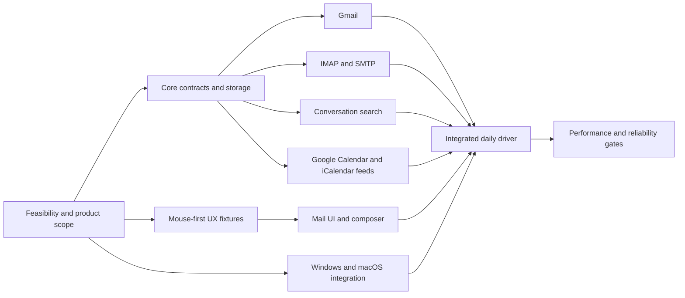

# Delivery plan and parallel work

Status: proposed engineering sequence implementing the accepted product scope. Dates and effort estimates await phase 0 evidence. This is a plan for parallel development; no implementation tasks or agents have been launched.

## Phases and exit gates

| Phase | Outcome | Exit gate |
| --- | --- | --- |
| 0 — Feasibility and contracts | Select reference devices, evaluate shell/search/storage, verify Google authorization and required protocol libraries, establish core interfaces | Recorded stack decision and representative measurements on Windows/macOS; agreed contracts and provider test matrix |
| 1 — Local foundation | Storage, migrations, durable operations, synthetic data, conversation model, search, shell and provider fakes | Browse/search a large fixture during ingestion; restart preserves drafts/operations; close terminates app activity |
| 2 — Google daily workflows | Multi-account Gmail and Google Calendar developed together; separate account UI, conversation reading/composition, full offline download pipeline | Personal/Workspace mail and calendar integrated; search/reading responsive during import; HTML/plain-text and account signatures work |
| 3 — Protocol and calendar completeness | IMAP/SMTP, read-only iCalendar feeds, full calendar views/recurrence/invitations/shared-calendar/reminder behavior | Required interoperability and calendar scenarios pass; feed refresh is read-only and resilient; complete offline attachment retention works |
| 4 — Daily-driver MVP | Integration tuning, recovery, packaging and real use on Windows/macOS | Search and resource budgets met or explicitly renegotiated; required workflows reliable through a proposed two-week founder trial; no hidden process after close |
| Later | Editable CalDAV; Linux if practical; possible open-source release | Separate scope and compatibility decisions; no effect on MVP completion |

Phases describe integration gates, not a requirement to implement every module serially. Calendar and IMAP/SMTP prototypes begin early. Google Calendar correctness is a central goal and must not be postponed until after the mail UI is polished. A Google-only or read-only mail demo is not the complete MVP.

## Parallel workstreams

| Stream | Owns | Can start independently with | Contract / integration dependency |
| --- | --- | --- | --- |
| A — Core and storage | Identifiers, schema, migrations, operation journal, full-content retention and recovery | Synthetic fixtures and provider fakes | Owns shared schema and query/command contracts; bounded writes and durable checkpoints |
| B — Gmail | Desktop auth, discovery, backfill/deltas, labels, attachment retrieval, draft/send mapping | Fake transport and provider fixtures | A's identities/checkpoints/operations; F's invitation reconciliation |
| C — IMAP/SMTP | Capability negotiation, folders, reference-based threading, reconciliation, submission/sent copy | Local protocol fixtures and library experiments | A's contracts without Gmail assumptions; explicit supported-server matrix |
| D — Search | Sender/subject/body parsing/indexing, ranking, coverage and benchmarks | Generated normalized messages/conversations | A's record/change contract; conversation results with matching-message snippets for E |
| E — Mail UI | Account navigation, conversation list/reader, mouse controls, plain-text/HTML composer and signatures | Mock local API and realistic datasets | A/D interfaces; no direct provider networking or schema ownership |
| F — Calendar | Event model, Google adapter, read-only feeds, recurrence, scheduling, views and reminders | Calendar/ICS fixtures and mocked application API | A's event/version model, B/C's mail invitation mapping, G's lifecycle/notifications |
| G — Platform and release | Windows/macOS shell, credential store, close/quit lifecycle, notifications, installers and OS integration | Minimal shell prototypes | Starts in phase 0; owns platform integration and verifies all activity ends on close |

These are ownership boundaries, not seven mandatory simultaneous contributors. A small team can combine roles. Keep one owner for shared API and schema changes; each stream owns its tests and diagnostics. Linux work must not delay required Windows/macOS behavior.

## Dependency map

## Shared contracts before parallel implementation

Agree account/message/conversation identities, capability flags, pending/error/ambiguous operation states, bounded pagination, search coverage, event series/exception representation and reminder ownership. Use provider fakes so UI/search development does not wait for live synchronization.

Give schema migrations a single owner. Synchronization emits normalized changes; search consumes those changes; the UI consumes bounded local views. Long conversations require paginated member loading and a way to open the matching search message directly. Attachments have durable download states independent of message-text indexing.

Integrate small end-to-end slices frequently: a message enters the local store, joins its conversation, becomes searchable, opens in the reader, and an action survives restart. Repeat for a calendar event and an offline attachment. Never commit private mailbox captures or real authentication material.

## Phase 0 experiment backlog

1. Establish actual account/provider inventory and message counts. Use the supplied approximately 25 GB local-store footprint as a starting reference, not a complete server inventory; model 100 GB growth and high-end hardware.
2. Validate durable Google desktop OAuth for personal and Workspace access; record actual quotas and resumable retrieval strategy. This planning work has not accessed any accounts.
3. Benchmark SQLite/FTS5 for sender names/addresses and subject/body keywords, including conversation grouping under concurrent ingestion. Evaluate Tantivy only if needed. Measure index size and recovery effort alongside latency.
4. Build a native shell/list/reader/composer prototype on both Windows and macOS. Evaluate Rust + Slint + SQLite first following the founder's request; retain Qt as a fallback. Follow the [Slint evaluation gates](slint-ui-investigation.md): attractive mail/calendar layouts, storage-backed list performance, a credible HTML reader and formatted composer, and desktop integration. Exclude a JS/TypeScript application and npm/Node pipeline. Verify mouse interaction, accessibility, HTML fidelity, total memory, draft persistence and actual process exit on close. Evaluate the message renderer separately from the application shell.
5. Evaluate maintained MIME, IMAP, SMTP, HTML sanitization and iCalendar/recurrence libraries for behavior, packaging and licenses. Editable CalDAV library selection can wait until its later phase.
6. Exercise recurring-event edits, organizer updates, attendee RSVP, read-only feeds and a constrained-capability IMAP server early. Design full calendar fixtures before promising a daily driver.

## Required release evidence

Mail: separate account identity, correct conversation grouping, fast scoped search, plain-text/HTML reading/composition, per-account signatures, full offline messages/attachments, reliable Gmail and IMAP/SMTP, durable drafts, and safe handling of uncertain sends.

Calendar: all four views, create/edit, recurrence exceptions and time zones, invitation updates/cancellations and RSVP, shared permissions, read-only external subscriptions, and reminders while running. Test conflicting edits and changes made in Google Calendar separately from ordinary CRUD.

Platforms: installable Windows and macOS builds, responsive interaction during import, recovery from interrupted work/low disk/expired cursors, and no continued sync or reminders after close. Numeric targets are documented in [performance](performance.md); core scope is in [product scope](product-scope.md).

Public distribution work is deferred because the initial audience is personal. If that changes, add the relevant OAuth verification, signing/updating and license decisions before a public release. AI, tasks, contacts and widgets remain outside MVP regardless of library capabilities.
