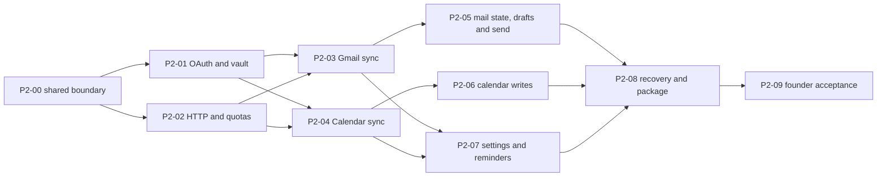

# Phase 2 — Google mail and calendar together

**D093 / SQLite fresh-profile cutover:** Core51/Search6/Gmail26/Calendar30/Quality68 integrate schema32 above D092's schema31 retention migration in the shared tree. The founder will move the old local profile, re-authorize and re-sync. New creation is direct and `STRICT`; pre-reset schemas are refused. The current Windows staged tree passes the Rust workspace and relocated fresh-live/GUI smoke; broad legacy GUI self-test, scale and other-host acceptance remain open. [Storage plan](sqlite-storage-reset.md) · [execution](../research/search-storage.md#2026-09-23-shared-tree-integration). Mail UI67/CLI42, fixtures0/3 and protocol1 continue; readiness remains 0/9.

**D092 / Third-export alignment:** implement the latest supplied reader, attachment media, Undo, account editing, per-account assistance and editable shortcut behavior, while preserving D089/D090. Core50/Mail UI67/CLI42/Calendar29/Local assistance18/Quality67 and schema31 own this packet. Verify scoped native/Rust behavior, rendered frames, responsiveness and a separate configured Windows candidate. D091 storage reset remains a separate cutover. [Execution record](../research/prototype-september-23.md).

**D090 / September 23 prototype packet:** account-scoped Calendar mail-count pills, the All calendars switch, saved reminder/snooze choices, a full-window scheduled reminder and per-label Auto-read for new model-classified mail are implemented. Calendar, Mail UI, Local assistance, Core and Quality contracts own the behavior. Schema30 protects the new typed settings; fixtures0/3 and protocol1 remain unchanged. Scoped Windows native/package checks pass, with the three older Core fixture/count failures preserved. D089 Calendar catch-up is included; actual mailbox, sound on other hosts and full Phase 2 acceptance remain separate gates. [Scoped record](../research/prototype-september-23.md).

**D088 / scoped thread-content follow-up:** complete contribution-only rendering and reversible message/group expansion, with new-acquisition body/FTS trimming and exact original blobs retained. Scoped store/MIME/native/relocated Mac checks pass; earlier archive rows and outstanding broad/other-host gates remain unchanged. Core48/Gmail25/Mail UI64/Quality64, schema29/fixtures0,3/protocol1 and readiness0/9.

**D087 / scoped navigation repair:** complete after the D086 feedback: bound repeated-key reader work and nested-table layout, reject superseded summary replies and keep delivery status geometry stable. Six scoped native suites, Cocoa scene-frame/input verification and the configured Mac candidate pass. Mail UI63/Quality63; shared schema29/fixtures0,3/protocol1 and readiness0/9 unchanged. Existing broad scroll-restoration and other-host gates remain open.

## Current packet: D086 — mail list and explicit backlog

The supplied September 22 reference, account missing-only analysis, shared CLI and unified native navigation are implemented. Core47/Local assistance16/Mail UI62/CLI41/Quality62 define the boundary; schema29 and fixtures0/3/protocol1 stay unchanged. Scoped source/account/lifetime/result preservation and native keyboard/visual controls pass. The configured Mac candidate passes scoped relocation/startup and engine/CLI readback, with source/binary identities preserved. Keep the broader post-arrival scroll-restoration self-test failure open for follow-up; no full GUI-suite or whole-area acceptance follows. Preserve D085 and historical failures.

**D084 / Reader stability Windows candidate:** the reported access violation is reproduced and fixed. Reader source/metadata/saved summaries prepare together, formatting runs off the UI thread, read-only prefetch warms nearby threads, and read receipts retain body layout. Horizontal mailbox/label tracks are removed. Five final Debug native suites pass (30.80 s), along with configured package relocation and the inspected final reader capture. `build/dev/fuckmail-gui.exe` is updated; the optimized package is `dist/reader-stability-windows-amd64/bin/fuckmail-gui.exe`. Rendered speed runs were interrupted, so the full latency gate remains open. [Evidence and limits](../research/prototype-september-15.md#d084--crash-repair-and-stable-reader-2026-09-22). Mail UI60/Quality61; Core46/Calendar26/CLI40/schema29, fixtures0/3/protocol1 and readiness0/9 unchanged.

**D081 / Mail responsiveness:** the scoped fixes and configured Windows candidate are implemented and verified as recorded in [the execution report](../research/prototype-september-15.md#d081--mail-responsiveness-and-scrolling-2026-09-22). Native focus/paging/reader/scrollbar checks and measured query improvements pass. Updating the legacy segmented-reader paint oracle and actual-mailbox/other-host performance acceptance remain open; preserve the failed baseline measurements. Core45/Mail UI57/Quality58, schema29, fixtures0/3/protocol1; whole-area readiness0/9 unchanged.

**D080 / Summary reliability Windows candidate:** local model requests default to direct answers, accept exact JSON wrappers, normalize summary whitespace and retry malformed output once within the existing time limit. All five installed models complete 80 repeated synthetic engine cases and 40 further cases through the isolated package. Regular `qwen3.8:27b` is the preferred tested choice; Gemma still makes factual/classification mistakes, and Q8 is much slower. Use `dist/summary-reliability-windows-amd64/bin/fuckmail-gui.exe` after closing the older app. Local assistance15/Quality57, schema29 and fixtures0/3/protocol1; readiness remains 0/9. Package scope and the broader GUI self-test limitation are recorded in the local-assistance execution report.

**D079 / Interaction polish Windows candidate:** the final review fixed attachment status layout shifts, asynchronous image replacement, EXIF orientation and obsolete/duplicate Send wording. Attachment saves use a reserved status line; the viewer retains images during resizing and shows save feedback in place. Four focused native suites pass (22.01 s), including stable tile geometry, exact-byte export failures/navigation, orientation and Send/summary regressions. Configured relocated package291 passes. Close the older app and use `dist/interaction-windows-amd64/bin/fuckmail-gui.exe`. Mail UI56/Quality56; Core44/Gmail24/CLI39/schema29, Calendar25, Local assistance14, fixtures0/3 and protocol1 unchanged. Whole-area readiness remains 0/9; no broad latency or actual provider-send claim.

**D077–D078 / Sending and attachments Windows candidate:** previously initialized accounts resume sync at startup. Send dispatches without the six-second hold, shows progress, and closes unchanged accepted drafts; cached summaries no longer animate on navigation. Image attachments render thumbnails with a fit/actual-size modal, and all available attachments have Save as. Thirty-seven scoped Core tests, strict lint, four native suites and configured relocated package287 pass. Close the older app and use `dist/send-attachments-windows-amd64/bin/fuckmail-gui.exe`. Core44/Gmail24/Mail UI55/CLI39/Quality55/schema29; Calendar25, Local assistance14, fixtures0/3 and protocol1 unchanged. Real provider sending was not automated; whole-area readiness stays 0/9 and D068 remains parked.

**D076 / P2-Summary motion Windows candidate:** Summarize becomes inline progress without moving the email body, then smoothly expands into the result. Cancellation stays in the container menu; regeneration and retry retain their existing surface. Native lifecycle/geometry and reader checks pass, as does configured relocated package269. Close the older app and use `dist/summary-motion-windows-amd64/bin/fuckmail-gui.exe`. Mail UI53/Quality53; Core43/Gmail23/CLI38/schema29, Calendar25, Local assistance14, fixtures0/3 and protocol1 unchanged. Whole-area readiness stays 0/9; D068 remains parked.

**D075 / P2-Reader date Windows candidate:** full local dates match the supplied format; the menu centers beside the timestamp block with a consistent ten-pixel gap and right edge. Native date/geometry checks pass across all themes and narrow large text; configured relocated package254 passes. Close the older app and use `dist/reader-date-windows-amd64/bin/fuckmail-gui.exe`. Mail UI52/Quality52; Core43/Gmail23/CLI38/schema29, Calendar25, Local assistance14, fixtures0/3 and protocol1 unchanged. Whole-area readiness stays 0/9; D068 remains parked.

**D074 / P2-Reader Windows candidate:** compact received paragraph spacing, default-collapsed nested quoted replies, corrected star/action alignment, CC participants, redundant Reply-To suppression and bounded model-name display are implemented. Three scoped native suites and the configured relocated package246 pass. Close the older app and use `dist/reader-windows-amd64/bin/fuckmail-gui.exe`. Stored email, model input and authored drafts are unchanged. Mail UI51/Quality51; Core43/Gmail23/CLI38/schema29, fixtures0/3/protocol1 unchanged. Whole-area readiness remains 0/9; D068 stays parked.

**D073 / P2-Mail feedback:** repair real Inbox/Archive/Trash behavior, empty Google submission framing, prototype sender/participant/recipient contact targets and draft MIME content verification. Seventy-four scoped Core/Google/engine tests, three native reader/draft/assistance checks, strict lint and the configured relocated Windows package pass. Close the older app and use `dist/mail-feedback-windows-amd64/bin/fuckmail-gui.exe`; package236 is preserved separately. Core43/Gmail23/Mail UI50/CLI38/Quality50/schema29; Calendar25, Local assistance14, fixtures0/3 and protocol1 unchanged. No real mailbox mutation was automated; whole-area readiness remains 0/9 and D068 stays parked.

**D072 / P2-Feedback Windows candidate:** permanent local archive deletion, restored-account status cleanup, setup retention (1 month / 3 months / 1 year default / All), removal of the Meetings checkbox, reliable model selection/request sizing and removal of the global error bar are implemented. Fifty-two scoped Core tests, CLI argument checks, three native control tests, strict lint and actual schema28→29 migration/refusal/reopen pass. Configured relocated package197 passes; use `dist/feedback-windows-amd64/bin/fuckmail-gui.exe` after closing the older app. Existing accounts keep their current history; retention controls initial downloads, not rolling deletion. Archive files are cleaned up at the next startup. Core42/Gmail22/Local assistance14/Calendar25/Mail UI49/CLI37/Quality49/schema29, fixtures0/3 and protocol1. Whole-area readiness stays 0/9; full rendered prototype comparison and other-host verification remain open. D068 stays parked. [Evidence](../research/prototype-september-15.md).

**D070–D071 / P2-UI3 Windows candidate:** the remaining identified Calendar UI gaps are implemented: Show/Hide other accounts, collapsed calendar/zone details and real adjacent-day timeline dragging. Native Settings/search/drag, Calendar controls/Undo, typed Core preferences, old-engine round-trip and strict lint checks pass. Configured relocated package182 passes; use `dist/ui3-windows-amd64/bin/fuckmail-gui.exe`. Earlier package176 remains preserved. D068 provider cleanup stays parked; schema28 remains active. Core41/Gmail21/Calendar25/Mail UI48/CLI36/Quality48, fixtures0/3 and protocol1; whole-area readiness remains 0/9. Source/native surface review is complete for the identified UI changes; rendered prototype comparison remains unavailable because of the browser restriction. [Coverage and evidence](../research/prototype-september-15.md).

**D056 / P2-LLM2B:** the Local model editor now contains the complete Ollama JSON request, including system instructions, response schema, options and all variables. Inference sends its expansion without hidden additions. Schema 23 preserves saved instructions and account choices. Scoped Rust/native tests, strict lint, 15 engine/CLI checks including exact HTTP request comparison, actual settings upgrade/refusal and relocated Windows launch pass. The configured app is `dist/llm2b-windows-amd64/bin/fuckmail-gui.exe`; close the older app first. The installed model has a recorded label-quality miss. Readiness remains 0/9.

D055 / P2-LLM2 is the current local-assistance packet: one model/prompt, default-on prospective summaries and automatic single-label classification, per-message cards and summary list previews. Remove the sample/default-reset buttons and top thread summary. Complete the scoped Windows, migration, delivery and installed-model checks before handing back the candidate; broad performance remains deferred. The D055 decision and Local assistance 8 supersede older delivery defaults below.

D054 continues founder feedback: respect Keychain denial and replace Local copy with immediate account-scoped Sync plus persisted last successful history check. Core 30/Gmail 15/Platform 18/Mail UI 32/CLI 24/Quality 32; schema 21 and fixtures 0/3/protocol 1 unchanged. Scoped tests and configured Mac package precede on-screen feedback; D053 summary presentation remains an independent concurrent packet.

D049/D050 P2-UI is the current continuation on `codex/phase-2-ui-alignment` from merged `a5bec7f`, after baseline three-host branch/PR CI passed. Complete updated native layout, context and multi-selection actions, Sent/Drafts date groups, visible splash, non-Trash account browsing and late-linked Gmail category repair. Ordinary GUI/CLI sync uses published quotas automatically. Core 28/Gmail 14/Mail UI 29/CLI 22/Platform 16/Quality 29, Calendar 21/Search 5/schema 20, fixtures 0/3/protocol 1. Scoped tests and configured Mac package verification precede feedback; whole Phase 2 remains open.

D046 moves raw evidence to [ignored local/CI artifact storage](../research/evidence-archive.md) before commit/merge preparation. Quality 27 adds repository hygiene checks; product sequence and acceptance gates are unchanged.

**D043–D045 — real-mailbox UI repairs:** the founder has signed into the configured Mac app. Real UI testing found and fixed Calendar creation after first sync, recurring editor invalidation, accessible event activation and search-popup focus/dismissal. Mail and Calendar walkthrough results are recorded below. Performance and the broad workspace sweep remain deferred under D041; this is not full Phase 2 acceptance.

**D040 / P2-01C on macOS:** email-first Google account addition, app-owned registration, shared CLI/reconnect/Restore and packaging are implemented. Native **22/22**, relocated Mac package and generated-provider account walkthroughs pass. Current boundary: **Core 27/Gmail 13/Calendar 21/Platform 15/Mail UI 28/CLI 21/Quality 26/Search 5/schema 20**; fixtures 0/3 and protocol 1 unchanged. The ordinary workspace rerun was stopped under D041 after the earlier timeout; the two performance attempts lost window focus. D042 supplies the app registration; the founder completed Gmail sign-in and reported sending/receiving. D043–D045 repairs and exercises the real UI.

**Current packet delivered:** configured UI Package03 passes relocated verification and final real-account readback; the connected app is running for founder testing. The walkthrough uses only newly labeled test items and the two explicitly authorized recipient addresses, held outside Git. Calendar creation/editing/invitation/recurrence/cancellation and mail submission/attachments/Reply all/forward/search/triage have observed provider or UI outcomes; detailed results and remaining gaps belong to the execution record. Sustained authorization, Workspace policy, full agreed offline coverage, backup/restore and other-host acceptance remain separate. Performance and the broader workspace sweep stay deferred; readiness stays **0/9**.

D039's Windows Package02 and the `618e8a0` rendering correction remain historical checkpoints. Preserve the 997-artifact handoff archive and all failed attempts. Current results and exact source/binary scope belong to [status](../status.md) and the [execution record](../research/phase-2-execution.md).

## P2-LLM — Ollama discovery, prompts and mail assistance (D051)

**State: implemented; scoped Mac verification, with acceptance limits below.** Deliver automatic same-machine Ollama/model discovery, selectable summary/classification models, editable prompts in Settings, label suggestions from the existing account taxonomy and Human/Automated/Unknown annotations. [Local assistance 6](../contracts/local-ai.md) owns behavior and default prompts; [Triage 7](../contracts/triage.md) preserves manual precedence and conversation projection. [Reference inspection](../research/local-ai.md#september-14-ollama-reference-inspection-d051) records reachable Ollama 0.34.0, 20 entries and model-specific metadata failures. [D052 execution](../research/local-assistance-execution.md#d052--p2-llm-mac-implementation-2026-09-14) records focused Rust/native/CLI checks, actual schema-20→21 upgrade and Ollama samples: 7/7 sender kinds and 5/7 exact label sets; auto-apply remains deferred.

### Start boundary and concurrent work

- Existing branch: `codex/phase-2-ui-alignment`. Re-read status and the current worktree before implementation: D049/D050 is actively changing Core labels/preferences, engine sync, CLI, Settings and Mail presentation. Preserve those edits; agree ownership of shared migrations/types and integrate narrow hooks after its current patch is stable. No competing package rebuild/replacement while the other packet validates its binaries.
- Baseline consumed contracts at planning: Core 28/Gmail 14/Mail UI 29/CLI 22/Platform 16/Quality 29, Calendar 21/Search 5/schema 20. Live/synthetic fixtures 0/3 and protocol 1 remain unchanged. Recheck revisions before assigning new ones; no advance reservation of another owner's schema number.
- Reuse `fm-assist` validation, `fm-core/src/assist_store.rs` transaction/replay guards, existing assistance tables, `message_sender_kinds`, the category catalog and the normal manual/provider label pipeline. Add optional classification descriptions to that catalog. The fake path currently returns a shared category list for a conversation; production classification needs independently targeted received messages. Its fake-only policy/provenance is not already a production API.
- Before writing production consumers, update Core, CLI, Mail UI, Platform and Quality with concrete persisted settings/provenance, per-message output, sender corrections, request ownership and typed errors. Keep old synthetic receipts byte-compatible; use a versioned extension/migration only as needed. Use dedicated synthetic Ollama cases rather than changing fixture 0/3 or importing real mail into fixtures.

D053 follows the founder’s visual review: align the reader summary with Update 2 and repair independent controls, exact source access and asynchronous lifecycle handling. [Scoped results](../research/local-assistance-execution.md#d053-summary-ui-and-lifecycle-repair-2026-09-14) record native rendering/races and engine verification; shared schema/fixtures/protocol stay unchanged.

### Implementation slices

| Slice | Deliverable | Evidence required before calling it complete |
| --- | --- | --- |
| LLM-01 — discovery and settings | Engine-owned loopback discovery, model eligibility, independent task selections, editable/resettable prompt buffers, account modes and CLI parity; no automatic inference on settings save | Fake server absent/empty/broken/remote-model/changed-digest cases; shared save/restart/conflict tests; native Settings across themes and text sizes; actual Mac version/catalog readback |
| LLM-02 — bounded inference and summaries | Ollama adapter, fixed task envelope, separate validated schemas, synthetic sample preview, owned queue/cancel, on-demand message/conversation summaries | Synthetic structured-result, oversized/invalid/thinking/tool-call/refusal/timeout cases; actual installed local model sample and cancellation/locality qualification; source links/partial/stale readback; unrelated GUI/CLI owner survives cancellation |
| LLM-03 — classification and corrections | Per-message sender kind and account-label suggestions, accepted labels through existing manual actions, correction precedence, prospective new-mail classification and explicit selected-conversation action | Labeled fixtures, newest-message filters/counts, empty taxonomy, provider changes/remaps, stale results, remove/restore, disable/restart/in-flight correction; paired native/CLI acceptance without read/star changes |
| LLM-04 — feedback package | Integrate the existing native Local model page and reader controls into the current configured Mac build | Focused Rust/native regressions, relocated package with and without Ollama, restart/quit/cancellation and a bounded founder walkthrough; preserve previous working package and record new binary identity |

Auto-apply is a subsequent qualification within the assistance roadmap: agree a labeled quality set and error/abstention thresholds before exposing it, then test mapped user-label additions, undo/manual override and provider recovery. Model confidence is not the threshold. vLLM, broad historical reclassification, attachment extraction and model installation are deferred. D041's broad workspace/performance deferral is unchanged; focused inference timing/resource and cancellation observations belong to this new feature's qualification, not a rerun of the deferred mail benchmarks.

### Acceptance cases and completion limits

Use authored synthetic cases covering personal replies, receipts, alerts, campaigns, human mailing-list posts, forwarded notifications, human mail with a no-reply address, important bot mail, personal noise, ambiguous origin, HTML-derived text, long/partial conversations, conflicting dates, multilingual text and embedded instructions. Include cross-account ID collisions, category rename/delete/remap while inference runs, manual correction during generation, unknown fields and invented label/source IDs. Labeled expectations must exist before evaluating the prompt. Report the model digest, prompt/schema hashes, fixtures, misses/abstentions and summary factual errors; deterministic validator tests and subjective quality are separate evidence.

Initial bounded policy follows Local assistance 5: one active inference, at most 16 queued jobs, existing context/result ceilings, no silent full-history work. LLM-02 fixes model-specific token budgeting and concrete HTTP/generation deadlines before live enablement. A metadata success does not authorize treating the model as qualified. Verify local-only routing and server-side cancellation using synthetic content first; diagnose the reference model's HTTP 500 only if that model is selected. Do not kill or reconfigure the shared Ollama service to obtain a cancellation pass.

Completion requires actual GUI and CLI selection, prompt save/reset/sample, summary readback, per-message suggestions/correction, provider acceptance of explicitly applied mapped categories and preserved manual state in the scoped test environment. Keep mailbox contents and raw inference traces in ignored private evidence. Record sanitized results in the owning local-assistance research report with exact source/binary scope and failures. Windows/Linux runtime qualification and remaining Phase 2 admission gates stay explicit. Planning, discovery and a model sample alone leave whole-area readiness at **0/9**.

## Historical planning and evidence

D051 adds the planned [P2-LLM packet](#p2-llm--ollama-discovery-prompts-and-mail-assistance-d051) alongside D049/D050 UI work at the founder's request. It advances Ollama assistance from the later Phase 3 sequence. That planning turn prepared contracts only; D052 subsequently authorized and implemented the packet.

D020 prepared this plan from merged Phase 1 `885de67`; D021 authorized implementation on `codex/phase-2`. The founder reported existing Cloud/OAuth/admin access and selected OS permissions plus verified disk encryption for pilot protection, with app-level store encryption deferred. Reported setup is not verified live admission. Earlier Phase 2 slices and immutable archives, including D031's failed/deferred performance checkpoint and D037's one-occurrence interim, remain in the [owning execution record](../research/phase-2-execution.md). D038 resumed measurement without changing those historical results. [Phase 1 CI](../research/phase-1-execution.md#p1-10-final-native-ci-and-phase-1-closure) retains its own three-host scope.

## Intended outcome

Deliver native feedback builds the founder can use with separate personal Gmail and Workspace mailboxes and their combined permitted Google calendars. Both GUI and CLI use the same engine/store and Google APIs. Preserve the current prototype, three themes, right-aligned controls, read-on-open, Done=read+unstar, untimed Delay and Mail-only timeline. Calendar work proceeds alongside mail, not after a mail-only release. This phase ends with controlled real-account evidence; it does not declare the whole Google-first product Ready.

## Implemented scope and remaining qualification

| Current reusable implementation | Remaining real-use evidence |
| --- | --- |
| Session-owned desktop OAuth, coordinated native vault access and recoverable account lifecycle | Actual personal/Workspace consent, locked/revoked access, protected-profile admission and sustained refresh |
| Empty live default, bounded Gmail acquisition/history, retained RAW/parts and source/index/coverage receipts | Complete agreed live inventory, oversized-source handling, restored backup and cross-client comparisons |
| Calendar catalog/detail/free-busy lanes, staged generations, indexed windows and permission/privacy fences | Real shared-calendar/ACL changes, dense or unsupported source cases, time zones and provider reconciliation |
| Shared human mail composition, attachments, Google Drafts/Send and uncertainty recovery | User-authorized recipient/attachment/From checks, live conflict/unknown outcomes and sustained daily use |
| Supported Calendar recurrence/invitations/RSVP, running-app reminders and bounded cached search | Controlled real meeting effects, edge-rule refusals, partial following recovery and actual reminder/lifecycle behavior |
| Windows checkpoint and current Mac package/native checks | Mac focus diagnosis and final packaged navigation/search/resize, current other-host CI and physical/platform qualification |

Current mail preparation still bounds MIME at 40 MiB, extracted text at 256 KiB and attachments at 50; HTTP bodies remain buffered. Failed/oversized items now retain explicit incomplete coverage and no longer have to prevent bounded siblings from publishing. Large-source retention/streaming remains required before claiming arbitrary full offline mailboxes. Calendar's new live path stages durable generations and selects indexed window candidates; a 10,001-item history fixture selects one relevant source. Live views use a validated saved IANA zone, with explicit missing-zone coverage. Bounded expansion and malformed-source gaps remain visible; native latency and real source completeness are not proved by these storage fixtures.

## Scope and pilot policy

- Include personal Gmail and intended Workspace configurations: durable auth, recent-first reading, full historical MIME/attachments, local search, explicit labels/read/stars/archive/trash/restore, human new/reply/reply-all/forward, local and Google drafts, explicit send and recovery. Permanent received-message deletion and alias administration stay unavailable; D033 separately implements explicit draft-only deletion with retained sources and recovery. Use the verified primary sending identity first.
- Include Google primary/secondary/shared calendars: discovery, permission-limited combined views, full source sync, time zones, recurrence/exceptions, create/edit/cancel, self RSVP, controlled invitations and running-app reminders. One-occurrence/series/following edits have separate acceptance; unsupported special event types or rules remain visibly restricted until their field-preserving path is proven.
- Keep one store, one writer and the existing command/query model. GUI/CLI consume capabilities and progress; neither performs provider HTTP or writes another database. Real accounts never use synthetic acknowledgments or upload previous fixture captures/events.
- Use a separate empty live profile outside Git and cloud-sync folders. Tokens belong only in the OS vault. Verify profile/blob/temp/backup permissions and disk encryption on every volume receiving real data; do not print recovery keys or token values. Lack of that verification blocks real import on that host. App-level encryption is explicitly later, not implicitly supplied by the vault.
- During the pilot, local drafts and unresolved operations survive offline periods, reconnect, sync repair and account disconnect. Disconnect stops local work and keeps data; grant revocation and local removal are distinct explicit actions. D036 implements addition/removal in both interfaces with a read-only retained archive, durable credential-cleanup state and same-subject Restore. That conservative archive choice does not settle the wider real-data retention/backup policy; retained data must never disappear through an implicit purge. Removing an app account does not delete Google mail/calendars or the Google account.

P2-00 must record the remaining real-data choices before import: recommended mailbox inventory includes Sent, Archive, Spam and Trash, while ordinary Inbox views stay scoped; confirmed remote deletions leave browsing/search only after authoritative reconciliation; original retained bytes stay protected until explicit cleanup. This proposed retention policy needs confirmation, including backup/restore destination and disk-space handling. Full offline synchronization is not an independent archival backup. Do not silently choose a retention timer, wipe unsent work or treat an interrupted inventory as deletion.

## Google setup and limits

Inspect the founder's existing project instead of creating a replacement. Record non-secret configuration: enabled Gmail/Calendar APIs, Desktop client type, External audience for mixed consumer/Workspace use, publishing/testing state, allowed testers, actual granted scopes, Workspace app policy, quota assignments and billing status. A reported project/admin login is a prerequisite, not proof of working consent or durable refresh. Never place client configuration containing secrets, credentials or mailbox samples in Git/chat evidence.

The proposed endpoint-driven consent set is `openid email`, `gmail.modify`, `calendar.events`, `calendar.calendarlist.readonly`, and `calendar.events.freebusy` for limited-access calendar busy queries. Add `calendar.calendars.readonly` only if P2-00's method inventory needs `calendars.get`; do not request broad `calendar`, `mail.google.com`, settings/ACL administration or domain-wide delegation for convenience. Validate Google `sub` as identity, with issuer/audience/expiry/nonce checks; email is mutable metadata. The native flow requests the agreed set together, inspects partial grants and reconnects explicitly if scope needs change. Installed-app incremental authorization must not be assumed. [Authorization and method evidence](../research/gmail.md#phase-2-planning-inputs), [Calendar scopes](../research/calendar.md#phase-2-planning-inputs).

External Testing normally gives these grants a seven-day lifetime; personal-use exceptions, publishing state and Workspace Trusted controls have different effects. Record the applicable configuration separately for each account and require later real refresh evidence beyond the Testing window before calling access durable. No verification warning is bypassed, no organization policy is worked around, and no public verification or billing change is performed by this planning task.

Quota values changed on May 1, 2026 and existing projects may retain older assignments. [Current Gmail research](../research/gmail.md#phase-2-planning-inputs) and [Calendar research](../research/calendar.md#phase-2-planning-inputs) retain dated sources and method costs. Do not hard-code remembered older limits. Quota units, bandwidth, concurrent requests, daily send/recipient limits, Calendar operational writes and announced future billing thresholds are separate constraints. A 100k-message import can take hours or days even though cached navigation is immediate; show measured progress and pauses, not an invented finish time.

**Historical P2-02 scheduling proposal (current contracts and executed tests govern implementation):** separate Gmail/Calendar project and account budgets at 80% of confirmed limits, bounded network concurrency (initially two reads/account and four overall), one mutation lane/account and one Calendar write/calendar. Reserve at least one quarter of schedulable capacity for user reads/writes and fresh deltas; historical work yields without starving forever. Cost every subrequest even when batched; no batching is required for the first slice. Honor Retry-After and documented errors with capped exponential backoff/jitter, shared account/project cooldowns and bounded retries. A definitive permission denial or expired grant needs action, not a hot retry loop. Send ambiguity is never a generic retry case.

Start with jittered mail/selected-calendar delta polling near 60 seconds while active, slower idle/nonvisible calendars near five minutes, and coalesced wake/reconnect/manual catch-up. Full catalog revalidation also has a bounded cadence because ACL-only changes can be absent from catalog deltas. Tune cadence against actual account/calendar counts and Console quotas; Settings shows the effective rate and pause reason. Poll only while an owning session exists. Gmail Pub/Sub and Calendar public HTTPS webhooks do not fit this desktop-only phase; a localhost OAuth callback is not a push endpoint. Cached account/reader/calendar navigation never waits for Google.

## Packets and evidence

The current consumed revisions are listed above. The packet table retains the full required scope and its admission/closeout gates; implemented Windows fixtures do not close real-account or other-host acceptance. Earlier schemas, navigation measurements and native results belong to their immutable execution checkpoints. Search 5/Triage 6 keep their existing mail query/action meaning; D039 Calendar search is an additive cached Calendar query.

| Packet | Owner/dependencies | Output and pass evidence |
| --- | --- | --- |
| **P2-00: live-data boundary and admission** | Core/Platform with all consumers; Phase 1 CI gate | Agree account/provider identity, service capabilities, auth references, typed sync coverage, durable operation states, retention/backup policy and fixture/live separation. Verify disk encryption/permissions and a restorable backup on the actual Windows profile volume. Test empty live-profile creation with zero seeded accounts/operations; migration/refusal preserves existing synthetic profiles and authored work. Publish exact shared types/fixtures before parallel consumers. |
| **P2-01: real desktop OAuth and vault** | Google/Platform/CLI; P2-00 | Bind loopback before browser launch; one-use state/PKCE/nonce, bounded timeout/cancel and verified identity/grants. Implement Windows native vault first, plus platform adapters needed for supported hosts. GUI and CLI share the token coordinator; no hidden browser launch from ordinary queries, no plaintext fallback. Prove personal and Workspace login, restart refresh, locked vault, revoked/policy-denied access, reconnect mismatch and refresh races. Initial live tests retrieve identity only. |
| **P2-02: bounded HTTP and scheduler** | Google/Core/Calendar; P2-00, fake auth can precede P2-01 | Select and pin a native Rust HTTP/TLS path after cancellation/root-store/package checks. Network waits and MIME parsing stay off the GUI/store mutation thread; only bounded completed work commits. Inject 401, policy 403, quota 403/429, Retry-After, 5xx, disconnect, partial pages and shutdown. Verify budgets, fair accounts/services, manual-write ordering, cancellation and sanitized logs. No real quota exhaustion test on the founder's mailbox. |
| **P2-03: Gmail acquisition and offline data** | Gmail/Core/Search; P2-01/02 | Capture initial history baseline; list IDs, prioritize current/recent content, retain RAW MIME once where appropriate, stage blobs and atomically publish indexed data/checkpoints. Keep backfill and deltas interleaved, perform final catch-up, handle history 404 and remote removals without losing pending intent. Support large/malformed item outcomes, resumable streaming and verified attachment bytes. Never call an estimate a complete count. Passive queries/render checks compare source/thread/label identity in both accounts; no read mutation from prefetch. |
| **P2-04: Calendar acquisition and permissions** | Calendar/Core/UI/CLI; P2-01/02, parallel with P2-03 | Real catalog plus paginated unexpanded masters/exceptions, per-calendar token/scope and atomic final-token publication. Recover 410 by staged replacement; no time-window parameters mixed into token deltas. Remove fixed display zone, index bounded visible ranges and preserve original provider fields. Handle read-only, free/busy, private and `writerWithoutPrivateAccess`, unknown roles and permission loss across every view/CLI/search. Compare both accounts' primary/shared calendars, old/current dates, DST and moved/cancelled instances with Google web. |
| **P2-05A: live mail state and composition inputs** | Gmail/Core/Mail UI/CLI; P2-03 | Wire deliberate open/Done/Delay and label/archive/trash/restore through explicit existing-message snapshots; preserve newer members and unrelated labels. Journal offline changes; reconcile remote changes and receipts. Import new local-file attachments through bounded durable blob storage, validate primary From/To/Cc/Bcc/subject, preserve source threading, signatures and authored content. Normal live GUI mail opening is exposed only once this read-on-open path is verified; passive admission checks are not a new product read mode. |
| **P2-05B: Google drafts and real send** | Same owners; P2-05A/02 | Keep local autosave authoritative and responsive; map stable Google draft IDs separately from replaceable message IDs. Coalesce uploads, preserve both versions on cross-client edit conflicts, distinguish remote deletion from send, and never import remote draft replacements as received arrivals. Freeze MIME/account/recipient/source identity and journal one submission; restart or lost response becomes acceptance-unknown. Sent/history/Message-ID inspection supplies evidence, not guaranteed deduplication. Prove no automatic resend and no submission of synthetic captures. Controlled user-authorized sends verify recipients, Reply all, Bcc, attachment bytes, Sent and cross-client draft edits. |
| **P2-06: real Calendar writes and invitations** | Calendar/Core/UI/CLI; P2-04/02 | Start no-attendee CRUD on disposable calendars. Revalidate capabilities and ETags; merge edits into retained complete resources, preserve fields omitted by the native form, and expose 412 conflicts. Stable created-event IDs and durable operation progress reconcile uncertain writes. Then verify self RSVP, organizer create/update/cancel, one occurrence, series and following edits with controlled recipients. Following edits are a recoverable multi-request operation; preserve/reconcile exceptions and never silently rewrite unsupported rules. Calendar alone owns invitation notifications; Gmail never sends a second invitation. |
| **P2-07: settings, progress and reminders** | UI/Platform/Core/CLI; P2-03/04, write surfaces follow 05/06 | Make existing Accounts/General/Mail/Calendar controls functional only for implemented capabilities: connect/reconnect/disconnect, calendar visibility/zone, sync status/cadence, coverage and retry state. Preserve the current design and P1-10 geometry. Enable actual Send only for a live capable account; retain local capture as synthetic behavior. Implement native running-app reminder/Join/dismiss delivery, deduplicated by account/calendar/occurrence and corrected on event changes/resume. Close ends GUI polling/reminders; explicit CLI sessions retain only their own work. |
| **P2-08: scale, recovery and final package** | Quality/Platform, all owners; integrated 00–07 | Fault-injection for expired cursors, quota pauses, denied calendars, mid-upload loss, unknown send, concurrent edits, disk full, corruption/restore, sleep and shutdown. Complete full inventory/MIME/attachment coverage on the agreed live scope. Measure cached navigation ≤100 ms p95 and visible search ≤200 ms p95 during concurrent mail/calendar acquisition with at least 100 observations per class and exact source oracles; retain P1-10 resize checks. Native Mac/Windows/Ubuntu CI and SDK-free packages pass; physical host/vault qualification remains separately recorded. |
| **P2-09: founder pilot and closeout** | Founder with implementation owner; milestones below | Run the real-account matrix, compare Google web/CLI/GUI, record account configuration and sanitized outcomes, then resolve/retest defects. Review durability beyond seven days under the actual OAuth mode. Produce an installable Windows build and an exact-source evidence report listing passed, failed and unavailable cases. No new phase, broad distribution or whole-feature Ready claim follows from one successful login/send. |

P2-04 has two distinct read paths: full-detail calendars retain masters/exceptions and sync tokens; limited-access calendars use bounded `freeBusy.query` snapshots, per-calendar error/freshness reporting and no invented occurrence IDs. Batch at most 50 explicit calendars per free/busy request; a successful response containing a calendar error is not proof of free time.

P2-05B must prove an effective Google conditional-write mechanism before claiming race-free remote-draft updates. `drafts.update` replaces content and its documented method has no explicit revision-precondition parameter. Preserve local revisions and fetched divergent versions; halt automatic overwrite on known conflict. If atomic preconditions cannot be established, require an explicit replacement decision for an externally changed draft and disclose the remaining concurrent-edit race; do not describe fetch-then-update as compare-and-swap.

P2-06 must preserve conference data using the required `conferenceDataVersion=1` behavior after full source acquisition; retaining a JSON field alone does not prove that an edit keeps Meet details. Preserve attachments, special-event properties and other provider fields with their supported request semantics. Generating new Meet conferences is a separate capability from preserving/Joining existing links.

P2-08 has two gates: **pilot admission** covers fault/recovery, performance and installable-package checks; **closeout** additionally requires complete agreed live inventory/MIME/attachment coverage. Milestone C may begin after admission while backfill continues. Phase 2 cannot close until closeout and sustained-auth evidence pass.

## Builds the founder can test

| Milestone | Available behavior | Admission and comparison |
| --- | --- | --- |
| **A — connection and read verification** | Both identities, mail source queries/passive rendering and combined calendar reads; recent data first | P2-00–04. Verify the real Windows vault/disk policy, correct personal/Workspace identity and granted service capabilities. No sends, attendee notifications or synthetic upload. Ordinary live Mail interaction waits for P2-05A's real read-on-open path. |
| **B — interactive mail and Calendar canary** | Normal mail browsing/triage, durable drafts, explicit sends; calendar CRUD then invitations/RSVP; visible backfill | P2-05A/B/06 plus relevant Settings. Use user-owned test threads and disposable secondary calendars in both accounts; recipient identities and invitation effects are explicit before automated external writes. First calendar writes have no attendees. Compare every mutation against Google web and the other client. |
| **C — daily-driver pilot** | Both real mailboxes and selected calendars together, offline attachments/search, reminders, recovery and full-history progress | P2-07 and P2-08 pilot admission. Start controlled daily use while old history backfills; do not label full offline complete until every inventory/source/blob/error count reconciles. P2-08 closeout, sustained auth and defect closure are required for P2-09 completion. |

Sending a message, marking one read and inviting/cancelling/RSVPing on a meeting affect Google. The plan itself authorizes no automatic test mail or invitations. The founder performs ordinary product actions; automated live tests use explicitly approved test recipients/calendars. `sendUpdates=none` is not a dry-run switch. Use fakes to test uncertain delivery and throttling, then carefully bounded live reconciliation with independently checked receipts.

## Real-account acceptance record

One consumer Gmail and one Workspace user are mandatory; test each additional Workspace policy/domain intended for the pilot rather than assuming equivalence. Keep addresses, subjects, event titles, tokens and raw responses out of committed evidence; use aliases and aggregate metrics. Private detailed oracles live only in the protected test profile. CI remains synthetic and credential-free.

| Scenario | Mail evidence | Calendar evidence |
| --- | --- | --- |
| Identity and restart | Separate accounts, correct primary From, no retargeted draft, refresh/reconnect after close/reopen | Combined permitted details preserve account/calendar identity and chosen write target |
| Cross-client changes | New mail, read/star/labels/archive/trash/restore converge; late reply survives Done; CLI query never marks read | Web edits/cancellation/time-zone and permission changes converge; stale/denied data is labeled/redacted |
| Composition and scheduling | New/Reply/Reply all/Forward, attachments/signature/Bcc, Google draft conflict, one known send receipt or visible uncertainty | Timed/all-day, shared read/write, controlled organizer/attendee create/update/RSVP/cancel, recurrence scopes/exceptions |
| Offline and recovery | Offline reads/search/attachments, draft/write durability, resumed backfill, history expiry, no resend after ambiguous result | Cached views/recurrence, durable pending edits, sync 410, ETag conflict, permission loss and partial following-edit recovery |
| Limits and speed | Measured request/unit/byte counts, rate pause, account fairness, complete coverage and unchanged navigation/search targets | Calendar budget/write throttling, visible-range bounds, no stale permission exposure or duplicate reminders/invitations |
| Lifecycle and protection | Correct ACL/disk/vault failure behavior, backup restore, no private diagnostics, no background owner after final close | Reminders stop on GUI close, independent CLI lifetime explicit, wake/reconnect catch-up without notification bursts |

First-day success is an early test build, not durable-auth or complete-history acceptance. Record the actual project policy and later refresh after the seven-day Testing boundary; revocation and admin-denial tests remain necessary even for a Production/personal-use configuration. Windows is the first physical pilot host. Mac/Linux live use waits for each native vault/profile-encryption/lifecycle check; synthetic three-host CI is required but cannot replace it. Public verification, trusted distribution, app-level encryption, live local models, received HTML rendering and legacy protocols keep their separate later scope.

## Next action

Finish the current large-navigation correctness investigation and final packaged performance checks. Then complete **P2-00** protected-profile/retention/restorable-backup admission and run the controlled **P2-01–07** personal Gmail/Workspace comparisons above. P2-08 closeout requires complete agreed inventory/source coverage, and P2-09 requires sustained authorization and defect closure. The generated Windows implementation and package are ready for their scoped feedback purpose; they do not establish those live gates or current Mac/Linux CI. The [Gmail](../contracts/gmail.md), [Calendar](../contracts/calendar.md), [Core](../contracts/core-storage.md), [Platform](../contracts/platform.md), [Mail UI](../contracts/mail-ui.md), [CLI](../contracts/cli.md) and [Quality](../contracts/quality.md) contracts own behavior; this plan owns order and evidence.
