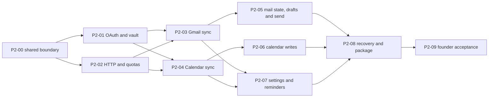

# Phase 2 — personal Gmail and Google Workspace daily workflows

**P2-05B2 functional interim under D029–D031:** from accepted B1 `09eadfa`, explicit Send and recovery pass workspace02 (469 tests, five ignored), isolated feature tests (132 unit and three process), CLI03 (four generated Sends/nine Google operations) and native04 (15/15). Integration takes 150.731 seconds under the 180-second aggregate allowance; primary 120-second and child 45-second watchdogs remain unchanged. Core 20/Gmail 9/Mail UI 18/CLI 13/Quality 16 define the current schema-14 boundary; fixtures 0/3/protocol 1 and Calendar 15/Platform 12/Search 5 remain unchanged. The [interim archive](../research/assets/phase-2/p2-05b2-interim/logs-manifest.json) preserves source-specific evidence and failures.

**B2's performance gate remains open.** Navigation01 fails the unchanged 100 ms p95 target at 158.3543/136.6387/177.9872/86.3356 ms for mailbox click/Tab/Shift+Tab/reader, with all 400 exact paints, 1,640 sources and 176 parts passing. D031 follows the founder's “Keep working; measure later”: defer remeasurement and continue B3 remote Drafts and remaining invitation/recurrence/reminder workflows, without claiming a new boundary before its packet is agreed. This is neither full B2 acceptance nor permission for live-account actions. Whole readiness stays 0/9; current package and complete Calendar/live gates remain unfinished.

**P2-05B1 is accepted under D028 on Windows**, from A2 `cdf5d40`: locally authored Google draft create/update/readback, preserved conflicts/unknown outcomes and bounded per-draft failure handling pass generated-provider Core/CLI/native and navigation gates. Core 19/Gmail 8/Mail UI 17/CLI 12/Quality 14 define schema 13 in the existing drafts, capture journal and blob store; fixtures 0/3 and protocol 1 stay unchanged. [Execution](../research/phase-2-execution.md#p2-05b1-locally-authored-google-drafts-under-d028) records 438 workspace tests, 14/14 native checks and final four-route p95 below 100 ms. P2-05B2 follows with explicit send and uncertain-delivery acceptance; remote-only draft discovery/import/deletion remains required for complete Drafts. This fixture acceptance grants no live-write permission.

D021 starts implementation after the planning checkpoint below. D022's schema-9 checkpoint `099558c` and D023's schema-10 checkpoint `7c53412` retain their recorded evidence. D024/D025's Core 17/Gmail 7/Calendar 15/Mail UI 15/CLI 10/schema-11 integration now has 376 passing Rust workspace tests (five ignored), strict lint and a final 11/11 native rerun covering all ten GUI/lifecycle checks plus their Rust build fixture. The first full run passed 11/12 before Calendar/label control corrections; unchanged Rust source connects its workspace pass to the final native source. This covers explicit sync ownership/limits, native capabilities and recovery, exact mail delivery and cached label setup with synthetic providers. Live fixture 0, synthetic fixture 3 and protocol 1 remain unchanged. [Execution evidence](../research/phase-2-execution.md#p2-07a-native-google-integration-under-d024d025) binds 271 source hashes and the executables. Acquisition/navigation measurements, packages and complete live-write acceptance remain separate gates. No real account is connected.

Prepared 2026-09-12 under D020. **Planning branch: `codex/phase-2`, based on merged `main` at `885de67d2d3807f73374ea2975a63fb9476d6e7f`. At that checkpoint, no Phase 2 runtime had been implemented and no real account was connected.** The branch base's tree matches Phase 1 checkpoint `cb6489b`; runtime `25b8b1e` has passing Windows package/performance evidence. [Final Phase 1 CI](../research/phase-1-execution.md#p1-10-final-native-ci-and-phase-1-closure) passes 9/9 tests and relocated packages on Mac/Windows/Ubuntu; exact Git-tree equality connects the tested PR merge to this branch base. The founder requested this next-phase plan and confirmed an existing Cloud/OAuth setup, Workspace administrator access, and OS permissions plus verified disk encryption for the pilot. App-level database/blob encryption is deferred.

Deliver a native Windows build the founder can use with separate personal Gmail and Workspace mailboxes and their combined permitted Google calendars. Both GUI and CLI use the same engine/store and Google APIs. Preserve the current prototype, three themes, right-aligned controls, read-on-open, Done=read+unstar, untimed Delay and Mail-only timeline. Calendar work proceeds alongside mail, not after a mail-only release. This phase ends with controlled real-account evidence; it does not declare the whole Google-first product Ready.

## Starting point and concrete gaps

| Current reusable implementation | Required before real use |
| --- | --- |
| Engine session-owned OAuth and coordinated vault refresh; synthetic signed success/reconnect tests | Actual personal/Workspace consent, protected-profile admission, native GUI/CLI launch/restart and long-lived refresh |
| Empty live profiles; Gmail HTTP, shared workers and bounded durable parts with source/FTS/intent/coverage receipts | Paired runtime ownership, broader recovery, larger-source retention and real provider comparisons |
| Calendar HTTP/workers, staged generations, indexed windows, private/limited-writer permissions and explicit live zone | Shared decoded-page bounds and writer preparation, effective permission cadence, real source comparisons and write reconciliation |
| Shared GUI/CLI mail, four compose modes, local drafts/capture and Calendar views | Provider capabilities, real send/remote drafts, file attachment import, real calendar writes/reminders |
| P1-10 navigation/cache/rendering fixes and synthetic ingestion harness | Same latency targets during real transport work; large-source/dense-calendar and throttling fixtures |

Current mail preparation still bounds MIME at 40 MiB, extracted text at 256 KiB and attachments at 50; HTTP bodies remain buffered. Failed/oversized items now retain explicit incomplete coverage and no longer have to prevent bounded siblings from publishing. Large-source retention/streaming remains required before claiming arbitrary full offline mailboxes. Calendar's new live path stages durable generations and selects indexed window candidates; a 10,001-item history fixture selects one relevant source. Live views use a validated saved IANA zone, with explicit missing-zone coverage. Bounded expansion and malformed-source gaps remain visible; native latency and real source completeness are not proved by these storage fixtures.

## Scope and pilot policy

- Include personal Gmail and intended Workspace configurations: durable auth, recent-first reading, full historical MIME/attachments, local search, explicit labels/read/stars/archive/trash/restore, human new/reply/reply-all/forward, local and Google drafts, explicit send and recovery. Permanent provider deletion and alias administration stay unavailable; use the verified primary sending identity first.
- Include Google primary/secondary/shared calendars: discovery, permission-limited combined views, full source sync, time zones, recurrence/exceptions, create/edit/cancel, self RSVP, controlled invitations and running-app reminders. One-occurrence/series/following edits have separate acceptance; unsupported special event types or rules remain visibly restricted until their field-preserving path is proven.
- Keep one store, one writer and the existing command/query model. GUI/CLI consume capabilities and progress; neither performs provider HTTP or writes another database. Real accounts never use synthetic acknowledgments or upload previous fixture captures/events.
- Use a separate empty live profile outside Git and cloud-sync folders. Tokens belong only in the OS vault. Verify profile/blob/temp/backup permissions and disk encryption on every volume receiving real data; do not print recovery keys or token values. Lack of that verification blocks real import on that host. App-level encryption is explicitly later, not implicitly supplied by the vault.
- During the pilot, local drafts and unresolved operations survive offline periods, reconnect, sync repair and account disconnect. Disconnect stops local work and keeps data; grant revocation and local deletion are distinct explicit actions. No automatic purge or destructive account removal in the first pilot.

P2-00 must record the remaining real-data choices before import: recommended mailbox inventory includes Sent, Archive, Spam and Trash, while ordinary Inbox views stay scoped; confirmed remote deletions leave browsing/search only after authoritative reconciliation; original retained bytes stay protected until explicit cleanup. This proposed retention policy needs confirmation, including backup/restore destination and disk-space handling. Full offline synchronization is not an independent archival backup. Do not silently choose a retention timer, wipe unsent work or treat an interrupted inventory as deletion.

## Google setup and limits

Inspect the founder's existing project instead of creating a replacement. Record non-secret configuration: enabled Gmail/Calendar APIs, Desktop client type, External audience for mixed consumer/Workspace use, publishing/testing state, allowed testers, actual granted scopes, Workspace app policy, quota assignments and billing status. A reported project/admin login is a prerequisite, not proof of working consent or durable refresh. Never place client configuration containing secrets, credentials or mailbox samples in Git/chat evidence.

The proposed endpoint-driven consent set is `openid email`, `gmail.modify`, `calendar.events`, `calendar.calendarlist.readonly`, and `calendar.events.freebusy` for limited-access calendar busy queries. Add `calendar.calendars.readonly` only if P2-00's method inventory needs `calendars.get`; do not request broad `calendar`, `mail.google.com`, settings/ACL administration or domain-wide delegation for convenience. Validate Google `sub` as identity, with issuer/audience/expiry/nonce checks; email is mutable metadata. The native flow requests the agreed set together, inspects partial grants and reconnects explicitly if scope needs change. Installed-app incremental authorization must not be assumed. [Authorization and method evidence](../research/gmail.md#phase-2-planning-inputs), [Calendar scopes](../research/calendar.md#phase-2-planning-inputs).

External Testing normally gives these grants a seven-day lifetime; personal-use exceptions, publishing state and Workspace Trusted controls have different effects. Record the applicable configuration separately for each account and require later real refresh evidence beyond the Testing window before calling access durable. No verification warning is bypassed, no organization policy is worked around, and no public verification or billing change is performed by this planning task.

Quota values changed on May 1, 2026 and existing projects may retain older assignments. [Current Gmail research](../research/gmail.md#phase-2-planning-inputs) and [Calendar research](../research/calendar.md#phase-2-planning-inputs) retain dated sources and method costs. Do not hard-code remembered older limits. Quota units, bandwidth, concurrent requests, daily send/recipient limits, Calendar operational writes and announced future billing thresholds are separate constraints. A 100k-message import can take hours or days even though cached navigation is immediate; show measured progress and pauses, not an invented finish time.

**Initial scheduler proposal, to verify in P2-02:** separate Gmail/Calendar project and account budgets at 80% of confirmed limits, bounded network concurrency (initially two reads/account and four overall), one mutation lane/account and one Calendar write/calendar. Reserve at least one quarter of schedulable capacity for user reads/writes and fresh deltas; historical work yields without starving forever. Cost every subrequest even when batched; no batching is required for the first slice. Honor Retry-After and documented errors with capped exponential backoff/jitter, shared account/project cooldowns and bounded retries. A definitive permission denial or expired grant needs action, not a hot retry loop. Send ambiguity is never a generic retry case.

Start with jittered mail/selected-calendar delta polling near 60 seconds while active, slower idle/nonvisible calendars near five minutes, and coalesced wake/reconnect/manual catch-up. Full catalog revalidation also has a bounded cadence because ACL-only changes can be absent from catalog deltas. Tune cadence against actual account/calendar counts and Console quotas; Settings shows the effective rate and pause reason. Poll only while an owning session exists. Gmail Pub/Sub and Calendar public HTTPS webhooks do not fit this desktop-only phase; a localhost OAuth callback is not a push endpoint. Cached account/reader/calendar navigation never waits for Google.

## Packets and evidence

Current contract revisions are Core 20, Gmail 9, Calendar 15, Platform 12, Mail UI 18, CLI 13 and Quality 16 under D029–D031. Search 5/Triage 6 remain consumers with unchanged query/action meaning. B2 implements schema 14 from accepted schema-13 B1 `09eadfa`; live fixture 0, synthetic fixture 3 and additive protocol 1 remain unchanged. A2 `cdf5d40` uses schema 12; prior P2-07A checkpoint `d60b652` and P2-08A checkpoint `55ef82c` use schema 11. P2-07A's 271-file source manifest binds its separate passing Rust and final native checks. D023's schema-10 checkpoint `7c53412`, D022's tested schema-9 checkpoint, D021's schema-8 live-profile start and D020's schema-7 planning state remain historical evidence. The packet table below retains the full required scope; passing an adapter or storage slice does not close a packet. Before code, each packet names its exact consumed boundary and fixture revision; implemented commands belong in CLI help and the local protocol document.

**Accepted P2-05A2 prerequisite:** local-file attachment import and draft save/capture preparation outside the Store writer precede P2-05B1 Google drafts/send. Existing attachments, blobs, drafts and receipts preserve exact replay before file access, immutable proofs, commit-time revision/source checks, 50-file/25-MiB limits and two workers whose permits survive cancellation until completion. Schema 12 adds only nullable received-message identity and the account foreign key. Stable native account/list models preserve delegates without changing store/query semantics, scroll policy or paint oracles. The separate Rust workspace run passes **397 tests, five ignored**; final normal-development CTests pass **13/13 in 179.39 seconds** (twelve native tests plus Rust test-build, no workspace rerun). Native press stability across two CLI account refreshes passes.

Final [navigation05](../research/assets/phase-2/p2-05a2/navigation-release-05.json) passes all four 100-observation routes at p95 **75.9224 / 76.4642 / 80.6248 / 43.3367 ms**, with 1,250 independently verified MIME/text/FTS messages, 137 parts and all source/ownership checks. The [immutable checkpoint](../research/assets/phase-2/p2-05a2/source-checkpoint.json) binds 138 artifacts, 289 source hashes and 258 runtime sources rechecked. Failures01/03/04 and earlier warnings remain recorded; final navigation has no shutdown warning. This closes the local attachment prerequisite, not Google drafts/send, Calendar concurrency, larger-scale, package/current-CI, live-account or physical-input gates. Whole readiness remains 0/9.

**Verified first P2-08A tier:** D026 isolates the navigation measurement to two Gmail accounts using actual engine workers and the unchanged four-route GUI benchmark. The Windows development run passes all 400 correct paints at p95 **84.59 / 82.38 / 91.30 / 77.03 ms**, independently verifies 1,290 retained/indexed messages and 141 durable part receipts, and proves GUI-close/CLI independence plus final-owner cancellation. Default-off in-memory provider/vault isolation and actual startup refusal tests pass. The maximum reader sample remains 213.99 ms, and the Qt shutdown warning is retained. Both pending-RSVP popup regressions pass. [Execution](../research/phase-2-execution.md#p2-08a-native-navigation-during-gmail-acquisition-under-d026) binds exact sources and all failed/passing attempts. This first mail-only Graphite tier precedes Calendar concurrency, large-mailbox/search/resize and package acceptance; whole P2-08 remains open.

| Packet | Owner/dependencies | Output and pass evidence |
| --- | --- | --- |
| **P2-00: live-data boundary and admission** | Core/Platform with all consumers; Phase 1 CI gate | Agree account/provider identity, service capabilities, auth references, typed sync coverage, durable operation states, retention/backup policy and fixture/live separation. Verify disk encryption/permissions and a restorable backup on the actual Windows profile volume. Test empty live-profile creation with zero seeded accounts/operations; migration/refusal preserves existing synthetic profiles and authored work. Publish exact shared types/fixtures before parallel consumers. |
| **P2-01: real desktop OAuth and vault** | Google/Platform/CLI; P2-00 | Bind loopback before browser launch; one-use state/PKCE/nonce, bounded timeout/cancel and verified identity/grants. Implement Windows native vault first, plus platform adapters needed for supported hosts. GUI and CLI share the token coordinator; no hidden browser launch from ordinary queries, no plaintext fallback. Prove personal and Workspace login, restart refresh, locked vault, revoked/policy-denied access, reconnect mismatch and refresh races. Initial live tests retrieve identity only. |
| **P2-02: bounded HTTP and scheduler** | Google/Core/Calendar; P2-00, fake auth can precede P2-01 | Select and pin a native Rust HTTP/TLS path after cancellation/root-store/package checks. Network waits and MIME parsing stay off the GUI/store mutation thread; only bounded completed work commits. Inject 401, policy 403, quota 403/429, Retry-After, 5xx, disconnect, partial pages and shutdown. Verify budgets, fair accounts/services, manual-write ordering, cancellation and sanitized logs. No real quota exhaustion test on the founder's mailbox. |
| **P2-03: Gmail acquisition and offline data** | Gmail/Core/Search; P2-01/02 | Capture initial history baseline; list IDs, prioritize current/recent content, retain RAW MIME once where appropriate, stage blobs and atomically publish indexed data/checkpoints. Keep backfill and deltas interleaved, perform final catch-up, handle history 404 and remote removals without losing pending intent. Support large/malformed item outcomes, resumable streaming and verified attachment bytes. Never call an estimate a complete count. Passive queries/render checks compare source/thread/label identity in both accounts; no read mutation from prefetch. |
| **P2-04: Calendar acquisition and permissions** | Calendar/Core/UI/CLI; P2-01/02, parallel with P2-03 | Real catalog plus paginated unexpanded masters/exceptions, per-calendar token/scope and atomic final-token publication. Recover 410 by staged replacement; no time-window parameters mixed into token deltas. Remove fixed display zone, index bounded visible ranges and preserve original provider fields. Handle read-only, free/busy, private and `writerWithoutPrivateAccess`, unknown roles and permission loss across every view/CLI/search. Compare both accounts' primary/shared calendars, old/current dates, DST and moved/cancelled instances with Google web. |
| **P2-05A: live mail state and composition inputs** | Gmail/Core/Mail UI/CLI; P2-03 | Wire deliberate open/Done/Delay and label/archive/trash/restore through explicit existing-message snapshots; preserve newer members and unrelated labels. Journal offline changes; reconcile remote changes and receipts. Import new local-file attachments through bounded durable blob storage, validate primary From/To/Cc/Bcc/subject, preserve source threading, signatures and authored content. Normal live GUI mail opening is exposed only once this read-on-open path is verified; passive admission checks are not a new product read mode. |
| **P2-05B: Google drafts and real send** | Same owners; P2-05A/02 | Keep local autosave authoritative and responsive; map stable Google draft IDs separately from replaceable message IDs. Coalesce uploads, preserve both versions on cross-client edit conflicts, distinguish remote deletion from send, and never import remote draft replacements as received arrivals. Freeze MIME/account/recipient/source identity and journal one submission; restart or lost response becomes acceptance-unknown. Sent/history/Message-ID inspection supplies evidence, not guaranteed deduplication. Prove no automatic resend and no submission of synthetic captures. Controlled user-authorized sends verify recipients, Reply all, Bcc, attachment bytes, Sent and cross-client draft edits. |
| **P2-06: real Calendar writes and invitations** | Calendar/Core/UI/CLI; P2-04/02 | Start no-attendee CRUD on disposable calendars. Revalidate capabilities and ETags; merge edits into retained complete resources, preserve fields omitted by the native form, and expose 412 conflicts. Stable created-event IDs and durable operation progress reconcile uncertain writes. Then verify self RSVP, organizer create/update/cancel, one occurrence, series and following edits with controlled recipients. Following edits are a recoverable multi-request operation; preserve/reconcile exceptions and never silently rewrite unsupported rules. Calendar alone owns invitation notifications; Gmail never sends a second invitation. |
| **P2-07: settings, progress and reminders** | UI/Platform/Core/CLI; P2-03/04, write surfaces follow 05/06 | Make existing Accounts/General/Mail/Calendar controls functional only for implemented capabilities: connect/reconnect/disconnect, calendar visibility/zone, sync status/cadence, coverage and retry state. Preserve the current design and P1-10 geometry. Enable actual Send only for a live capable account; retain local capture as synthetic behavior. Implement native running-app reminder/Join/dismiss delivery, deduplicated by account/calendar/occurrence and corrected on event changes/resume. Close ends GUI polling/reminders; explicit CLI sessions retain only their own work. |
| **P2-08: scale, recovery and final package** | Quality/Platform, all owners; integrated 00–07 | Fault-injection for expired cursors, quota pauses, denied calendars, mid-upload loss, unknown send, concurrent edits, disk full, corruption/restore, sleep and shutdown. Complete full inventory/MIME/attachment coverage on the agreed live scope. Measure cached navigation ≤100 ms p95 and visible search ≤200 ms p95 during concurrent mail/calendar acquisition with at least 100 observations per class and exact source oracles; retain P1-10 resize checks. Native Mac/Windows/Ubuntu CI and SDK-free packages pass; physical host/vault qualification remains separately recorded. |
| **P2-09: founder pilot and closeout** | Founder with implementation owner; milestones below | Run the real-account matrix, compare Google web/CLI/GUI, record account configuration and sanitized outcomes, then resolve/retest defects. Review durability beyond seven days under the actual OAuth mode. Produce an installable Windows build and an exact-source evidence report listing passed, failed and unavailable cases. No new phase, broad distribution or whole-feature Ready claim follows from one successful login/send. |

P2-04 has two distinct read paths: full-detail calendars retain masters/exceptions and sync tokens; limited-access calendars use bounded `freeBusy.query` snapshots, per-calendar error/freshness reporting and no invented occurrence IDs. Batch at most 50 explicit calendars per free/busy request; a successful response containing a calendar error is not proof of free time.

P2-05B must prove an effective Google conditional-write mechanism before claiming race-free remote-draft updates. `drafts.update` replaces content and its documented method has no explicit revision-precondition parameter. Preserve local revisions and fetched divergent versions; halt automatic overwrite on known conflict. If atomic preconditions cannot be established, require an explicit replacement decision for an externally changed draft and disclose the remaining concurrent-edit race; do not describe fetch-then-update as compare-and-swap.

P2-06 must preserve conference data using the required `conferenceDataVersion=1` behavior after full source acquisition; retaining a JSON field alone does not prove that an edit keeps Meet details. Preserve attachments, special-event properties and other provider fields with their supported request semantics. Generating new Meet conferences is a separate capability from preserving/Joining existing links.

P2-08 has two gates: **pilot admission** covers fault/recovery, performance and installable-package checks; **closeout** additionally requires complete agreed live inventory/MIME/attachment coverage. Milestone C may begin after admission while backfill continues. Phase 2 cannot close until closeout and sustained-auth evidence pass.

## Builds the founder can test

| Milestone | Available behavior | Admission and comparison |
| --- | --- | --- |
| **A — connection and read verification** | Both identities, mail source queries/passive rendering and combined calendar reads; recent data first | P2-00–04. Verify the real Windows vault/disk policy, correct personal/Workspace identity and granted service capabilities. No sends, attendee notifications or synthetic upload. Ordinary live Mail interaction waits for P2-05A's real read-on-open path. |
| **B — interactive mail and Calendar canary** | Normal mail browsing/triage, durable drafts, explicit sends; calendar CRUD then invitations/RSVP; visible backfill | P2-05A/B/06 plus relevant Settings. Use user-owned test threads and disposable secondary calendars in both accounts; recipient identities and invitation effects are explicit before automated external writes. First calendar writes have no attendees. Compare every mutation against Google web and the other client. |
| **C — daily-driver pilot** | Both real mailboxes and selected calendars together, offline attachments/search, reminders, recovery and full-history progress | P2-07 and P2-08 pilot admission. Start controlled daily use while old history backfills; do not label full offline complete until every inventory/source/blob/error count reconciles. P2-08 closeout, sustained auth and defect closure are required for P2-09 completion. |

Sending a message, marking one read and inviting/cancelling/RSVPing on a meeting affect Google. The plan itself authorizes no automatic test mail or invitations. The founder performs ordinary product actions; automated live tests use explicitly approved test recipients/calendars. `sendUpdates=none` is not a dry-run switch. Use fakes to test uncertain delivery and throttling, then carefully bounded live reconciliation with independently checked receipts.

## Real-account acceptance record

One consumer Gmail and one Workspace user are mandatory; test each additional Workspace policy/domain intended for the pilot rather than assuming equivalence. Keep addresses, subjects, event titles, tokens and raw responses out of committed evidence; use aliases and aggregate metrics. Private detailed oracles live only in the protected test profile. CI remains synthetic and credential-free.

| Scenario | Mail evidence | Calendar evidence |
| --- | --- | --- |
| Identity and restart | Separate accounts, correct primary From, no retargeted draft, refresh/reconnect after close/reopen | Combined permitted details preserve account/calendar identity and chosen write target |
| Cross-client changes | New mail, read/star/labels/archive/trash/restore converge; late reply survives Done; CLI query never marks read | Web edits/cancellation/time-zone and permission changes converge; stale/denied data is labeled/redacted |
| Composition and scheduling | New/Reply/Reply all/Forward, attachments/signature/Bcc, Google draft conflict, one known send receipt or visible uncertainty | Timed/all-day, shared read/write, controlled organizer/attendee create/update/RSVP/cancel, recurrence scopes/exceptions |
| Offline and recovery | Offline reads/search/attachments, draft/write durability, resumed backfill, history expiry, no resend after ambiguous result | Cached views/recurrence, durable pending edits, sync 410, ETag conflict, permission loss and partial following-edit recovery |
| Limits and speed | Measured request/unit/byte counts, rate pause, account fairness, complete coverage and unchanged navigation/search targets | Calendar budget/write throttling, visible-range bounds, no stale permission exposure or duplicate reminders/invitations |
| Lifecycle and protection | Correct ACL/disk/vault failure behavior, backup restore, no private diagnostics, no background owner after final close | Reminders stop on GUI close, independent CLI lifetime explicit, wake/reconnect catch-up without notification bursts |

First-day success is an early test build, not durable-auth or complete-history acceptance. Record the actual project policy and later refresh after the seven-day Testing boundary; revocation and admin-denial tests remain necessary even for a Production/personal-use configuration. Windows is the first physical pilot host. Mac/Linux live use waits for each native vault/profile-encryption/lifecycle check; synthetic three-host CI is required but cannot replace it. Public verification, trusted distribution, app-level encryption, live local models, received HTML rendering and legacy protocols keep their separate later scope.

## Next action

Finish **P2-01–04** runtime multi-owner and shared Calendar memory/writer bounds against the passing fixture/native checkpoint, while completing **P2-00** protected-profile/retention/backup admission. Then implement **P2-05/06** durable live mail and Calendar writes, **P2-07** effective settings/reminders and **P2-08/09** recovery, measured performance, packages and real-account closeout. No existing adapter result replaces these gates. The Phase 1 CI gate remains closed on its recorded source tree. The [Gmail](../contracts/gmail.md), [Calendar](../contracts/calendar.md), [Core](../contracts/core-storage.md), [Platform](../contracts/platform.md), [Mail UI](../contracts/mail-ui.md), [CLI](../contracts/cli.md) and [Quality](../contracts/quality.md) contracts own behavior; this plan owns order and evidence.
