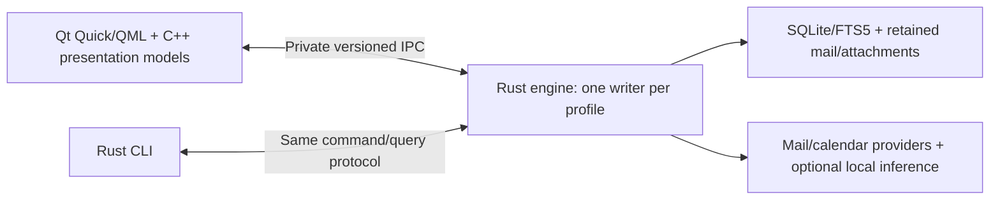

# Desktop stack options and QML

Sources checked 2026-09-10; QML, CLI, Linux/deployment, renderer and Rust-core assessment evidence checked 2026-09-11. Documentation/source evidence and proposals only; no app prototype, live account flow or benchmark has run. Recheck version-sensitive claims before implementation.

Build boundary: [Platform contract](../contracts/platform.md).

## Current decision context

D009 (2026-09-11) accepts QML expressions while excluding Node.js and a separate JS compilation/bundling pipeline. Human correspondence is text-first; received HTML can come later with good-enough readability. The earlier browser-fidelity gate no longer drives toolkit selection. Qt Quick remains the proposed baseline for custom UI and human text editing, with no WebEngine prerequisite. Build a small CLI and GUI together, and dogfood Google workflows before legacy protocols. This changes the earlier cost comparison without locking a toolkit.

The founder supplied three early nonfinal [mockups](design-references.md), a closer mail/calendar pair and then the current initial-phase mail/calendar/settings trio. The latest references clarify sans-serif styling and an inline reply; settings is explicitly plumbing only, with detailed controls still to come. Linux (Ubuntu, Arch/Omarchy), a full CLI for third-party agents and smooth installation remain mandatory. Modern tools are preferred when they improve the result; maturity is an advantage when it reduces integration risk. One visual design applies to Windows, macOS and Linux.

The references are sufficient to recommend a technical baseline while visual design continues. This is a recommendation for the first implementation spike, not a completed feasibility result or founder-approved version lock. Earlier Slint-first/Qt-fallback ordering is superseded by this comparison. The subsequent founder-supplied Rust-core critique changes the recommended engine language while retaining Qt Quick and the existing on-demand process boundary. The attachment is analysis to evaluate, not authority to lock a stack or start implementation.

## Recommended baseline

| Layer | Recommendation | Reason and remaining proof |
| --- | --- | --- |
| Shared core/engine | Qt-free Rust libraries hosted by one on-demand engine process | Ownership/concurrency checks suit parsing, sync and durable background work; verify protocol correctness, cancellation and dependency coverage |
| Desktop UI | C++20 + Qt 6 Quick/QML with deliberate custom components and presentation adapters | Fits the supplied typography, split views, subtle state marks and bottom time strip; validate input, accessibility and rendering on all target desktops |
| Mail reader | Text-first display from MIME/plain text or safe HTML-only extraction | Preserve source/attachments. Later best-effort HTML can use a limited native document renderer; WebEngine is only an optional candidate if actual needs justify it |
| Human composer | Qt Quick text/document facilities plus restrained formatting controls | Qt has a rich-text editor example; required MIME/signature/attachment and editing behavior still needs a mail-specific prototype |
| Storage/search | SQLite + FTS5 first, with retained message/attachment blobs | Shared local data and source-text search; retain the existing scale/recovery benchmark gate |
| CLI | Small Rust command client paired with the first GUI, expanding Google workflow coverage with versioned JSON | Usable by humans/agents with GUI closed; no Qt Quick/WebEngine dependency in its startup path |
| Build/distribution | Cargo for engine/CLI; CMake + Ninja for Qt GUI; coordinated per-platform packages | Two build toolchains, but no Rust/Qt ABI bridge in the proposed IPC design; users install binaries, with clean-machine discovery/upgrade tests |

Qt Quick exposes custom visual/input/model facilities, and Qt publishes a QML rich-text editor example. Those are evidence for the approach, not a ready-made mail/calendar app. [Qt Quick](https://doc.qt.io/qt-6/qtquick-index.html), [Qt text editor example](https://doc.qt.io/qt-6/qtquickcontrols-texteditor-example.html). Storage evidence remains in [Search/storage](search-storage.md); process and packaging evidence is scoped to [CLI/engine](cli-and-local-engine.md) and [Linux/distribution](linux-and-distribution.md).

## Why this leads the alternatives

The screenshots do not demand a browser application or OS-native widgets. My project-fit judgment favors evaluating Qt Quick for custom UI and human text editing. Optional HTML integration may be useful later, but is no longer a deciding early advantage. Qt does not need to own the mail engine. The full CLI does not force Rust, but a Qt-free Rust engine/CLI makes good use of compile-time ownership and concurrency checks while preserving the stronger UI integration argument for C++/Qt. The earlier recommendation overweighted using one implementation language across these independent responsibilities.

Rust/Slint can express this visual style. The earlier comparison emphasized rich-mail integration; D009 reduces that requirement, while human editing and desktop behavior still need validation. Its current Servo example still identifies itself as experimental. Rust plus Qt Quick can instead use the already-proposed private engine IPC: CXX-Qt is an optional in-process alternative, not a requirement for combining the two languages. [Slint Servo example](https://github.com/slint-ui/slint/tree/master/examples/servo), [CXX-Qt](https://kdab.github.io/cxx-qt/book/).

Qt Widgets remains useful mature desktop technology, but I would not choose its form-oriented approach as the primary surface for these custom layouts. That is a design/maintenance judgment; it can be customized. Avalonia is another credible custom-rendered option, but changing to .NET does not by itself resolve the same full-email rendering and three-OS integration tests. Neither C++ nor Rust makes search fast without good storage/query design.

## Costs and conditions

- The Rust core still needs correct transactions, sync state machines, cancellation, resource bounds and recovery tests. Native dependencies and unsafe interfaces retain their own risks. C++ remains in the UI adapter, so ownership/RAII, model-thread discipline and diagnostics still matter. There is one domain implementation, not separate Rust and C++ mail engines.
- Two implementation languages mean Cargo plus CMake, separate dependency/toolchain updates and a protocol tested from both clients. IPC adds serialization, startup, disconnect and version handling. These costs must earn their place in the feasibility slice.
- QML expressions are explicitly accepted. Keep domain logic in Rust. Do not introduce Node.js or a separate JS/TS compilation/bundling step into the required product build.
- If later selected, Qt WebEngine brings Chromium and helper processes. Package size, memory, HTML isolation and update cadence are real costs; the existing 300 MB off-mode target remains unproven. It also affects distribution choices. [WebEngine overview](https://doc.qt.io/qt-6/qtwebengine-overview.html).
- Building WebEngine itself from source requires tools including Node and Python; prebuilt modules avoid making that the ordinary app build or end-user setup. Static WebEngine builds are unsupported, so do not promise a single static executable. A Node-dependent WebEngine source build is outside the clarified required build boundary; it cannot become a default prerequisite. Best-effort HTML may instead use a limited document renderer. [WebEngine platform notes](https://doc.qt.io/qt-6/qtwebengine-platform-notes.html).
- Review the exact toolkit/modules, dependency licenses and release access before pinning versions. CMake packaging does not make signing, Linux ABI/compositor tests or CLI discovery automatic. [Qt deployment](https://doc.qt.io/qt-6/deployment.html).

## Desktop implementation choices

The founder rejected the JavaScript ecosystem and requested a native cross-platform direction. Tauri/TypeScript and Electron are excluded from the current application shortlist. This leaves several practical desktop choices; avoiding JS does not require writing two complete applications.

| Option | Documented basis | Assessment for this project |
| --- | --- | --- |
| Qt Quick/QML + C++ UI, Rust engine/CLI | Custom scene/UI components with C++ presentation models and private IPC to a Qt-free engine | Recommended initial spike; includes QML bindings and the renderer/composer/packaging gates above. [Qt Quick](https://doc.qt.io/qt-6/qtquick-index.html) |
| Qt 6 Widgets + C++ | Desktop controls, model/view lists and tables, styling and CMake integration | Candidate with broad desktop facilities and a native rich-text composer. Assess the work to express the supplied custom design, component licenses and packaging with the prototype. [Qt Widgets](https://doc.qt.io/qt-6/qtwidgets-index.html), [QTextEdit](https://doc.qt.io/qt-6/qtextedit.html) |
| Rust + Slint | Rust integration, a declarative `.slint` UI language, Windows/macOS/Linux desktop support | Candidate previously investigated at the founder's request; retained as an alternative to compare with the recommended Qt Quick baseline. No JS application layer is needed; prototype visual quality, human editing and accessibility before commitment; HTML display is a later separate evaluation. [Slint overview](https://docs.slint.dev/latest/docs/slint/), [desktop support](https://docs.slint.dev/latest/docs/slint/guide/platforms/desktop/) |
| C# + Avalonia | .NET/XAML cross-platform UI using its own renderer | Additional non-JS option if .NET is desirable. It uses managed application code and custom-drawn controls; do not describe it as platform-native widgets. [Avalonia](https://docs.avaloniaui.net/docs/welcome) |
| Separate platform UIs with a shared core | Architectural alternative: an OS-specific UI implementation per platform | Historical alternative; the founder now requires one consistent design across OSes, so OS visual conformity does not justify separate frontends. |

Iced is another Rust GUI candidate, but the currently served API documentation explicitly describes it as experimental. It is not the first experiment for this desktop application. That is a project-fit judgment, not a claim that it cannot work. [Iced documentation](https://docs.iced.rs/iced/)

Cross-platform native toolkits often render their own controls with platform styling. A compiled desktop UI does not automatically mean that every control is an AppKit or WinUI control. The recommendation is one shared desktop codebase with platform integration, tested on every required OS and Linux desktop configuration.

## What QML would give us

QML describes components and their relationships declaratively. Qt Quick supplies the visual types, input handling, models/views, states and animation; C++ can expose application logic to that UI. For this project, that suggests a custom shared mail/calendar design with C++ presentation adapters and provider, storage and indexing work behind the engine protocol. This is a project-fit inference, not a prototype result. [Qt QML](https://doc.qt.io/qt-6/qtqml-index.html), [Qt Quick](https://doc.qt.io/qt-6/qtquick-index.html), [C++ integration](https://doc.qt.io/qt-6/qtqml-cppintegration-overview.html).

QML includes JavaScript integration and expressions. It can be built with Qt/CMake without an npm/Node application pipeline; it is not an all-C++ UI. Its costs include another language/runtime boundary, binding and object-lifetime discipline, and separate work for complete HTML reading and formatted composition. Its language/runtime tradeoff is explicit in the current recommendation. Qt Quick/QML now leads the proposed comparison, while the founder has not yet locked a stack/version. The benefit is custom UI expression, not automatic mail protocols or better search performance. [Qt QML module/build integration](https://doc.qt.io/qt-6/qtqml-index.html), [QML/C++ boundary](https://doc.qt.io/qt-6/qtqml-cppintegration-overview.html).

## Assessment of the supplied Rust-core analysis

Reviewed 2026-09-11. The founder supplied another AI's recommendation to build the engine in Rust with a thin C++/QML shell, and clarified that Codex is expected to implement the whole product. The direction is persuasive; some arguments and effort estimates are too strong. This is an architectural assessment, not comparative implementation or model-quality evidence.

| Claim | Assessment |
| --- | --- |
| Qt UI does not require a C++ mail engine | Agree. Core/UI separation was already in the plan. The proposed engine process makes IPC an available language boundary without an in-process binding. |
| Rust materially reduces engine risk | Agree for memory ownership and data races in safe code. Incorrect cursors, duplicate submission after a lost acknowledgement, false unread counts, deadlocks and bad transactions are still possible. A memory-safe engine can persist the wrong answer. |
| A C++ CLI requires Qt overhead or duplicate logic | False choice. C++ can share GUI-independent libraries, and Qt Core explicitly supports non-GUI applications. Rust is our preferred engine language, not a prerequisite for a full CLI. [QCoreApplication](https://doc.qt.io/qt-6/qcoreapplication.html). |
| Rust's listed crates settle mail/calendar integration | They are candidates, not verified coverage. lettre has message-building/sending facilities; imap-proto supplies protocol parsing/types/builders rather than a complete sync engine. MIME, Google recurrence/time zones and OAuth remain early gates. IMAP extension/session and SMTP transport evidence is deferred under D009. [lettre](https://docs.rs/lettre/latest/lettre/), [imap-proto](https://docs.rs/imap-proto/latest/imap_proto/). |
| Rust is share-nothing by default | Imprecise. Ownership and Send/Sync constrain safe sharing; Rust also supports shared state. Qt object affinity can stay at the presentation boundary in either architecture. [Rust concurrency](https://doc.rust-lang.org/book/ch16-04-extensible-concurrency-sync-and-send.html). |
| AI-written Rust is reliably better | No comparative evidence was supplied. My engineering judgment favors compiler-enforced ownership checks for code I will generate and revise; that does not excuse review, unsafe dependency scrutiny or behavioral tests. |
| Qt adapters will be only 200–400 lines, or bindings cost weeks | Unmeasured estimates. Paging, selection preservation, change application, composition, HTML resource integration, input/accessibility and process lifecycle are real work. Keep the adapter narrow in responsibility, without promising an arbitrary line count. |
| Rust packaging is effectively a Cargo target | Incomplete. Cargo does not resolve native dependencies, OS credentials, renderer deployment, signing or Linux compatibility. An rlib is not the supported artifact for a foreign linker; staticlib still needs deliberate native linking. Separate engine executables avoid that particular link boundary. [Rust linkage](https://doc.rust-lang.org/reference/linkage.html). |
| Rust versus C++ settles performance | No. Query/index design, parsing, bounded concurrency and renderer behavior require measurement. Neither choice proves the existing storage, latency or memory budgets. |

Rust's ownership checks reject invalid ownership patterns at compile time; Send/Sync constrain cross-thread use. Those are useful guarantees for concurrent work on untrusted mail, but assume sound unsafe/native interfaces. They do not prove application-level correctness. [Rust ownership](https://doc.rust-lang.org/book/ch04-01-what-is-ownership.html), [Rust concurrency](https://doc.rust-lang.org/book/ch16-04-extensible-concurrency-sync-and-send.html).

The attachment's version claims check out: CXX-Qt 0.10.0 was published on 2026-08-24, and Qt announced the Rust bridge public beta on 2026-07-01. These establish that the options exist, not that either has passed our requirements. Qt's beta announcement says further refinement is planned. [CXX-Qt release](https://github.com/KDAB/cxx-qt/releases/tag/v0.10.0), [Qt Rust bridge beta](https://www.qt.io/blog/qt-bridges-public-beta-for-rust).

## Proposed boundary for this project

The engine owns accounts, sync, drafts/operations, provider flags/categories, recurrence, indexing, search and classification/summary policies. The Qt side owns the visual components, model adapters, text editing, HTML viewer and OS presentation integration. QML never accesses SQLite or providers. The CLI shares protocol/client code with the Rust workspace and submits work to the engine; it does not link a second active writer into every command.

Use bounded query pages, stable IDs and revisions, and notifications that trigger targeted refreshes or row changes. Do not transfer millions of rows or entire attachments inside UI model updates. Apply presentation-model changes on the GUI thread; background code cannot directly call Qt model APIs. [Qt model threading and incremental loading](https://doc.qt.io/qt-6/qabstractitemmodel.html#thread-safety).

This uses the process separation already proposed for concurrent GUI/CLI use. It avoids Rust-to-Qt binding and cross-language object lifetimes; it introduces protocol serialization, lifecycle and compatibility work instead. Qt Core local IPC APIs are one GUI-side candidate, with matching Rust transport still to select and verify on each OS. It is not a network service or default permanent daemon. See [engine process research](cli-and-local-engine.md).

For a build maintained through this collaboration, I recommend accepting the extra Cargo toolchain to gain Rust's checks in the large, stateful engine, while keeping established C++/Qt integration in the UI. Costs include Rust async/ownership complexity, compile times, crate selection and two-language debugging/release coordination; there is no demonstrated speed-of-delivery advantage yet. If IPC or dependency feasibility fails materially, compare an all-C++ engine and an in-process Rust bridge against that evidence. Do not make a beta binding a prerequisite merely to reduce the number of handwritten C++ files.

## What the comparison must settle

Compare the supplied design, text/composer behavior, storage-backed scrolling, accessibility, dependencies and packaging on Windows, macOS and the required Linux configurations. The recommended Rust engine plus C++/Qt UI leaves two toolchains, protocol coordination, UI lifetime/thread correctness and Qt component costs to the implementation. An all-C++ engine reduces language count but gives up Rust's compiler-enforced ownership checks. Rust/Slint offers a different UI boundary but still needs credible rich-email and desktop integration. Neither language proves mailbox performance. Keep the database benchmark independent of the UI language.

## Execution plan

Use the [development plan](../development-plan.md) and [Phase 0 packets](../plans/phase-0.md) to validate this baseline. The latest references supply the initial mail/calendar composition, inline reply and settings shell; they do not resolve Done/Delay semantics, Busy visibility or platform support. Settings controls and remaining production interactions await their affected design. Record versions and measured gates when execution happens, not in advance.

## Next experiment

P0-04: use the nonfinal references to prototype shell/list, calendar week/day strip, readable text including HTML-only extraction and a human-written reply. Received HTML visual rendering is deferred. Measure memory, accessibility, mouse interaction, draft persistence and lifecycle on every required platform. Combine this with P0-10's paired small CLI/engine/GUI experiment and P0-11's clean installation test; final colors and dimensions can continue evolving.

See [Slint investigation](slint-ui.md) for the retained examples and specific unresolved gates, and [HTML mail](html-mail.md) for the renderer tradeoffs.

Do not choose Qt solely from these references. The baseline must pass text reading/human composition, native Wayland, GUI-plus-CLI access/concurrency, clean install and search/resource gates. Best-effort HTML is evaluated later, not used to block the first pair. If it fails a material gate, record the evidence and compare the affected layer before replacing the entire stack. MIME, IMAP/SMTP, sanitization and recurrence library selections remain open.
